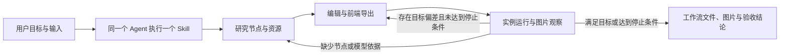

# ComfyUI 工作流 Skill 最小实施计划

## 1. 名词定义

1. **计划执行者**指用户批准后，依据本计划开发并测试 Skill 的 Agent。
2. **Skill 执行者**指使用交付后的 Skill 完成用户工作流任务的 Agent。
3. **目标实例**指用户指定的 ComfyUI 服务，包括已安装的节点、模型和前端扩展。
4. **工作流文件**包含可编辑的 UI Workflow JSON，以及由目标前端导出的 API Prompt JSON。

## 2. 总目标

1. 交付一个独立 Skill：`comfyui-workflow-builder`。同一个 Skill 执行者完成节点研究、工作流编辑和实测调优，最终交付工作流文件及结果。
2. 本次支持图片工作流，包括模型生成及图像、遮罩处理。节点研究方法适用于官方节点和第三方节点；MOSS 多 LoRA 作为其中一个验收用例。
3. 交付物可移出本仓库使用。用户提供实例地址、任务和输入文件；Skill 通过 ComfyUI HTTP 接口、目标前端及获授权的 SSH 连接完成任务。

## 3. 现状调研

1. 已读取 `192.168.110.122:8188` 的 2,837 个节点定义和 20 个已保存工作流。已核对版本为 ComfyUI `0.42.0`、前端 `1.55.18`。
2. 已完成 MOSS 多 LoRA、Anima 两阶段生成、图像与遮罩合成及文字修正试验。任务 ID 和产物见[试验索引](../research/comfyui-workflow-skill-evidence/manifest.json)。
3. 用户新增的两个 LoRA 已完成分别启用、共同启用和原生加载对照。相同参数下，rgthree 多 LoRA 节点与原生加载节点串联的图片逐像素一致。结果见[LoRA 试验记录](../research/comfyui-workflow-skill-evidence/new-lora-tests.json)。
4. 独立探针已验证前端导出、HTTP 提交、状态查询和输出下载。前端探针仅使用 Node.js 内置模块，并已在仓库外运行，结果见[探针记录](../research/comfyui-workflow-skill-evidence/standalone-probe-results.json)。
5. 复杂 Anima 子图曾出现重载后节点增加和连接缺失。该类图仍需逐图验证。节点接口、前端序列化及组合语义的来源见[接口证据](../research/comfyui-workflow-capabilities-20261020.md)。

## 4. 面临的问题

1. 节点接口只能提供结构信息。节点用途、模型兼容性和组合条件仍需核对安装源码、作者资料及实际结果。
2. 动态控件和子图依赖目标前端序列化。错误的控件映射可能使实际执行参数偏离设计。
3. 任务执行成功后，图片仍可能缺少用户要求的内容。

## 5. 问题的解决和实施方案

### 5.1 交付内容与职责

1. 计划执行者创建一个独立 Skill 目录，包含 `SKILL.md` 和 `scripts/comfyui.mjs`。测试输入与运行记录保存在 Skill 目录之外。
2. `SKILL.md` 规定第 5.2 节的操作流程。Skill 执行者负责需求理解、节点研究、工作流编辑、图片观察和调整决策。
3. `scripts/comfyui.mjs` 提供 `inspect`、`export`、`run`、`status` 四个命令，分别读取实例接口、调用前端导出、提交并收集结果、查询已有任务。程序只处理数据结构、接口调用和文件保存。
4. CLI 帮助说明参数和示例；大结果写入文件并返回路径。正常结果写入 stdout，诊断写入 stderr，失败返回非零退出码。
5. 每次运行保存独立记录和输出，认证信息从环境注入并从记录中剔除。提交结果未知时，工具必须保留该状态，禁止自动重提。工具不得覆盖其他任务的文件或中断其他任务。

### 5.2 写入 Skill 的操作流程

1. 计划执行者将以下流程写入 `SKILL.md`。表中每一步均由 Skill 执行者完成。

| 步骤 | 操作与完成条件 |
| --- | --- |
| 1. 明确目标 | 读取用户任务、实例地址和输入文件；列明输出要求、必须保留的内容及允许改动的范围。仅对影响执行的缺失信息提问。 |
| 2. 研究节点 | 先读取实例节点与模型索引，再按任务读取所选节点。沿节点注册位置、执行函数及前后节点核对数据语义；动态控件另查前端源码。记录来源版本、组合条件和未验证项。 |
| 3. 创建或修改 | 根据研究结果编辑 UI Workflow。通过目标前端导出 API Prompt；重新导入保存的 UI Workflow，核对连接、控件和执行参数。原始输入文件保留，候选文件另存。 |
| 4. 运行与调整 | 核对模型引用和全部目标输出后运行。读取日志与实际图片，逐项比较目标。修改已有工作流时先保存基线；每轮针对一个已观察到的问题调整并记录结果。 |
| 5. 交付结果 | 保存工作流文件、资源要求、实际图片、任务 ID、参数和逐项验收结论。未满足的条件必须列明，禁止将任务完成状态作为图片达标的依据。 |

2. 计划执行者在“研究节点”步骤写明：已安装资源不足时，查阅作者代码仓库中的源码、文档和示例。候选插件须列出版本、依赖及安装影响；安装须先取得用户授权。不得执行未经授权的外部安装命令或下载脚本。
3. 计划执行者在“运行与调整”步骤写明：优先采用用户给出的运行限制。用户未给出限制时，执行前说明预计运行次数与停止条件。达到限制后交付当前结果和未满足项，不得降低验收目标。
4. 计划执行者在“交付结果”步骤写明：数量、尺寸和确定性像素运算由程序核对；画面内容与效果由 Skill 执行者直接观察，用户确认偏好是否满足。

### 5.3 实施方案遵循的架构流程图

### 5.4 实施步骤

1. 计划执行者从已验证探针中提取 CLI 所需能力。针对第 7.3 节的条件先编写失败测试，再开发 CLI 命令；直接复用 ComfyUI 接口和目标前端。
2. 计划执行者按第 5.2 节编写 `SKILL.md`。模型名称、文件路径和示例节点 ID 仅作为测试输入，不得写成通用判断规则。
3. 计划执行者将 Skill 复制到仓库外，按第 7 节运行全部验收用例。测试发现的缺陷须追溯到首次错误判断或调用，并提交修正方案供用户批准。
4. 计划执行者按用户规定派发独立文档审阅，修正用词与执行歧义后交付 Skill 目录及验收记录。

### 5.5 依赖与独立运行条件

1. CLI 计划使用 Node.js 内置模块，新增第三方依赖数量为 `0`。已有导出探针使用 Node.js `25.8.2` 和本机 Chrome；计划执行者须记录交付时验证的运行版本。
2. 浏览器导出使用用户已有的 Chrome 或 Chromium，以及本次任务专用的临时 Profile。工具结束时须删除该 Profile，停止本轮启动的浏览器进程，并释放其占用的端口。
3. Skill 内部文件路径使用相对路径；实例地址、浏览器位置和输出目录通过参数传入。工具不得导入本仓库源码或依赖本仓库服务。
4. 如果确需新增依赖，计划执行者须先提供用途、固定版本和安全审计意见，取得用户授权后安装。

## 6. 方案待决策项清单

1. 当前无待决策项。

## 7. 计划验收清单

### 7.1 四个实测用例

1. 计划执行者使用 `192.168.110.122:8188` 及现有资源准备以下用例。每个用例须交付工作流文件、实际输出及逐项判定依据。

| 编号 | 用户任务 | 通过条件 |
| --- | --- | --- |
| 1 | 修改用户提供的 MOSS 工作流，保留加速 LoRA，增加两个可独立启停的 LoRA。 | 基线、分别启用和共同启用均可运行；保存重载后保留行顺序、强度及开关；图片符合约定的画面要求。 |
| 2 | 根据画面目标和实例中的 Anima 资源，从零创建包含初次生成、放大再采样两个阶段的工作流。 | 模型组件适配有依据；实际输出达到指定尺寸；主体、构图和画面比例符合任务；交付的 UI Workflow 可重载运行。 |
| 3 | 根据给定图片与遮罩，从零组合图像合成、缩放、批处理和双路保存。 | 至少组合官方节点与一个已安装的第三方节点；数据语义有源码依据；输出数量、顺序、尺寸及指定位置的像素值符合用例给定的预期值。 |
| 4 | 修正已有海报图片中的重复文字，并保留约定的版式。 | 先读取错误图片，再依据观察调整工作流或提示词；重新生成后逐字核对，确认重复文字已消除、目标文字准确、约定版式保留；保存调整前后图片及运行记录。 |

### 7.2 执行与判定

1. 每个用例由干净上下文的独立 Agent 执行指定路径的 Skill。计划执行者提供明确的工作目录、输入、目标、授权范围和运行限制；执行中不得追加解题提示。
2. 用例输入须包括至少一组未用于编写 Skill 的图片或画面目标。每个用例默认最多运行 6 次；资源缺失、运行失败和目标未满足须分别记录。
3. 独立审阅 Agent 逐项核对工作流、调用记录和实际图片。计划执行者保存资料读取、工具发现、调用参数及返回结果；不得补写宿主未提供的思考记录。
4. 四个用例均须满足表中条件，并在仓库外完成。交付时列出失败记录与修正后的复测结果；用户查看图片并确认偏好要求。

### 7.3 CLI 必须通过的条件

1. 导出测试覆盖普通图及用例 1 的动态 LoRA 控件。保存前与重新导入后的 UI Workflow 所导出的 API Prompt 执行参数一致。`export` 与 `run` 均校验节点、必填输入和连接结构；参数值由目标实例在提交时校验，CLI 保存实例返回的具体错误。
2. 运行测试覆盖成功、节点失败、目标输出缺失及提交结果未知。错误记录须包含出错命令、具体错误及已取得的任务 ID；未知状态可查询，自动重复提交次数为 `0`。
3. CLI 为每次调用独立保存文件，并在正常结束或失败退出时释放本轮浏览器资源。根命令帮助列出子命令，各子命令帮助列出参数与示例。输出与退出码符合第 5.1 节。

## 8. 非本次目标

1. 多 Skill 拆分、主控调度及跨 Skill 交接机制。
2. 视频与音频工作流、全部节点百科、全部子图与插件版本的兼容认证。
3. 本仓库功能接入、全局安装、生产部署及自动安装插件或模型。

## 9. 已获得的授权

1. 已获准在独立 worktree 中调研和简化方案，工作目录为 `/Users/fzfz/.codex/worktrees/comfyui-workflow-skill-research/harness-comfyui`。
2. 已获准读取用户指定工作流，通过 SSH 检查目标实例，并使用现有资源及新增 LoRA 完成可行性试验。
3. 用户已通过 implement Skill 授权开发本计划的 Skill 与 CLI，完成测试和审查，并提交当前分支。
4. 用户已批准修正子目录参数误拒和导出连接漏检。用户已批准修正 HTTP 错误正文丢失和查询错误残留。
