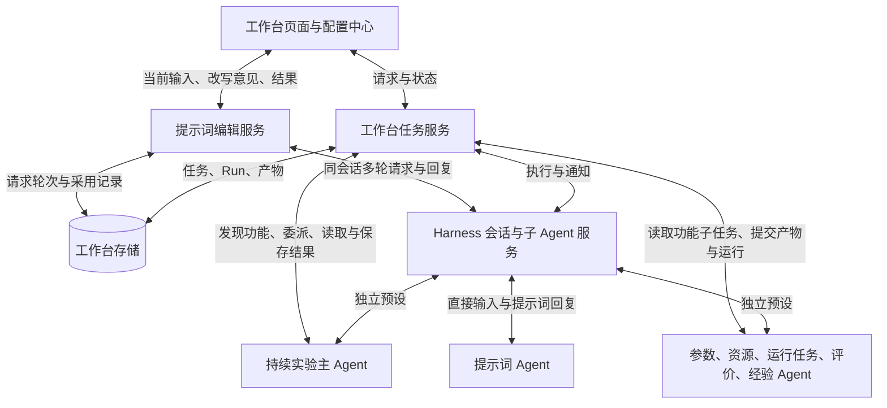
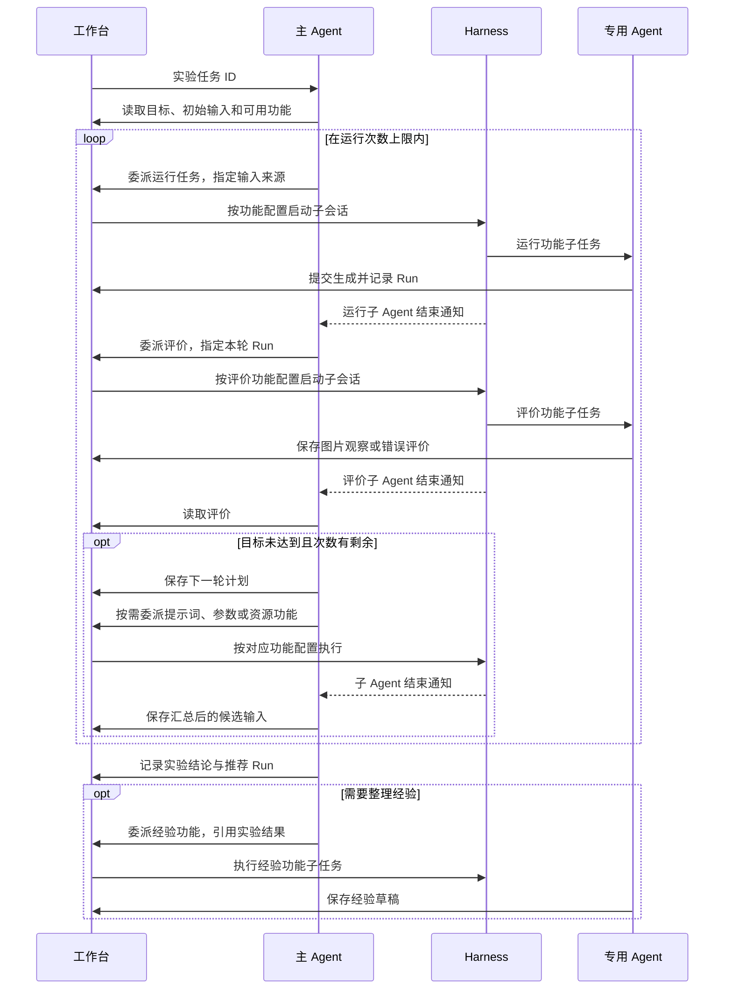
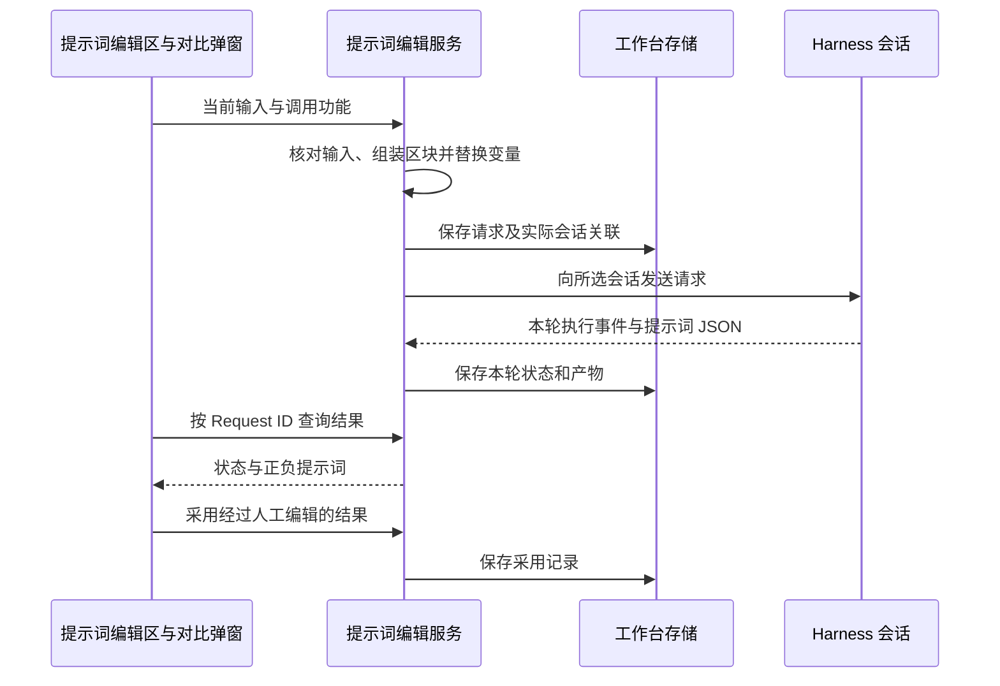

# ComfyUI 专用预设、持续实验与提示词编辑

## 1. 名词定义

1. 已有的 Workspace、Session、Generation Run 和 Preset 使用 [CONTEXT.md](../../CONTEXT.md) 中的定义。
2. **功能配置**：配置中心中的一条功能记录，对应 `FunctionBinding`。记录保存功能类型、预设、提供商、模型、推理等级、指定 Skill 和执行要求。
3. **专用预设**：为一种业务职责组合身份指令、原生工具、MCP 服务和 Skill 的 Harness 预设。专用预设清单见第 5.2 节。
4. **主 Agent**：执行持续实验总目标的 Agent，负责委派、汇总评价、决定下一轮改动和结束实验。
5. **子 Agent**：接受主 Agent 委派的执行实例。Harness 为子 Agent 创建子会话，并记录父子关系。某个专用预设被直接选择时，产生独立 Agent；被主 Agent 委派时，产生子 Agent。
6. **实验任务**：工作台中类型为 `experiment` 的任务，保存用户目标、初始输入、次数上限和实验记录。
7. **功能子任务**：主 Agent 为执行一次具体功能而委派的任务。记录包含独立任务 ID、功能类型、固定输入、功能配置快照和执行会话。
8. **实验轮次**：实验任务中的一次 Generation Run，以及该次 Run 对应的评价。提示词生成、资源查询和评价调用均不增加运行次数。
9. **下一轮计划**：主 Agent 根据某次 Run 的评价，记录拟修改的内容、修改原因和预期效果。下一次 Run 关联实际采用的计划。
10. **提示词编辑任务**：一次提示词生成及后续改写的工作台记录，归属于发起编辑的分支。编辑任务关联 Agent 会话和多条提示词请求；所引用资料可来自其他工作区。
11. **提示词请求**：用户点击一次生成或改写后，工作台保存的输入、执行配置、请求文本和回复。`request_id` 标识一次请求，并与 Harness 会话中的执行轮次对应。
12. **改写基础**：对比弹窗中用于下一次改写的正向、负向提示词。首次进入时取页面当前文本；产生结果后取右侧生成结果，包括用户在该处的手动修改。
13. **图像底模**：生成模型所属的基础模型类型。工作台通过目录中的底模 ID 和名称表达；提示词 Agent 据此选择适用 Skill。

## 2. 总目标

1. 实施者交付六个专用业务预设和一个持续实验预设。六个业务预设既能独立使用，也能在持续实验中作为子 Agent 使用。
2. 持续实验按功能配置调用专用预设。用户单独点击工作台功能和主 Agent 委派该功能，使用同一条功能配置。
3. 工作台保存每轮输入、Run、评价、下一轮计划和执行者。用户选中某次运行后，可以查看这次运行的改动、评价及后续计划。
4. 实施者完成本地验证后，启动安装候选插件的独立官方 Desktop，供用户执行真实模型与 ComfyUI 验收。
5. 用户根据当前表单生成提示词，并在同一弹窗中连续改写、查看中英对照和采用结果。请求直接携带页面输入；工作台按提示词编辑任务保存各轮记录。

## 3. 现状调研

### 3.1 调研基线与原始材料

1. 产品基线为提交 `278c83761d79bf756bef7ffaf6ec9763d89e26c3`，版本为 `0.52.0`。本次实施的 worktree 为 `/Users/fzfz/.codex/worktrees/experiment-agent-presets/harness-comfyui`。
   本文覆盖该基线之后尚未合入主线的本版需求。PR #18 对应的实施方案为 [工作台迭代方案](experiment-workbench-iteration-20261109.md)。
2. 日常 Desktop 安装了 `dsh-agent-studio@0.1.8`。现场通过“Agent 中心”查看“生图迭代主Agent”，其子 Agent 包括“生图提示词创建子代理”“读图子代理”“出图子代理”。
3. Agent Studio 的 Agent 记录装载提示词集、工具集、技能集，并配置模型、后台模式和子代理名单。预设通过绑定记录选择主 Agent。装配与委派源码位于已安装插件的 `lib/apply.js` 和 `lib/delegate.js`。
4. Harness SDK 的 `SubagentStartRequest` 支持 `agentPreset` 和 `agentOptions`。`startActivation()` 支持指定子会话 ID，并通过 `delivery` 选择结果接收者。依据为本机 `@deepseek-ai/dsh-subagent@0.2.1-rc.3` 的 `lib/types/types.d.ts` 和 `lib/types/child-agent.d.ts`。
5. 调研采用界面观察、已安装插件源码阅读、SDK 类型核对和工作台数据调用追踪。

### 3.2 v0.52.0 基线行为

1. [预设注册表](../../agent-presets/presets.cordis.yml)注册 ComfyUI 工作台预设与翻译预设。[功能初始化](../../src/host/storage/workbench-store.ts)默认将其他功能绑定到 ComfyUI 工作台预设。
2. [会话适配器](../../src/host/workbench/harness-adapter.ts)为一次工作台功能创建会话、选择模型并发送请求。[工作台预设](../../agent-presets/harness-comfyui-cli-candidate/agent.cordis.yml)的通用子 Agent 配置继承父预设。
3. [任务服务](../../src/workbench/service.ts)按功能类型生成输入与产物合同。当前 `createTask()` 从分支输入或被评价 Run 构造任务。
4. [任务存储](../../src/host/storage/workbench-store.ts)保存任务产物，并将实验评价关联到同一任务拥有的 Run。持续实验的次数、候选输入和完成状态也按任务归属计算。
5. [持续实验界面](../../src/client/workbench/experiment-status.tsx)在任务卡上显示各轮评价结论，进度区显示“查看本轮结果”。图片下方的运行评价使用人工保存的评价记录。
6. 当前 `comfyui-generate` Skill 包含资源选择与生成执行。当前 `comfyui-image-review` Skill 要求评价图片后改写提示词。

### 3.3 提示词编辑的接入依据

1. [工作台页面](../../src/client/workbench/experiment-workbench.tsx)的提示词功能经任务请求弹窗提交。[任务服务](../../src/workbench/service.ts)的 `createTask()` 为每个新任务创建会话；`replyTask()` 向已有会话发送补充回答。
2. [Harness 适配器](../../src/host/workbench/harness-adapter.ts)的 `dispatch()` 接受已有 `sessionId`，通过官方 `controller.prompt()` 发送消息。提示词连续编辑可复用此接口。
3. [资源输入适配器](../../src/host/workbench/input-adapter.ts)在选择生成模型时读取目录中的 `base_model_id`。图像底模检查复用该目录来源。
4. [翻译服务](../../src/host/workbench/translation-service.ts)读取配置中心的翻译绑定，并通过 Harness 创建翻译会话。[翻译弹窗](../../src/client/workbench/experiment-translation-dialog.tsx)发起请求后每 500 毫秒查询状态；结果临时保留在弹窗中。
5. 本版交互原型位于 `/Users/fzfz/.codex/worktrees/prompt-studio-architecture/harness-comfyui/prototype/experiment-workbench/index.html`。原型使用固定样例回复；本节源码是实际接入依据。

## 4. 面临的问题

1. 当前持续实验缺少按功能配置发现并调用专用 Agent 的入口。单独运行功能时设置的预设和模型，尚未用于实验内委派。
2. 直接把同一个实验任务 ID 交给所有子 Agent，会使提示词、参数和经验 Agent 读到实验合同；这些 Agent 的产物类型与实验合同不同。
3. 直接创建互不关联的功能任务，会使运行次数分散到各任务。评价子任务提交的结果也无法成为父实验对应 Run 的评价。
4. 页面缺少逐轮呈现 Agent 评价和下一轮计划的位置。提示词中的评价要求尚未形成完整的保存、读取和展示约定。
5. Agent Studio 的 Agent 池使用插件自有记录。工作台需要复用 Harness 预设与子会话接口，并保持功能配置的唯一来源。
6. 提示词编辑需要读取尚未保存的表单内容。先保存分支再创建任务，会使用户反复退出编辑，并使生成结果与随后修改的文本发生冲突。
7. 每次改写都创建会话，会分散讨论历史。只依赖会话历史，又无法确定用户手动修改或未采用的提示词。
8. 提示词请求尚缺少统一的图像底模前置检查、页面输入占位符和回复归属规则。任务页与当前编辑位置需要共同呈现执行状态。

## 5. 问题的解决和实施方案

### 5.1 总架构与职责

1. 工作台管理业务任务、输入、产物和页面展示；Harness 管理 Agent 装配、子会话、模型调用、消息与结束通知。

2. 工作台复用 Agent Studio 的职责组合方式。七个新增预设注册到 Harness 后，出现在官方预设清单及 Agent Studio 的预设选择区域。预设资源随插件交付；运行时通过 Harness 原生接口装配。
3. 功能配置保存调用选择。预设保存身份与能力组合。任务保存执行时采用的配置和输入。三者的修改入口分别沿用配置中心、Harness 预设管理和工作台任务服务。

### 5.2 预设与功能对应

1. 实施者在唯一结构化配置中定义以下预设及功能映射。原有通用工作台预设和翻译预设继续保留各自入口。

| 新增预设 | 对应功能 | 身份与产出 | 必需能力范围 |
| --- | --- | --- | --- |
| ComfyUI 提示词预设 | 生成提示词 | 根据画面需求和修改要求编写正向、负向提示词 | 底模与模型资料读取、参考图片读取、适用底模的 Prompt Builder Skill；输入与回复见第 5.7 节 |
| ComfyUI 参数预设 | 建议参数 | 为指定 Workflow 选择真实参数 ID 对应的值 | 任务读写、Workflow 参数查询、历史 Run 查询 |
| ComfyUI 资源预设 | 推荐资源 | 从目录选择图像模型、Workflow 和 LoRA | 任务读写、图像模型与 Workflow 及 LoRA 的目录查询 |
| ComfyUI 运行任务预设 | 运行任务 | 执行固定生成输入，返回 Run 和最终状态 | 任务读写、固定输入提交、生成结束等待、Run 状态与媒体查询 |
| ComfyUI 评价预设 | 分析结果、比较结果、诊断失败 | 根据真实图片或错误记录提交观察和评价 | 任务读写、Run 输入与媒体查询、图片读取、错误指向的资源状态查询 |
| ComfyUI 经验预设 | 整理经验 | 形成包含适用条件、具体做法、效果和局限的经验 | 任务读写、经验证据读取、Run 与图片查询 |
| ComfyUI 持续实验预设 | 持续实验 | 委派业务功能、选择下一轮输入、记录计划、决定结束 | 任务读取与产物提交、功能发现与委派、官方子会话控制、结束实验 |

2. 六个业务预设的身份指令描述职责和产出。功能配置中的执行要求描述这次功能的目标。工具声明描述数据结构、字段用途和提交方式。
3. 提示词功能按第 5.7 节传入数据并接收回复。其他工作台功能通过任务 ID 提供固定输入。普通会话直接使用业务预设时，Agent 根据用户消息和所选 Skill 工作，并在会话中交付结果。
4. 原生工具、Skill 和 MCP 服务的装配遵循第 5.2.1 节。
5. 新建工作区按本节映射选择默认预设。已有功能配置保留用户设置；用户在配置中心选择专用预设后，独立调用和下一次委派均采用该选择。用于本次验收的独立工作区预先配置完整映射。

### 5.2.1 最小可用工具原则

1. 每个预设只提供完成所属功能必需的原生工具、Skill 和 MCP 服务。实施者按输入读取、业务操作和结果提交逐项确定所需能力。
2. 实施者为每个预设维护一份结构化能力清单。原生工具记录名称、用途和对应任务步骤。Skill 记录名称与调用条件。MCP 按服务选择，记录服务名称和用途；所选服务提供的工具整体可用。
3. 未列入能力清单的原生工具、Skill 和 MCP 服务不得装配给该 Agent。专用预设不得整套继承通用工作台预设或父 Agent 的能力。
4. 实施者按预设职责配置补充数据和核验数据所需的查询能力。执行任务时，Agent 优先使用入口提供的数据；所需数据缺失或需要核验时，再调用查询工具。Skill 目录只提供职责内的条目，正文按任务需要读取。
5. 单一业务操作优先通过对应业务工具提供。现有能力只通过 CLI 提供时，实施者复用业务服务封装所需操作；不得因此默认装配通用 shell 和整套 CLI 能力。
6. 选用现有 Skill 前，实施者必须核对其步骤及工具依赖。Skill 包含其他 Agent 的职责时，先分离所需步骤或复用底层接口，不得将整套 Skill 直接装入专用预设。
7. 持续实验主 Agent 通过委派使用业务能力。各专用预设在独立会话和子会话中均按本节规则装配能力。

### 5.3 功能发现与委派

1. 持续实验预设获得原生工具 `workbench_function_list`。工具读取指定实验任务所在工作区的功能配置，返回功能 ID、名称、职责、产物类型、预设和模型。名单覆盖第 5.2 节的六类业务功能，并纳入这些类型下的用户自定义功能。
2. 原生工具 `workbench_function_delegate` 接收实验任务 ID、功能 ID、具体要求、输入来源和参考产物 ID。工具从功能配置读取预设、模型、推理等级、执行要求与指定 Skill。
3. 输入来源采用带类型的结构：实验初始输入、指定候选输入产物，或指定 Run。工作台据此构造功能子任务的固定输入；主 Agent 的具体要求保存到该子任务的 `requirements.instructions`。
4. 子任务继承实验的画面总目标和适用参考资料。引用经验继续使用包含适用条件、正文及出处的结构；直接参考的任务、Run 与经验证据分别保留各自关系。
5. 工作台先创建功能子任务并绑定预生成的子会话 ID，再调用 Harness `startActivation()`。请求指定该功能的独立预设与模型，初始消息由该功能的执行要求生成。
6. Harness 向父会话发送子 Agent 的结束通知。主 Agent 随后读取子任务产物，决定下一个动作。工具回执返回功能子任务 ID 和子会话 ID，并说明各自用途。
7. 实施者复用官方父子消息、查询和中断接口。工作台依据官方结束事件更新子任务状态；子会话已释放时，读取持久事件确认执行结果。
8. 提示词功能子任务复用第 5.7 节的输入构造、底模检查、模板替换和回复校验。Host 将有效回复保存为该子任务的 `prompt` 产物，供父实验读取。其父子会话归属仍按本节建立。

### 5.4 任务、Run 与产物关系

1. 实施者扩展现有任务与运行记录，保存以下关系。

| 位置 | 字段或内容 | 定义与消费者 |
| --- | --- | --- |
| `workbench_tasks` | `parent_experiment_task_id: string \| null` | 功能子任务指向所属实验；独立任务为 `null`。供委派列表、实验汇总和控制操作读取。 |
| 任务固定输入 | 本轮输入来源、参考产物 ID、委派要求 | 子 Agent 根据自己的功能合同读取输入；来源 ID 用于追溯输入的产生过程。 |
| `generation_runs` | `workbench_task_id` | 保留 Run 的业务归属；实验中产生的 Run 指向实验任务。 |
| `generation_runs` | `execution_task_id: string \| null` | 记录实际发起生成的功能子任务；已有记录可为 `null`。供运行子任务状态及执行者显示使用。 |
| `workbench_task_artifacts` | 现有 `task_id`、`payload_json`、会话和工具调用字段 | 产物保存在实际产出任务下。父实验读取带来源任务 ID 的汇总结果。 |
| `review` 产物 | 现有观察、结论及 `run_ids` | 评价子任务提交后，工作台关联被评价的实验 Run。 |
| `iteration_plan` 产物 | `source_run_id: string`、`changes: string[]`、`reason: string`、`expected_result: string` | 分别记录来源 Run、拟修改内容、原因和预期效果。主 Agent 提交，页面按来源 Run 展示。 |
| `generation_input` 产物 | 候选输入及 `plan_artifact_id` | 主 Agent 汇总子任务结果后提交；下一轮 Run 通过候选产物关联采用的计划。 |

2. 运行子 Agent 的生成请求使用自己的功能子任务 ID。首次提交与请求重放都由工作台解析实验归属。接纳运行时核对固定输入，并同时记录业务归属和实际执行任务。
3. 次数上限和轮次编号按实验任务计算。各运行子任务执行一次生成；请求重试继续沿用现有请求身份规则。
4. 评价子任务引用实验中被评价的 Run。发布事务保存评价产物并更新 Run 的评价指针。父实验汇总视图供任务读取、下一轮输入选择和实验状态计算共同使用。
5. 汇总视图保留产物所属任务、产生顺序及问题回答状态。候选输入必须对应最近已评价的实验 Run；下一轮执行的输入与被选候选输入一致。
6. 功能子任务的产物写入任务记录。主 Agent 将选定的提示词、参数和资源汇总为候选输入；工作台继续保留用户正在编辑的分支输入。
7. 经验 Agent 的结果进入经验草稿。用户通过现有保存入口确认后，经验进入工作台共用经验库。

### 5.5 持续实验运行流程

1. 首轮使用实验任务保存的初始输入。后续轮次使用主 Agent 根据已完成评价提交的候选输入。

2. 达到目标或运行次数用尽时，主 Agent 完成实验结论。失败 Run 及失败评价保留在对应轮次。
3. 子 Agent 提出补充问题时，工作台显示该功能子任务的问题，并将实验标为等待输入。用户回答后，继续该子任务；主 Agent 读取更新后的结果。
4. 用户暂停实验时，工作台通过官方中断接口停止子 Agent 当前执行并保留会话。用户结束实验时，工作台通过官方子会话释放接口结束所属 Agent 执行。已经提交到 ComfyUI 的 Run 继续记录状态和结果。

### 5.6 页面与交互

1. 配置中心继续使用现有功能表和编辑弹窗。每项功能可以选择第 5.2 节的专用预设、提供商、模型、推理等级与指定 Skill；执行要求继续按功能保存。
2. 持续实验进度区显示当前正在执行的功能、实际预设和状态。轮次区沿用“查看本轮结果”入口。
3. 用户选中某个 Run 后，图片下方显示“Agent 评价”，包含本轮实际改动、图片观察和评价结论。运行失败时显示对应错误评价。
4. 同一区域显示该 Run 对应的“下一轮计划”。下一轮产生后，用户可以从计划打开对应 Run，查看实际输入和结果。
5. 人工保存的评价继续使用现有入口，显示作者来源。Agent 评价保存后即可查看。
6. “任务”页将功能子任务列在所属实验任务下，显示功能名称、状态、预设、模型和结果。独立执行的功能仍显示为独立任务卡。
7. 经验子任务完成后，用户可以打开已有评价与经验弹窗，检查回填内容并保存经验。

### 5.7 提示词编辑与连续会话

#### 5.7.1 页面输入与调用入口

1. 右栏按原始需求、图像底模、功能入口、正向提示词、负向提示词排列。引用运行时，已有的改进要求紧随原始需求。底模明确时显示其名称；底模缺失时提供底模选择。
2. 用户点击“生成提示词”时，前端取得当前表单值。原始需求和图像底模是必需输入。Host 在派发前再次检查底模 ID 是否存在；选择生成模型时，从该模型的目录记录确定底模，单独选择底模时直接解析所选底模。
3. 底模检查复用于生成和改写。缺少底模时，在调用位置显示“请先选择底模”，本次点击不创建会话或请求记录。
4. 提示词为空时显示“生成提示词”。已有提示词时显示“对比提示词”，打开第 5.7.2 节的弹窗。查看历史运行的只读区域继续展示历史输入。
5. 生成期间，按钮及两个提示词框旁显示执行状态。空输入框保持原样时，结果直接回填；等待期间修改了需求或提示词时，结果进入对比弹窗，待用户采用。结果只写入当前编辑内容；“保存参数”仍负责保存分支运行输入。

#### 5.7.2 对比弹窗与连续改写

1. 弹窗顶部显示原始需求及图像底模。中部按正向、负向提示词展示改写前文本与生成结果。底部提供改动意见输入框、“改写提示词”“关闭”和“采用生成结果”。
2. 首次改写使用第 1 节定义的改写基础。用户输入改动意见后，页面提交原始需求、底模、改动意见和正负提示词。原始需求与本轮改动意见分别保存。
3. 改写期间，弹窗显示正在改写的状态。结果返回后，中部显示本轮输入与输出。用户可修改右侧结果，再输入下一条改动意见继续改写。
4. “采用生成结果”只将右侧正向、负向提示词填回来源分支的编辑表单。Agent 回复与用户采用的文本分别保存；其余生成参数保持当前编辑值。
5. 关闭弹窗保留编辑任务、已完成结果和未提交的改动意见。再次打开时，工作台按来源分支定位编辑任务。正在执行的请求继续在右栏显示状态。
6. 请求并行规则见第 5.7.4 节第 5 条。“停止”调用对应会话的中断接口，该请求保留已停止状态；后续改写创建新的请求记录。

#### 5.7.3 模板与直接输入

1. 配置中心保留一个内置“生成提示词”功能，类型为 `prompt`。首次生成与后续改写共用该功能的预设、模型、Skill 和执行要求。工作台保存原始输入，再按固定规则生成带标题及说明的文本区块。

| 原始输入字段 | 数据来源与类型 | 使用目的 |
| --- | --- | --- |
| `base_model_id` | 目录中的底模 ID，字符串 | 查询底模资料、选择适用 Skill |
| `base_model_name` | 同一底模记录的名称，字符串 | 明确提示词面向的图像底模 |
| `original_request` | 原始需求，字符串 | 确定画面目标及需要保留的内容 |
| `change_request` | 本轮改动意见，字符串；首次生成可为空 | 确定本轮修改内容 |
| `positive_prompt` | 本次改动前的正向提示词，取自改写基础，字符串；首次生成可为空 | 提供待修改的正向文本 |
| `negative_prompt` | 本次改动前的负向提示词，取自改写基础，字符串；可为空 | 提供待修改的负向文本 |
| `reference_context` | 由现有引用解析器构造的 JSON 对象 | 提供指定 Skill、经验、带来源的历史产物、参考 Run 与 Agent 参考图片 |

2. 主模板使用下表的区块占位符。请求构造器按加入条件生成区块，区块标题、用途说明与数据一起加入请求。不满足加入条件时，对应区块占位符替换为空字符串。

| 主模板占位符 | 加入条件 | 区块模板可使用的原始字段 |
| --- | --- | --- |
| `{{requirements_block}}` | 每次请求加入 | `base_model_id`、`base_model_name`、`original_request` |
| `{{prompt_edit_block}}` | 正向或负向提示词含有非空白文本 | `change_request`、`positive_prompt`、`negative_prompt` |
| `{{references_block}}` | 已指定 Skill，或至少一类引用资料非空 | `reference_context` |

3. `reference_context` 的字段为 `requested_skill`、`experiences`、`task_artifacts`、`run_ids` 和 `images`。经验正文包含适用条件和做法；历史产物保留来源任务与产物标识；图片保留用途及参考要求。工作台沿用已有引用结构构造这些字段。
4. 参考资料区块只包含有值的资料类别，每类采用 `{purpose, data}` 结构。`purpose` 取自该类资料的用途配置，`data` 保存第 3 条中对应资料类别的输入。用途留空时省略 `purpose`。空数组和未指定的 Skill 连同对应说明一起省略。
5. 首次生成按原始需求编写提示词。改写区块明确要求 Agent 按本轮改动意见修改已有文本。负向提示词为空且改写区块存在时，用 `""` 表示当前负向文本为空；原始字段仍保存空字符串。
6. 配置中心在执行要求下提供三个区块编辑器。用户可编辑区块的标题、说明和变量位置，并可编辑各类参考资料的用途说明。执行要求与区块编辑器旁均提供“插入变量”按钮。点击后展开当前编辑器支持的变量列表，每项显示中文名称与占位符。提示词主模板和区块的变量范围见第 2 条；翻译模板提供 `source_text`，其他任务模板提供 `task_id`。选中变量后，编辑器在光标处插入占位符；已有选区时替换选区文本，尚未定位光标时追加到末尾。插入后收起列表，光标停在占位符之后。用户可用键盘选择变量，按 Esc 或点击列表外部收起列表。资料用途说明按普通文本编辑。请求预览使用当前页面输入、主模板及区块配置；保存后，实际请求使用相同的组装函数。
7. 请求构造器先按第 2 条选取区块，再替换区块中的原始字段，最后替换主模板中的区块变量。模板语法仅支持固定变量替换。请求构造器替换各模板中的全部占位符，插入的用户文本保持原样。变量名、中文名称、编辑范围和固定加入条件由共享配置声明；变量列表、模板校验、Host 和请求预览共同使用该配置。实施者扩展 `src/workbench/request-template.ts` 与 `request-template.json`，主模板默认正文仍由 `functions.json` 提供。
8. 功能绑定增加 `request_parts`，结构为 `{block_templates, reference_descriptions}`。`block_templates` 的键使用第 2 条的三个区块名，值为区块模板字符串；`reference_descriptions` 的键使用第 3 条的资料类别，值为用途说明字符串。SQLite 的 `workbench_function_bindings.request_parts_json` 保存该对象。每轮请求保存当时的区块配置，字段见第 5.7.4 节。
9. Agent 根据图像底模选择预设中的 Prompt Builder Skill。回复沿用现有 `prompt` 结构：`type` 固定为 `prompt`，`positive_prompt` 与 `negative_prompt` 为完整文本字符串。Host 校验回复后保存产物。
10. 提示词编辑请求的 Task ID、Session ID 和 Request ID 由工作台与 Harness 接口传递。历史引用中的 ID 按引用对象及关系保留。提示词预设通过会话回复交付结果；实验委派入口按第 5.3 节第 8 条接纳回复。
11. 实施者以生产 Desktop 的提示词配置为基础，保留画面与提示词编写要求。实施者采用用户审阅后的本版主模板、区块模板和用途说明。其他功能的用户配置沿用第 7.1 节第 7 条。
12. 实施者移除独立的 `rewrite` 功能类型及调用分支。已有工作区的内置 `prompt` 功能保留预设、模型和 Skill 设置，并采用本版统一指令及区块配置。历史请求及实际执行配置继续保留。自定义改写功能改用 `prompt` 类型，保留其自定义名称和配置；原始字段占位符按第 2 条归入对应区块。

#### 5.7.4 会话与每轮记录

1. 首次调用创建提示词编辑任务和 Harness 会话。后续调用同一功能，预设相同时复用会话；每轮使用新的 Request ID。
2. 下一轮显式选择了不同预设时，Host 按该预设创建会话，并传入完整当前输入。请求记录保存实际会话、预设、提供商、模型及推理等级。
3. 提示词编辑服务复用官方 `controller.prompt()`，逐轮关联请求接纳、执行轮次、完成事件和结构化回复。前端通过工作台 Remote 接口取得状态；轮询复用已有 500 毫秒间隔，结果按 Request ID 回填到发起位置。
4. 实施者在工作台 SQLite 中新增 `workbench_prompt_turns`。现有 `workbench_tasks` 保存任务与来源分支；`workbench_prompt_turns` 保存每轮的独立记录，任务页从轮次记录生成汇总。

| 位置 | 字段与类型 | 定义 |
| --- | --- | --- |
| `workbench_prompt_turns` | `request_id: string`，主键；`task_id: string`，引用工作台任务 | 请求归属与轮次查询 |
| 同表 | `turn_index: integer`；`function_id: string`；`kind: prompt` | 任务内顺序和实际调用功能 |
| 同表 | `session_id: string`；`harness_turn: integer \| null` | 实际执行会话与 Harness 轮次 |
| 同表 | `preset_id: string`；`agent_model_json: object` | 实际预设、提供商、模型与推理等级 |
| 同表 | `input_json: object`；`request_template: string`；`request_parts_json: object`；`request_text: string` | 第 5.7.3 节的原始输入、主模板、区块配置和实际发送文本 |
| 同表 | `status: queued \| running \| succeeded \| failed \| interrupted`；`error_json: object \| null` | 本轮执行状态与错误 |
| 同表 | `artifact_id: string \| null` | 指向现有 `workbench_task_artifacts` 中由 Host 保存的 `prompt` 产物 |
| 同表 | `adopted_json: object \| null`；`applied_at: integer \| null` | 用户实际采用的正负提示词及采用时间 |
| 同表 | `created_at: integer`；`finished_at: integer \| null` | 请求创建与结束时间 |
| 分支编辑草稿 | `prompt_edit_task_id: string \| null`；`prompt_change_request: string` | 当前编辑任务及尚未提交的改动意见 |

5. 同一编辑任务的轮次顺序由存储事务分配。UI 和 Host 均拒绝向正在执行的编辑任务追加并行请求；不同编辑任务可以并行执行。
6. 任务页用一张提示词编辑任务卡展示各轮需求、意见、输入、回复、采用内容及状态。刷新页面后读取已保存记录和当前执行状态。

#### 5.7.5 中英对照

1. 打开对比弹窗后，工作台自动将左右两侧非空的正负提示词交给配置中心指定的翻译预设。各区域显示翻译进度、中文译文或重试入口。
2. 翻译复用现有 `translateStart`、`translateGet` 和 `translateCancel` 接口。译文仅在当前弹窗内保留；关闭后再次打开会重新请求。
3. 编辑原文后，该区域的原译文失效，用户可点击“翻译”更新。晚到的翻译结果只能写入与其原文一致的区域。
4. 采用提示词时使用原文。翻译请求独立于提示词编辑任务的轮次记录。

### 5.8 实施步骤

1. 实施者按下表顺序交付。每项通过所列页面或接口验证后，再处理依赖该项的工作。

| 序号 | 实施目标 | 依赖 | 代码位置 | 可验收结果 |
| --- | --- | --- | --- | --- |
| 1 | 完成共同数据关系与合同 | 无 | `src/workbench/contract.ts`、`schema.ts`、`state.ts`、`src/host/storage/workbench-store.ts` | 实现第 5.4、5.7.4 节的数据关系；公共接口分别返回实验、功能子任务、提示词请求、实际执行者、Run 和产物。 |
| 2 | 注册七个预设并装配能力 | 1 | `agent-presets/`、结构化预设配置、包清单 | 官方预设列表与 Agent Studio 可见七个名称；业务预设可单独选择；实际能力符合第 5.2 节清单及第 5.2.1 节原则。 |
| 3 | 接通配置中心与功能发现 | 2 | 功能初始化、环境查询、原生工具描述 | 新建验收工作区已配置各专用预设；主 Agent 读到相同功能和配置。修改某功能模型后，下次委派使用修改后的模型。 |
| 4 | 接通委派及 Harness 生命周期 | 1、3 | `src/host/workbench/harness-adapter.ts`、`tools.ts`、`plugin.ts`、`src/workbench/service.ts` | 独立 Desktop 显示实际父子会话；工作台出现对应子任务；结束通知使主 Agent 继续。 |
| 5 | 接通运行、评价与下一轮输入 | 4 | 任务服务、Generation 接入、任务存储 | 两轮 Run 计入同一个实验；评价关联各自 Run；第二轮使用选定候选输入；计划能追溯到来源 Run。 |
| 6 | 展示逐轮评价和子任务 | 5 | `src/client/workbench/experiment-status.tsx`、`experiment-workbench.tsx`及对应组件 | 用户选中不同 Run 时看到对应评价和计划；任务页显示子任务；经验可以回填并由用户保存。 |
| 7 | 接通统一提示词功能与实际请求 | 1、2 | `src/workbench/request-template.ts`、`request-template.json`、功能配置与编辑弹窗、提示词预设 | 配置中心只列出一个内置提示词功能；主模板、区块模板和资料用途可编辑；变量插入交互符合第 5.7.3 节第 6 条；区块加入条件符合第 5.7.3 节第 2 条；预览与实际发送内容一致。 |
| 8 | 整理输入区并接通底模检查 | 7 | `experiment-workbench.tsx`、输入适配器、提示词编辑服务 | 原型右栏的需求、底模、正负提示词相邻；缺少底模时生成和改写均显示选择入口，实际 Agent 调用次数为零。 |
| 9 | 接通原位生成与状态 | 8 | 提示词编辑服务、Remote、输入区 | 未保存的当前需求直接参与生成；按钮与提示词框显示进度；空文本直接回填，途中手动修改的内容保留。 |
| 10 | 接通弹窗改写与采用 | 9 | 提示词对比弹窗、表单编辑状态 | 弹窗显示原始需求、改动意见、改写前文本及结果；再次改写使用最新结果；采用只修改正负提示词。 |
| 11 | 接通连续会话与轮次归属 | 10 | Harness 适配器、提示词编辑服务、第 5.7.4 节存储 | 连续两轮在同一编辑任务和会话中执行；显式更换预设时采用对应会话；停止、关窗及切换分支后，结果仍归入发起的请求。 |
| 12 | 接通中英对照 | 10 | 翻译服务、提示词对比弹窗 | 左右两侧的正负提示词分别显示原文及中文；自动翻译、失败重试和原文修改后的更新可操作。 |
| 13 | 展示提示词编辑记录 | 11 | 任务页、轮次查询接口 | 一张任务卡按轮展示输入、改动意见、实际预设和会话、回复及采用内容；刷新后记录完整。 |
| 14 | 完成审查、验证与人工验收环境 | 2—13 | 测试、系统文档、独立 Desktop probe | 候选安装包已载入独立 Desktop，专用预设、持续实验和提示词编辑均可验收；交付实例身份和未完成的真实业务验收项。 |

2. 实施者修改共享合同后，同步更新原生工具、CLI 和 Remote 消费者。工具说明引用共享 schema；预设指令保持职责与业务目标。
3. 实施者更新预设开发规范中的会话装配约定。各角色按专用预设装配，公共能力复用共享模块。
4. 本次实施复用已经安装且版本固定的 Harness SDK 和项目依赖。预计新增依赖包为零。

## 6. 方案待决策项清单

1. 当前无待决策项。

## 7. 计划验收清单

### 7.1 自动化验证边界

1. **官方预设装配接口**：分别在独立会话与子会话中核对能力装配。原生工具、Skill 和所连接的 MCP 服务须符合第 5.2.1 节的能力清单。验证实际工具声明、工具调用、身份指令与必需 Skill 的读取。释放预设装配时创建的作用域后，确认该作用域注册的工具与 Skill 提供者已移除。
2. **工作台任务与委派接口**：验证固定输入、配置快照和父子任务关系。覆盖异步结束、暂停、失败与待回答状态，同时核对两个并行实验的结果归属。
3. **生成与评价接口**：使用受控结果验证实验总次数、Run 执行者和评价关联。核对候选输入与下一轮计划。
4. **工作台页面交互**：验证评价与计划切换、子任务状态和功能配置修改。核对经验回填与保存。
5. 实施时按 TDD 逐项编写接口行为测试。交付前运行类型检查、包验证、适用的回归测试与官方 Desktop 验证。测试结果分别记录通过、失败和未执行的具体项目。
6. 验收记录保留官方预设清单、实际工具声明、父子会话事件和工作台保存结果。
7. 实施者只读提取生产 Desktop 配置中心的提示词，复制到独立测试工作区。持续实验指令改为委派对应功能的子 Agent。参数、资源、运行任务、评价、经验和翻译功能沿用生产原文。测试模型采用用户指定的 `gpt-6.1-terra`，推理等级为 `medium`；翻译沿用翻译功能配置。验收记录逐项列出生产来源与测试环境采用的内容。
8. 提示词功能按第 5.7.3 节第 11 条调整生产来源指令。自动化覆盖空底模、未保存表单、区块组装、两轮同会话和预设变化；并验证请求与 Harness 轮次关联、途中手动修改、关闭重开和不同分支并行。真实回复必须通过现有 `prompt` schema 校验。
9. 区块验证覆盖首次生成、已有正向但负向为空、无引用资料、仅有一类资料，以及用户文本包含花括号的情况。编辑区块标题或资料用途后，预览与下一次实际请求必须使用编辑值；历史请求保留原配置和原文。
10. 翻译验证覆盖 4 个非空区域的请求来源、单个区域失败、原文编辑后的过期回复及采用原文。原型截图用于视觉对照；真实 Agent 调用事件和存储记录用于确认执行结果。
11. 分别验证主模板、各区块、翻译及其他任务模板的可选变量范围。交互验证覆盖光标插入、选区替换、连续插入、键盘操作和收起列表。修改功能类型后，变量列表须随之更新。插入内容须参与现有模板校验与请求预览，并在保存、刷新后保留。

### 7.2 用户在独立 Desktop 中验收

1. 在预设选择器中逐一选择六个业务预设，确认能独立接收对应请求。
2. 在配置中心为运行任务和评价设置不同预设或模型。发起持续实验后，确认实际子会话采用各自配置。
3. 运行至少两轮实验，确认每轮图片、评价、本轮改动和下一轮计划均可查看。
4. 核对第二轮实际提示词、参数或资源改动是否落实第一轮的修改计划。
5. 触发一次运行失败，确认错误、评价及后续处理记录归入同一实验。
6. 整理一条经验，确认经验正文能独立理解，并能通过人工保存进入共用经验库。
7. 暂停或结束实验，确认页面状态与实际子 Agent 状态一致。
8. 在右栏直接修改尚未保存的需求，再生成提示词。确认 Agent 收到当前文本，页面显示进度并原位回填。
9. 首次生成后，在对比弹窗连续改写两轮，第二次改写使用上一次的提示词结果。确认三次调用使用同一功能、预设、指令和会话，改动意见分别保存，中文译文与各自原文对应。
10. 手动修改结果后采用，确认只更新正负提示词。任务页可查看 Agent 原回复和实际采用内容。
11. 清除底模后分别点击生成和改写，确认请求被拦截；选择底模后，确认 Agent 读取适用的 Skill。
12. 在配置中心验收变量插入：
    1. 打开“生成提示词”的编辑弹窗。
    2. 把光标移到执行要求中。
    3. 点击“插入变量”，选择一个区块占位符。
    4. 展开对应的区块编辑器。
    5. 通过“插入变量”选择该区块支持的字段。
    6. 核对插入位置和请求预览。
    7. 保存功能配置。
    8. 重新打开该功能的编辑弹窗，确认编辑内容保留。

## 8. 非本次目标

1. GitHub 发布、主线合并与日常 Desktop 的候选安装由后续明确授权的交付任务处理。
2. 多分支批量执行、自动任务恢复、版本修订号和独立操作日志不在本次实施范围。
3. Agent Studio 自有的 Agent 池编辑器和配置存储不在本次修改范围。

## 9. 已获得的授权

1. 用户已批准专用预设与持续实验部分的调研、开发、测试及候选 Desktop 启动。
2. 用户已要求各业务预设同时支持独立使用与作为子 Agent 使用。
3. 用户已要求开发后保留运行中的候选 Desktop，交由用户执行真实业务验收。
4. 用户已要求各预设采用第 5.2.1 节的最小可用工具原则。
5. 用户已要求测试采用生产 Desktop 配置中心的提示词，并允许以生产原文为基础修改持续实验提示词。
6. 用户已批准第 5.7 节的设计，以及对应原型和本版实施方案的修改。本轮交付限于这两项；该节的产品代码实施须另行取得确认。
7. 用户已要求本版需求与已合入主线的 PR #18 实施方案分开管理。
