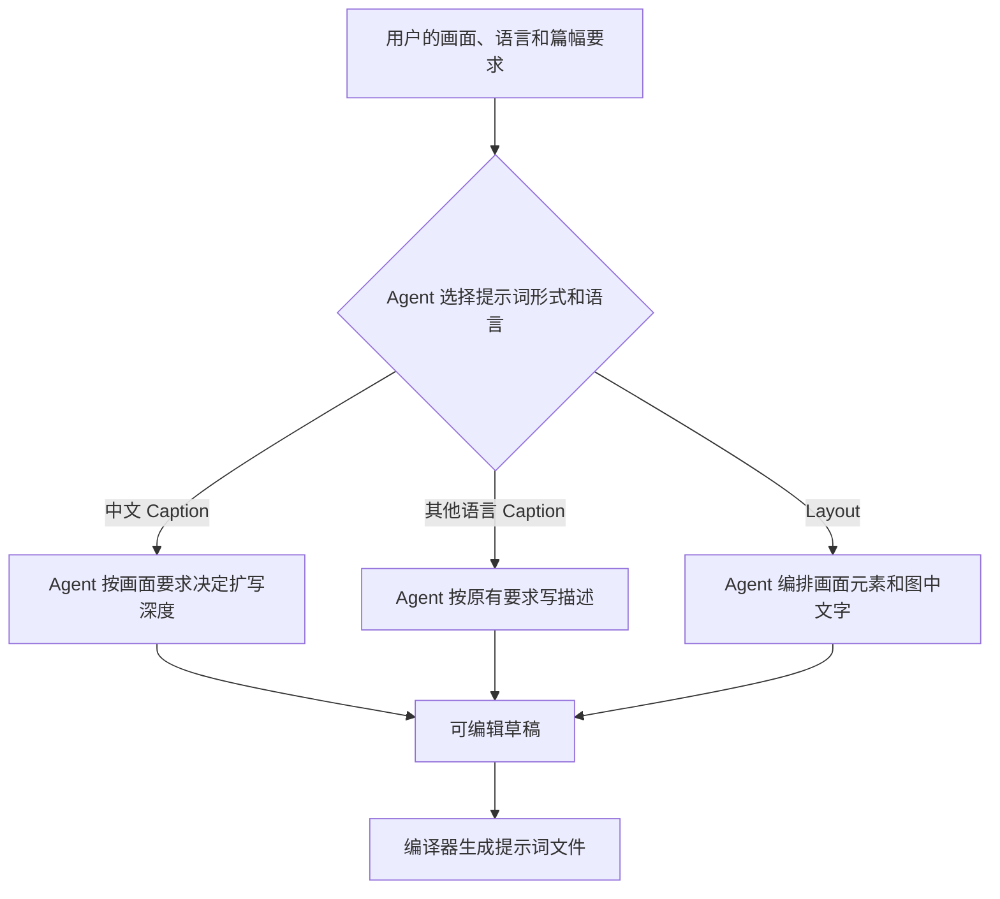

# MOSS 中文 Caption 写作规则升级计划

## 1. 名词定义

1. **Caption** 是用自然语言写成的画面描述，也是本次建议调整的提示词形式。
2. **Layout** 是用结构化数据指定画面元素、位置和图中文字的提示词形式。
3. **中文字数** 在本次对照中按 Caption 正文的 Unicode 码点数统计，包含标点、空格、数字及英文。统计取草稿的 caption 字段，避开编译文件末尾追加的换行。原作者使用约数分档。

## 2. 总目标

1. Agent 能根据用户关心的画面细节，把详细中文 Caption 写到 500 字以上。画面要求交代清楚时即可收笔。

## 3. 现状调研

1. 现有 Skill 已经规定语言选择、画面详略、图中文字和编译方式。正文、入口配置、CLI 帮助、脚本及测试的核对结果见[调研第 2 节](../research/moss-caption-length.md#2-项目目前如何处理篇幅)。
2. 本计划采用用户提供的实验结论。500 字以上的新增描述仍然有效，三个较长档位的实际变化见[调研第 1 节](../research/moss-caption-length.md#1-500-字以上的描述仍然有效)。

## 4. 面临的问题

1. 目前正文只说明复杂场景可以补充细节。详细中文描述达到约 500 字后，Agent 缺少继续扩写的依据。例如，人物姿态已经交代清楚，用户还要求看清布料经纬和侧光下的针脚阴影。

## 5. 解决和实施方案

### 5.1 写作与编译的职责

1. Agent 根据画面要求取舍细节。下图给出从用户要求到编译文件的路径。中文扩写规则只在中文 Caption 分支生效。

### 5.2 实施步骤

1. 基线图提交后，执行者在[项目 Skill 的 Caption 一节](../../.agents/skills/moss-prompt-builder/SKILL.md#caption)追加一条英文写作指令。该节现有的行文、空间关系与图中文字要求继续适用。建议正文如下。

   > For a detailed Chinese caption, continue past roughly 500 Chinese characters when the scene calls for more visible detail. Develop the features that matter to the user, such as how fabric catches side light or where reflections fall. Stop when the requested features and their relationships are clear. Follow any length or brevity the user specifies.

2. 执行者按第 7 节逐项核对文件内容，并将对应文件和条款交给验收者。
3. 独立语义审阅者逐句检查修改后的 Skill 正文，记录需要调整的行号和措辞。执行者完成修订后，将候选正文及验收结果交回用户。

### 5.3 基线和成图对照

1. 执行者先提交实验方案与[任务原文、种子及评审项目](../verification/moss-caption-length/cases.json)。详细任务使用两个种子，短句任务使用一个种子，每轮生成三张图。
2. 执行者在两轮分别派独立 Agent 读取对应版本的 Skill。两轮使用相同的模型和推理配置，并在实验记录中登记。每个新会话只收到该项任务的原文、Skill 路径和输出目录。执行者保存第一份编译成功的 Caption 及草稿。
3. 执行者先按任务顺序生成基线图，将原图、实际工作流、运行编号及提示词一并提交，然后修改 Skill。在候选轮复用模板、模型、实例、种子、尺寸、负向提示词和采样参数。每一对工作流只允许正向提示词与输出文件名不同。
4. 评审者先看匿名图片，按任务清单逐项记录“符合”“欠缺”或“无法辨认”，并指出可见依据。执行者揭示图片版本后，按种子列出改善、退步和未变的项目。评审者按第 1 节统计中文字数，核对细节覆盖和一句话约束。两个种子的结果分别保留。
5. 执行者交付两轮原图、运行记录、逐项评审和本分支提交号。画面效果按本次输入与种子报告。

## 6. 方案待决策项清单

1. 出图模板由用户从目录中的 MOSS 文生图模板中选定，两轮共用该模板及其默认模型。

## 7. 计划验收清单

1. **写作指令。** 验收者阅读 `SKILL.md` 的 `Caption` 一节，确认指令适用于详细中文描述。条文须说明何时写过约 500 字、接着写什么，以及何时收笔。
2. **篇幅优先级。** 验收者用两项请求对照条文。用户要求“一句话写一只白杯”时，一句话优先。用户用一句话委托“详细描述旧戏服的补丁与侧光”时，Agent 可以按细节需要写到 500 字以上。判断依据是用户对成文的要求。
3. **语言与版式。** 验收者核对 `Choose the deliverable` 与 `Layout` 两节。英文 Caption 继续按英文描述要求撰写。Layout 中的图中文字、换行和文字框仍按画面空间处理。
4. **规则位置。** 验收者查看 Skill 目录、入口配置、CLI 帮助和编译脚本。中文扩写条件应只出现在 `SKILL.md` 的 `Caption` 一节，编译器继续按原文输出非空 Caption。
5. **验收证据。** 验收者提交正文差异、上述各项对应的文件位置及独立语义审阅结果。

## 8. 非本次目标

1. 英文推荐字数、Layout 字段长度、编译器字数限制和模型出图参数均在本计划范围之外。

## 9. 已获得的授权

1. 用户已授权建立独立工作区、核对实验与项目文件、编写升级计划。用户已批准第 5.2 节的写作规则，并要求提交修改前的基线、生成并提交基线图、修改 Skill 后再出图比较。
