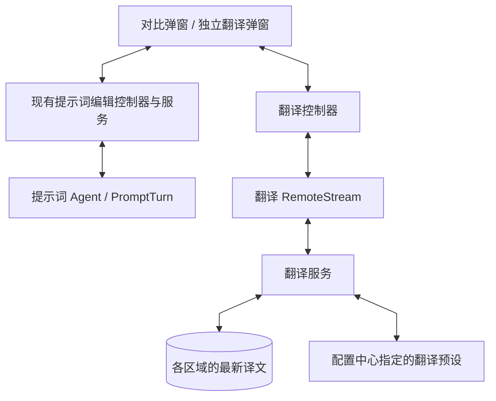
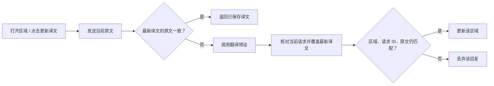

# 对比提示词与翻译交互改进计划

## 1. 名词定义

| 名词 | 定义 |
| --- | --- |
| 对比弹窗 | 用户从提示词编辑区打开的“对比提示词”界面。 |
| 改写前 | 一次提示词请求发出时使用的正向、负向提示词。 |
| 生成结果 | 该次请求返回的正向、负向提示词；用户可编辑后采用或继续改写。 |
| 改动意见 | 用户针对当前提示词填写的本轮修改要求。 |
| 改写轮次 | 提示词 Agent 的请求与结果轮次，对应已有 `PromptTurn`。 |
| 翻译区域 | 一组原文及其译文的显示区域。对比弹窗包含改写前与生成结果的正负四个区域；独立翻译弹窗包含当前输入的正负两个区域。 |
| 最新译文 | 一个翻译区域最后保存的一份原文及其中文翻译；再次请求成功时覆盖。 |
| 当前译文 | 最新译文中与该区域当前原文完全匹配的中文翻译。 |
| 翻译控制器 | 两个翻译入口共用的请求和显示状态管理组件。 |
| 冻结原型 | 本文第 3.1 节指定的界面文件、样例和截图，作为本版实施依据。 |

## 2. 总目标

1. Desktop 的对比弹窗必须与冻结原型保持相同的布局、样式、控件和交互。
2. 长提示词在左右文本区域内滚动。原始需求、正负切换、改动意见和底部操作区保持可见。
3. 对比弹窗始终显示双语对照。再次打开时复用匹配的最新译文。
4. 删除翻译次数、翻译记录选择、历史原文展示及翻译历史积累功能。
5. 保留连续改写、人工编辑生成结果、保存编辑、停止请求和采用结果的完整操作流程。

## 3. 现状调研

### 3.1 产品源码与原型依据

1. 本版源码基线为主线 `cf531595c0c1e8828b44dc603dcb335aba22cd40`，包版本为 `0.55.0`。实施者从该提交或包含该提交的主线建立独立 worktree。
2. 冻结原型位于 [prototype/prompt-comparison-20261118](../../prototype/prompt-comparison-20261118/)。文件清单和验收窗口尺寸以 [baseline.json](../../prototype/prompt-comparison-20261118/baseline.json) 为准。
3. 原型入口为 [对比提示词](http://127.0.0.1:18764/?edit=prompts&compare=long)。启动命令为 `python3 prototype/prompt-comparison-20261118/serve.py --port 18764`。
4. 布局以 [prompt-comparison.css](../../prototype/prompt-comparison-20261118/prompt-comparison.css) 为准，控件以 [prompt-comparison.ts](../../prototype/prompt-comparison-20261118/prompt-comparison.ts) 为准，长文本以 [prompt-comparison-example.json](../../prototype/prompt-comparison-20261118/prompt-comparison-example.json) 为准。
5. 实施对象包括对比弹窗、独立翻译弹窗及两者共用的翻译功能。周围工作台提供操作入口和采用结果后的回填位置。

### 3.2 生产现象对应的源码

1. [ExperimentPromptDialog](https://github.com/fzfz/harness-comfyui/blob/cf531595c0c1e8828b44dc603dcb335aba22cd40/src/client/workbench/experiment-prompt-dialog.tsx)将正负提示词、译文及翻译记录纵向排列。原文容器随文本增长，生成结果使用可缩放的文本框。
2. [usePromptTranslation](https://github.com/fzfz/harness-comfyui/blob/cf531595c0c1e8828b44dc603dcb335aba22cd40/src/client/workbench/experiment-translation-state.ts)读取分支下同字段的翻译列表。找不到匹配原文时，会选取列表末项。界面随后补充“记录原文”。
3. 提交 [1942db1](https://github.com/fzfz/harness-comfyui/commit/1942db12da6ec0fb1de199bb5f9f99c8365316c5) 在接入持久化和订阅时，增加了“第几次翻译”下拉框。
4. `WorkbenchTranslations` 当前写入 `workbench_translations`；`WorkbenchRemoteService.subscribe()` 将翻译列表与工作台状态一起发送给前端。现有单元测试包含翻译历史选择操作。

## 4. 面临的问题

1. 长文本导致左右列高度不同。翻译与历史原文继续增加页面长度，改写和采用操作离开当前视口。
2. 翻译历史增加了用户没有要求的浏览功能。历史回退逻辑还可能将另一段原文的译文放入当前区域。
3. 原型、实施代码和测试曾分别描述不同的界面。测试通过仍可能交付原型中没有的控件。

## 5. 问题的解决和实施方案

### 5.1 原型与实施的一致性规则

1. 实施者必须将冻结原型及本文纳入同一开发分支。实施期间将原型作为只读依据，不许通过修改原型消除产品实现差异。
2. 视觉范围包含弹窗尺寸、间距、字号、颜色、边框、分栏、滚动区域、按钮位置及各状态的控件。
3. 交互范围包含进入、切换、输入、生成、停止、失败重试、关闭、保存及采用后的回填。
4. 实施者必须按第 5.5 节逐项核对。发现冲突时，必须记录具体控件和行为，取得用户确认后同步修改原型、本文及对应验收项。
5. 验收使用相同窗口尺寸、文本、提示词字段和执行状态。证据必须同时包含原型截图与官方 Desktop 截图；静态截图与实际操作分别验收。

### 5.2 对比弹窗的交互

| 区域 | 确定的 UI 与操作 |
| --- | --- |
| 标题栏 | 显示“对比提示词”、当前底模和关闭按钮。 |
| 原始需求 | 默认显示一行；展开后在限定高度内滚动；收起后恢复单行。 |
| 正负切换 | “正向提示词”和“负向提示词”两个页签，切换后保留各自输入与阅读位置。 |
| 左右对比 | 左侧为改写前，右侧为生成结果；两列等宽、等高，文本分别滚动。 |
| 双语对照 | 每列上半区显示原文，下半区显示中文译文；区域高度采用冻结原型。 |
| 译文状态 | 窗口高度不超过 850 px 时，状态提示与翻译或重试按钮横排；长错误信息在状态区内滚动。 |
| 复制 | 列标题旁提供“复制原文”；译文完成后，在中文译文标题旁提供“复制译文”。 |
| 字符数量 | 分别显示两侧原文长度，人工编辑后更新。 |
| 改动意见 | 输入框位于固定的底部编辑区。已有结果时，“继续改写”使用右侧当前文本和本次改动意见。 |
| 执行中 | 右侧显示改写状态，改写按钮变为“停止改写”，采用按钮禁用；界面保留改写前文本。 |
| 人工编辑 | 生成结果的原文可编辑；编辑结果保留到后续切换、保存、继续改写或采用。 |
| 关闭 | 有未保存的人工编辑时，提供“继续编辑”“放弃修改”“保存并关闭”。保存结果保留为候选；采用时才回填提示词编辑区。 |
| 采用 | “采用正负提示词”一次回填两项原文并关闭弹窗。之后保存分支参数沿用已有工作台流程。 |
| 轮次状态 | 底部轮次对应 `PromptTurn`，由提示词请求驱动。 |

### 5.3 最新译文的行为与数据

1. 用户打开弹窗或切换正负页签时，翻译控制器读取该页签的译文。区域存在尚未更新译文的人工编辑时，按第 3 项处理；其余非空区域发送当前原文。Host 先查询最新译文；原文相同时直接返回，原文不同时调用翻译预设。
2. 翻译成功后覆盖该区域的最新译文。关闭弹窗、刷新页面或重新打开 Desktop 后，仍可读取这份结果。
3. 用户在弹窗内编辑原文后，该区域停止展示已有译文，显示更新入口。用户点击后翻译当前文本。切换正负页签再返回时，保留该区域的更新入口。
4. 每个区域独立保存当前请求 ID 和原文。回复必须与当前请求及原文匹配。较早请求晚到时，不得覆盖较新请求的显示内容或已保存译文。
5. 翻译失败时，该区域提供重试。最新译文保持上次成功值；显示时仍须满足原文一致的条件。
6. 关闭弹窗时取消未完成的翻译，释放显示状态。已经保存的最新译文继续保留。
7. 独立翻译弹窗复用同一翻译控制器。采用提示词始终读取原文。

| 保存对象 | 字段与归属 |
| --- | --- |
| 最新译文唯一键 | `workspace_id`、`work_id`、`branch_id`、`target`、`field`。`target` 为 `before`、`result` 或 `draft`；`field` 为正向或负向提示词。 |
| 最新译文内容 | `source_text` 与 `text`。每个唯一键只保存一行，成功后覆盖。 |
| 服务执行状态 | `request_id`、当前原文及运行状态，请求结束后释放。 |
| 界面显示状态 | 当前原文、请求 ID、进度、译文及失败信息。失败信息保留至重试、修改原文或关闭弹窗。 |
| 改写输入与结果 | 沿用 `workbench_prompt_turns` 的输入、结果、人工编辑和实际采用字段。 |
| 翻译执行配置 | 沿用配置中心的翻译功能绑定、预设和模型。 |

8. 实施者在现有 SQLite 存储中定义 `workbench_prompt_translation_latest`，由统一存储方法读写。比较原文使用字符串全值；请求 ID 仅用于关联异步回复。

### 5.4 架构与执行流程

1. 对比组件负责布局和操作。提示词编辑控制器继续管理改写轮次；翻译控制器管理当前区域的请求状态。

2. 实施者使用 Harness 已有的 `RemoteStream`，提供一个 `translate` 请求入口。输入包含第 5.3 节唯一键、当前原文和请求 ID；输出是按 `status` 区分的运行中、成功或失败结果。客户端结束流时取消未完成的翻译。
3. 翻译服务先读取最新译文。匹配时返回成功结果并结束流；需要翻译时，使用现有的预设绑定、模型选择和会话事件读取能力。成功后保存最新译文，再返回结果。
4. 服务按请求 ID 管理内存中的执行状态，并为同一唯一键记录当前请求。写入前核对该请求仍为当前请求；结束或取消后释放执行状态。
5. 实施者必须完整删除下表列出的翻译历史代码与测试。
6. 原文、译文和对比布局使用共享组件。状态类型与 Remote 输入输出由仓库统一合同入口定义。实现使用已有依赖，新增依赖包为零。

| 删除范围 | 对应位置 |
| --- | --- |
| 历史列表、次数、选中记录、历史原文及回退末项 | `experiment-prompt-dialog.tsx`、`experiment-translation-dialog.tsx`、`experiment-translation-state.ts` |
| 按请求积累的翻译记录读写、列表和恢复 | `workbench-store.ts` 中 `workbench_translations` 的 DDL、索引及方法；`translation-service.ts`、`plugin.ts` 中对应消费者 |
| 全量工作台状态中的翻译历史数组 | `remote-service.ts`、`WorkbenchUpdate` 合同、`experiment-store.ts`、`experiment-delivery.tsx` |
| 分散的开始、查询、取消接口 | `translateStart`、`translateGet`、`translateCancel` 的合同、Remote 注册、Host 适配与前端调用 |
| 验证上述行为的测试与夹具 | 翻译历史选择、列表下发、历史恢复、旧 Remote 和旧表持久化测试；替换为最新译文及请求流测试 |

7. 已有工作台任务、改写轮次和 Run 的存储及订阅继续服务各自功能。既有翻译历史数据的清理按第 8 节处理；翻译功能的持久化代码只读写最新译文表。

### 5.5 实施顺序与视觉验收

1. 每个界面任务必须产出可在官方 Desktop 单独验收的结果。共用基础设施由下表任务 1 实现。

| 序号 | 目标 | 依赖 | 页面与交互验收 | 实现与数据范围 |
| --- | --- | --- | --- | --- |
| 1 | 替换翻译历史实现，保存各区域的最新译文 | 无 | 基础设施：覆盖写入后每个键仅有一行；匹配原文时直接读取；并发及晚到回复保持正确归属；逐项完成第 5.4 节删除清单 | 最新译文表、统一读写方法、翻译合同、RemoteStream、翻译服务与控制器；同步删除旧代码与测试 |
| 2 | 重建弹窗布局与固定操作区 | 无 | 以长文本打开弹窗；左右等高，整体不随文本拉长，1280×720 与 1539×877 下均能看到改写及采用按钮 | `experiment-prompt-dialog.tsx`、`experiment-prompt-styles.ts`；局部样式限定在对比弹窗 |
| 3 | 接通需求展开及正负提示词切换 | 2 | 展开、收起原始需求；切换正向与负向提示词后保留文本和阅读位置 | 对比弹窗的显示状态；原文来自当前提示词编辑状态 |
| 4 | 接通固定双语对照及最新译文读取 | 1、3 | 两列始终同时显示原文与译文；没有语言显示模式切换；无匹配译文时显示进度；重新打开直接显示匹配译文；复制内容与按钮名称对应 | 翻译控制器、四个翻译区域、最新译文读取与复制操作 |
| 5 | 移除独立翻译弹窗中的历史功能 | 1 | 正负提示词旁的“翻译”入口可用；显示当前原文与译文；翻译次数、记录下拉框及历史原文均不存在 | `experiment-translation-dialog.tsx`、共享翻译控制器 |
| 6 | 接通连续改写与停止 | 2、3 | 填写意见后原位显示改写状态；停止后可再次改写；下一轮输入为上一轮当前结果与本轮意见 | `experiment-prompt-editor.ts`、已有提示词服务和 `PromptTurn` |
| 7 | 接通人工编辑与译文更新 | 4、6 | 编辑结果后切换页签仍保留；旧译文停止显示；点击更新后只翻译当前文本；晚到回复不能覆盖新内容 | 生成结果编辑状态、当前翻译请求匹配 |
| 8 | 接通关闭、保存与采用 | 6、7 | 分别验证继续编辑、放弃修改、保存并关闭；重新打开结果符合所选操作；采用后正负原文回填编辑区 | 候选保存、`promptSaveCandidate`、`promptAdopt`、分支编辑草稿 |
| 9 | 完成逐项原型对照与候选验收 | 2—8 | 执行第 7 节全部场景；截图与操作记录覆盖每个控件和状态 | 冻结原型、官方 Desktop 候选包、视觉证据与业务测试 |

2. 任务 1 先写结构与状态测试，再实现替换。界面任务按冻结原型逐项开发；最终候选运行仓库要求的独立审查、`pnpm quality`、`git diff --check` 和 `pnpm test:desktop`。
3. 静态依赖由 TypeScript 与仓库现有架构约束检查。界面控件、布局和交互通过第 7 节的浏览器及 Desktop 验收验证。

## 6. 方案待决策项清单

1. 本计划已获实施授权，当前没有待决策项。

## 7. 计划验收清单

### 7.1 固定的对照材料

1. 使用 `baseline.json` 声明的窗口尺寸及样例文本。产品验收将样例放入隔离测试数据，生产账号原有需求与提示词保持原值。
2. 分别保存正向双语、负向双语、执行中、失败、译文失效、未保存关闭确认的原型与 Desktop 截图。
3. 每项证据注明原型路径、窗口尺寸、候选提交、安装包版本和 Desktop 实例。评审者逐项核对第 5.2 节的控件与第 5.5 节的操作结果。

### 7.2 翻译验收

1. 验证打开对比弹窗后直接显示双语。首次读取没有匹配译文时，只翻译当前页签的非空原文。
2. 关闭并重新打开、刷新页面、重新打开 Desktop，验证匹配译文直接显示且翻译 Agent 调用次数为零。
3. 使用受控延迟验证旧请求晚到、左右同时翻译、切换正负字段及关闭弹窗。不同区域的结果保持独立。
4. 在两个验收窗口中验证翻译失败、重试、空文本及复制行为。人工编辑后，翻译按钮必须完整可见且能点击；翻译失败后，重试按钮必须完整可见且能点击。复制译文只能取得当前原文对应的完成结果。
5. 验证两个翻译入口均没有翻译次数、历史选择或历史原文。连续完成两次不同原文的翻译后，同一唯一键只有第二次结果。
6. 验证编辑原文后该区域译文失效，用户点击更新才翻译；切换页签不会绕过更新操作。
7. 验证关闭后释放请求状态、保留最新译文。失败和取消不得用其他原文的译文替代当前结果。
8. 对照第 5.4 节删除清单，确认旧前端、后端、订阅、存储及测试均已移除；新测试覆盖最新译文读写与界面行为。

### 7.3 改写与采用验收

1. 连续执行两轮改写，核对原始需求、本轮改动意见及改写前正负提示词的实际输入。
2. 验证生成中、停止、失败和成功的原位状态。执行中采用按钮禁用，原始文本与改动意见保持可读。
3. 手动编辑生成结果后分别执行三种关闭操作，重新打开核对保留的内容。
4. 验证采用结果回填两项原文。译文仅供阅读，采用与保存分支参数的行为符合第 5.2 节。
5. 真实 Agent 测试沿用用户配置的功能提示词。提示词 Agent 测试使用 `gpt-6.1-terra`、推理等级 `medium`；翻译使用配置中心指定的翻译预设及模型。

### 7.4 Desktop 与生产安装验收

1. 验收者按仓库 worktree 开发规范构建并安装候选包，在官方 Desktop 中验收。
2. 视觉与交互验收通过后，记录候选提交和包版本。发布及生产安装按仓库发布规范取得对应授权。
3. 安装执行者记录生产插件的实际安装目录，确认 Desktop 加载的包来自已验收候选提交。随后在生产 Desktop 重做第 5.2 节的界面核对及改写、翻译、采用操作。
4. 候选验收与生产安装验收分别记录结果。完成生产验收后，才能报告生产界面与冻结原型一致。

## 8. 非本次目标

1. 资源目录、多资源选择、实验工作台其他页面、Agent 预设职责和提示词生成内容要求按各自计划处理。
2. 既有翻译历史数据与 Harness 会话的清理另行授权。本计划移除旧表的读写和创建代码，不执行既有生产数据库的数据删除。

## 9. 已获得的授权

1. 用户要求重做对比提示词的排版与交互，并已要求将本轮原型作为实施依据。
2. 用户要求删除没有使用需求的翻译次数与翻译记录功能。
3. 用户要求新建本版独立计划，明确生产 Desktop 的 UI 和交互与原型一致的实施及验收要求。
4. 用户要求每个区域只持久化最后一份译文，并完整删除旧翻译历史的前后端与测试代码。用户要求对比弹窗固定为双语对照。
5. 用户已通过 `implement` 授权产品开发、测试、独立审查和分支提交。发布与生产安装按第 7.4 节执行。
6. 用户已批准小窗口译文状态区的横排预览，并授权同步原型、实现与验收项。
