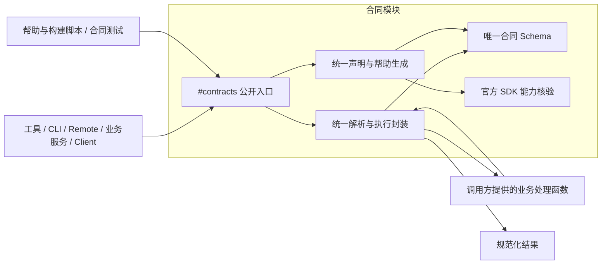

# Schema 合同深模块修复计划

## 1. 名词定义

1. **合同 Schema**：第 5.3 节数据格式的唯一声明，包含字段结构、类型、必填、可空、默认值、额外字段及约束。实施后保存于 `src/contracts/internal/schema.ts`。
2. **合同模块**：封装合同 Schema 读取、解析、转换、校验与帮助生成的深模块。消费者统一通过模块说明符 `#contracts` 导入，公开入口为 `src/contracts/index.ts`。
3. **消费者**：合同模块之外，使用合同 Schema 的工具、CLI、Remote、业务服务、Client、构建脚本和测试代码。
4. **宿主声明**：合同模块为官方工具注册生成的 JSON Schema。宿主支持范围由当前 SDK 的 `assertSupportedJsonSchema()` 核验。
5. **规范化结果**：合同模块完成字段解析、默认值处理和校验后返回的数据。
6. **旧实现**：消费者自行定义合同 Schema、读取规则或实现转换和格式校验的代码。删除范围见第 5.3 节。

## 2. 总目标

1. 全部消费者通过合同模块使用合同 Schema。
2. 合同模块独占规则读取和转换实现。消费者不得直接导入、读取、遍历或修改内部数据格式定义文件。
3. 消费者不得自行拼装 Schema、复制转换算法或新增格式校验路径。
4. 合同模块必须让合法输入进入业务处理，让合法输出完成交付。非法输入必须在业务处理前被拒绝，非法输出必须在交付前被拒绝。

## 3. 现状调研

### 3.1 已验证的生产故障

1. 生产插件为 `0.54.2`，官方 Desktop 为 `0.2.1-rc.3`。任务 `70cadae8-9166-45bf-bf97-73d0a6565f37` 的固定输入和输出合同均已保存。
2. 该任务的模型快照包含 `fields.skill_name: null`。领域校验接受该值，宿主输出校验报告 `oneOf branch (matched 0)`。
3. 会话记录包含 3 次读取失败。Agent 随后发布询问，任务进入 `waiting_input`；该任务的 Generation Run 数量为 0。

### 3.2 已验证的实现差异

1. `nativeToolSchema()`（`src/host/workbench/tool-schema.ts`）将联合类型转换为 `oneOf`。包含任意 JSON 值的分支与 `null` 分支重叠。
2. 同一转换器统一禁止额外字段。`contractObject()`（`src/shared/field-contract.ts`）则按调用参数决定额外字段规则。
3. 普通 `Schema.object` 与 `contractObject()` 对可选字段的 `null` 值处理不同。
4. 数值范围、字符串格式和数组长度只进入宿主声明的说明文字。字典值类型、JSON 深度及自定义约束依赖领域校验。
5. [普通工具](../../src/host/workbench/tools.ts)返回领域解析结果。[专用工具](../../src/host/workbench/specialist-tools.ts)的业务输出路径直接返回 JSON 数据。[CLI route](../../src/host/cli/route.ts)执行领域校验后仍返回原值。
6. `CLI 帮助生成器`（`scripts/cli/contract-help.mjs`）直接读取 Schema 内部字段，并独立解释类型、默认值和约束。
7. [Workbench Remote](../../src/workbench-remote.ts)直接组合共享 Schema。业务校验函数和测试还直接导入这些声明。

### 3.3 已完成的对照验证

1. 诊断已遍历当前注册的 13 个原生工具，并完成 35 组类型和约束对照。
2. 重叠联合声明涉及 `workbench_task_get`、`workbench_task_publish`、`workbench_run_inputs` 和 `workbench_workflow_parameters`。
3. 通过实际注册工具的 `execute` 入口注入受控返回值时，合法的 `current_value: null` 被宿主拒绝。领域 Schema 禁止的 `width: -1` 却能完成工具返回并通过宿主校验。
4. 诊断脚本和结果位于 `.local/diagnostics/schema-audit/`。

## 4. 面临的问题

1. 字段声明被复用后，消费者仍能自行解释字段规则。共享字段声明尚未形成完整的唯一来源。
2. 转换器既会缩小合法值范围，也会扩大可接受值范围。
3. 宿主无法表达的约束依赖领域校验，但各入口执行领域校验的方式不同。
4. 现有测试覆盖具体调用样例，缺少对规则唯一来源和消费者依赖关系的持续约束。

## 5. 问题的解决和实施方案

### 5.1 实施方案遵循的架构

1. 下图规定依赖方向。消费者只连接公开入口。

2. `package.json` 的 `imports` 将 `#contracts` 映射到公开入口。源码、测试和构建共用该映射。
3. 构建器必须解析该入口，产出可独立安装的 Host、Client 和 CLI 文件。安装包执行不得依赖开发 checkout。
4. 合同模块内部复用当前锁定的 Schemastery 和官方 SDK。模块新增文件按内部职责拆分，公开入口保持唯一。
5. 业务处理函数负责权限、资源存在性、任务状态和外部调用。字段格式与转换规则由合同模块执行。

### 5.2 唯一声明与公开接口

1. 合同 Schema 按操作标识组织输入和输出。工具名、CLI 命令及 Remote 方法对应的结构引用同一声明；跨渠道结构差异也在该声明中表达。
2. 每个字段的规则只写一次。转换所需的对象开放性、缺失与空值规则必须保存在同一声明中。
3. 合同 Schema 使用现有校验能力及内部构造函数。构造函数保留转换元数据，禁止消费者依据 Schemastery 的内部结构再次推断规则。
4. 可调整的运行参数继续使用项目配置来源。合同 Schema 引用配置值，禁止复制配置值。
5. 自定义校验函数归合同模块所有。合同 Schema 引用函数，公开接口不得暴露字段构造器或校验器注册能力。
6. 公开接口职责如下。业务输入和输出的 TypeScript 类型必须从合同 Schema 推导。其他参数由对应接口定义类型。

   | 接口 | 消费者传入 | 模块返回或执行 |
   | --- | --- | --- |
   | `contracts.parse()` | 合同标识、输入或输出方向、待解析值 | 校验后的规范化结果；供业务服务解析持久数据或内部调用数据 |
   | `contracts.bind()` | 操作标识、渠道、业务处理函数和调用上下文适配 | 封装输入解析、业务调用、输出校验及返回的渠道注册项 |
   | `contracts.describe()` | 操作标识、帮助视图 | 可直接显示的字段说明与用法 |

7. 公开入口导出派生的输入和输出类型。消费者不得手写重复的数据传输类型。
8. `bind()` 生成的注册项只交给对应宿主注册接口。消费者不得读取或修改注册项中的 Schema 节点。
9. CLI 的文件参数展开与渠道字段映射由模块内部适配执行。文件访问通过调用方提供的 I/O 能力完成，展开后的数据继续由模块解析。
10. 验证错误必须包含操作标识、输入或输出方向、字段路径及修正要求。消费者只转交错误。

### 5.3 删除与迁移范围

1. 下表列出当前已定位的文件及待迁移职责。实施者必须沿引用关系覆盖其消费者。

   | 当前位置 | 必须删除或迁入模块内部的内容 | 迁移后的消费者职责 |
   | --- | --- | --- |
   | `src/host/workbench/tool-schema.ts` | `nativeToolSchema()` 及文件 | 调用 `bind()` |
   | `src/shared/field-contract.ts` | 字段元数据读取、对象构造、可空与必填处理 | 引用公开类型或调用 `parse()` |
   | `src/shared/json-contract.ts` | JSON 格式声明、深度与键约束校验 | 通过模块解析；值比较函数继续承担值比较职责 |
   | `src/workbench/schema.ts`、`src/workbench/agent-model-schema.ts` | 合同 Schema 声明 | 调用公开入口 |
   | `src/workbench/delegation.ts`、`prompt-edit.ts`、`translation.ts` | 格式声明及重复传输类型 | 保留业务操作，使用模块派生类型 |
   | `src/cli/input-schema.ts`、`result-schema.ts` | 输入、输出与 Job 结果声明 | 调用公开入口 |
   | `src/cli/contract.ts`、`submission-fields.ts` | 字段格式解析、重复约束与转换规则 | 使用模块返回的请求数据 |
   | `src/generation/json-contract.ts`、`src/generation/lora-contract.ts`、`src/generation/submission-contract.ts` | 共享数据格式及其校验定义 | 使用模块派生类型与解析结果 |
   | `src/generation/run-input-contract.ts`、`src/generation/run-wait-contract.ts`、`src/generation/inspection-contract.ts` | Run 数据与参数检查数据的格式及校验定义 | 使用模块派生类型与解析结果 |
   | `src/image-reader/run-media-contract.ts`、`prompt-contract.ts` | 工具输入输出引用的数据格式 | 调用公开入口 |
   | `src/host/workbench/tools.ts`、`specialist-tools.ts` | Schema 导入、拼装、局部转换和格式校验 | 提供身份与业务处理函数，调用 `bind()` |
   | `src/host/cli/route.ts`、`src/host/cli/dispatch.ts` | 合同 Schema 的局部解析、输出校验和渠道结构转换 | 保留 HTTP、鉴权与业务分派职责 |
   | `src/workbench-remote.ts`、`src/workbench/validation.ts` | Schema 组合、字段格式解析和直接规则读取 | 调用模块；保留资源与状态校验 |
   | `scripts/cli/contract-help.mjs` | Schema 遍历、类型识别及约束解释算法 | 调用 `describe()` |
   | 消费上述定义的 Client、服务及测试 | 私有导入、规则遍历和重复传输类型 | 只使用公开入口 |

2. 替换文件中的全部职责后，实施者必须删除该文件。对于混合职责文件，实施者必须迁移表中列出的合同职责，并保留其余业务职责。
3. 原路径不得保留转发导出、兼容包装或备用转换器。

### 5.4 宿主能力与转换原则

1. 合同模块必须保证领域校验后的输出能通过宿主声明校验。
2. 联合分支必须按允许值集合处理。包含关系明确的分支由模块合并；互斥分支由模块生成宿主支持的组合。
3. 对象额外字段规则、必填字段和可空类型必须来自合同 Schema。
4. 宿主无法表达的范围、格式和自定义约束必须由模块的统一解析器执行。帮助信息从同一约束生成。
5. 模块必须用官方 SDK 核验生成结果。模块不得自行维护另一份宿主支持关键字清单。
6. 当前宿主拒绝 `anyOf`。模块遇到尚未支持的转换组合时，必须在构建或注册阶段报告合同路径与原因。
7. 实施者不得通过放宽业务规则、填充伪造字段或删除合法空值使测试通过。

### 5.5 实施步骤

#### 第 1 步：删除消费者自有实现与规则读取入口

1. 实施者必须先在独立 worktree 中删除第 5.3 节的旧实现和私有引用。
2. 实施者必须将需保留的合同声明归入唯一合同 Schema。重复定义必须合并，混合文件按第 5.3 节处理。
3. 实施者必须把消费者改为引用 `#contracts`。此时模块尚未提供的能力通过类型错误和失败测试显式暴露。
4. 实施者必须加入依赖约束测试。受控夹具必须证明该测试能识别旧实现和直接读取路径；删除后的候选树必须通过该测试。

#### 第 2 步：实现合同模块公开接口

1. 实施者必须先为 `parse()` 编写原生产故障的匿名回归测试。
2. 实施者必须先编写失败测试，再实现对应功能，最后复核接口。规则解析与规范化必须逐项遵循该顺序。
3. 实施者必须逐项增加第 7.3 节的类型与约束测试。
4. 实施者必须实现 `bind()` 与 `describe()`，由同一合同声明派生注册项和帮助。

#### 第 3 步：接入全部消费者

1. 实施者必须迁移当前 13 个原生工具的注册与执行。
2. 实施者必须迁移 CLI 请求、Job 结果、帮助与结果文件交付。
3. 实施者必须迁移共享合同的 Remote、服务、Client 和测试引用。
4. 实施者必须验证模块向业务处理函数只传入规范化输入，并向渠道只返回规范化输出。
5. 实施者必须按当前注册结果生成工具覆盖清单；新增工具必须自动进入清单。

#### 第 4 步：完成构建与交付验收

1. 实施者必须验证源码运行、Host、Client、CLI 构建及独立安装包均能解析唯一模块入口。
2. 实施者必须更新架构和测试文档的索引，指向合同模块公开入口。
3. 实施者必须完成改动文件要求的独立审查和第 7 节验收。
4. 实施者必须在最终候选树运行 `pnpm quality` 和 `git diff --check`。

## 6. 方案待决策项清单

1. 用户需审批本计划的实施范围、公开接口及第 7 节验收要求。审批后，实施者可以修改产品代码和测试。
2. 实施者发现字段规则存在冲突时，必须依据业务类型和调用证据提交具体字段的决策项。不得根据某个校验器更宽松就扩大支持范围。
3. 当前方案复用已锁定依赖。新增依赖需求必须附版本、安全审计和用途，并单独取得安装授权。

## 7. 计划验收清单

### 7.1 旧实现删除验收

1. 验收者必须按第 5.3 节逐项核对删除结果，并检查每个原消费者的调用路径。
2. 验收者必须确认原路径的转发导出、局部转换器、规则遍历器和备用分支数量均为 0。
3. 验收者必须核对最终源码与安装包中的职责归属。改名或移动到消费者目录内的重复实现仍判定为失败。

### 7.2 唯一入口与内部文件隔离验收

1. 依赖约束测试必须解析源码导入关系。覆盖静态导入、重导出、类型导入、动态导入和 `require()`。
2. 模块外代码必须使用第 1 节的模块说明符。依赖约束测试发现相对路径穿透、私有子路径或间接转发时，必须报告失败。
3. 依赖约束测试发现消费者读取内部数据格式定义文件时，必须报告失败。消费者也不得通过 `.dict`、`.list`、`.inner`、`.meta` 遍历派生声明并重建规则。
4. 依赖约束测试必须包含私有导入、规则文件读取和局部转换的受控夹具。这些夹具必须触发约束失败。
5. 公共接口测试只能经公开入口取得数据。依赖隔离测试可以分析源码和构建清单。测试不得将读取到的格式定义作为业务运行输入。
6. 独立审阅者必须核对消费者只调用模块。源码分析结果与人工审阅共同确认第 2 节要求。

### 7.3 类型与规则验收

1. 类型测试必须覆盖字符串、布尔值、整数、有限数值、枚举和数组元素。约束测试必须覆盖长度、范围、格式、字典键和值、JSON 深度及自定义约束。
2. 测试必须分别覆盖字段缺失、`undefined`、`null`、默认值、必填与可选，以及开放对象和封闭对象。
3. 联合类型测试必须覆盖互斥分支、重复分支、包含关系、数字与整数、字符串与字面量、任意 JSON 与 `null`。
4. 实施者必须使用最小匿名夹具复现第 3.1 节故障，并保留模型快照空值。Workflow 参数测试必须覆盖合法 `current_value: null` 与非法 `width: -1`。
5. 预期结果必须来自已批准的字段规则与固定案例，禁止由被测转换器生成预期结果。
6. 测试必须通过仅修改合同声明，验证类型、帮助、输入解析和输出校验同步变化。消费者调用代码必须保持不变。
7. 未支持的转换组合必须在构建或注册阶段失败，错误必须包含合同路径。

### 7.4 真实消费路径验收

1. 原生工具测试必须经实际注册和宿主校验路径调用。非法输入到达业务处理函数的次数必须为 0。
2. CLI 测试必须经受管请求与结果文件读取路径调用。返回值必须等于模块的规范化结果。
3. Remote 与服务测试必须经公开调用入口执行，覆盖共享字段的同类输入输出。
4. 验收者必须通过官方 Desktop 读取原故障结构的任务，确认固定输入和输出合同完整交付。
5. 验收者必须保存工具声明、调用、返回和页面结果。执行步骤与实例清理遵循[worktree 开发规范](../agents/worktree-development.md)。
6. 验收者必须按[测试规范](../system/testing.md)运行最终全量门禁，记录通过结果。

## 8. 非本次目标

1. 本次修复范围之外的工作包括 ComfyUI 图像生成算法、外部 Catalog 协议和宿主 SDK 的功能扩展。
2. 独立配置文件的加载规则继续由对应配置模块维护。
3. 生产数据迁移、用户任务重试和生产部署由后续获授权的操作完成。

## 9. 已获得的授权

1. 用户已授权根因调查、架构重设计与修复计划编写。
2. 用户已确定合同 Schema 唯一、转换方法由深模块独占、消费者只按模块名称调用的设计约束。
3. 用户已要求将删除旧实现安排为实施第 1 步，并将删除结果与消费者隔离列为最终验收条件。
4. 产品代码实施以第 6 节审批为准。发布、合并、生产安装及任务重试需要单独授权；发布操作遵循[发布规范](../system/releasing.md)。
