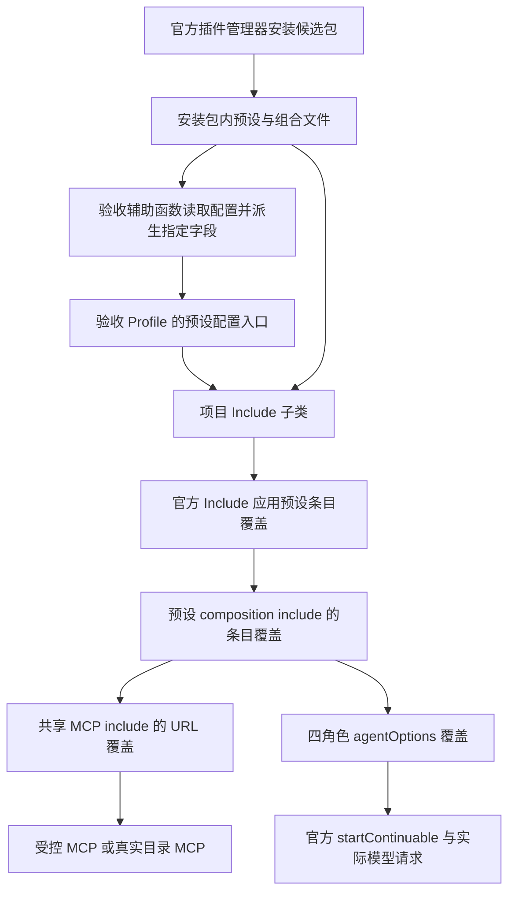

# 项目预设配置与 MCP 验收接入方案

## 1. 名词定义

1. 原迁移计划：`docs/plans/skills-mcp-migration-20261013.md`。
2. 候选包：Desktop 测试运行器从本轮候选树构建、由官方插件管理器安装的插件 tarball。
3. 预设配置入口：官方 Profile 中 `harness-comfyui-presets.config.patches`，拟接受官方 `Include.Config.patches` 定义的条目覆盖数组。
4. 验收 Profile：本轮独立 Desktop 环境中的官方 Profile。
5. 受控 MCP：测试进程创建的回环 HTTP 服务，提供验收需要的 MCP 初始化、工具发现与工具调用响应。

## 2. 总目标

1. 实施者补齐预设配置入口，使验收 Profile 能为候选包中的两个项目预设配置受控 MCP，并完成原迁移计划第 5.9 节第 2 项的角色模型设置。
2. 实施者通过官方 Desktop 验证候选包安装、MCP 工具作用域、实际工具调用、预设激活失败与恢复，以及四个角色实际使用的模型。

## 3. 现状调研

1. `.local/skills-mcp-migration-desktop.log:26–66` 记录 lifecycle 与 live 测试创建项目会话时返回 `agent-preset/invalid`，错误指向 MCP 首次连接或工具同步。日志尚未区分认证失败、服务不可达与工具同步失败。
2. `agent-presets/noobai-mcp.cordis.yml` 定义 MCP 地址、认证表达式和启动失败策略；两个项目预设通过相对 include 加载该文件。`tests/desktop/official-desktop-live.test.mjs` 的 `createOfficialBusinessConfig()` 与环境文件写入逻辑仅提供模型测试凭据，`tests/desktop/fixtures/official-lifecycle-services.mjs` 的环境文件写入逻辑也仅提供模型测试凭据。
3. `tests/desktop/fixtures/official-business-services.mjs` 已使用系统分配的回环端口提供模型、数据源与 ComfyUI 服务，其当前路由尚未实现 MCP。
4. 本机已安装的 `@deepseek-ai/cordis-plugin-include` 提供 `Include.Config.patches`、`applyEntryPatches()` 与 `entryListSchema`。已核对该包 `src/index.ts` 的条目覆盖查找范围、字段替换行为和 YAML 表达式处理方式。
5. `agent-presets/project-installed-presets.mjs` 的 `apply(ctx)` 当前只向 Include 传入安装包内文件路径。该组件尚未接收 Profile 配置，因此顶层 Profile 无法直接配置其独立 include 树中的预设。
6. `agent-presets/presets.cordis.yml` 定义两个预设的 Skill 作用域和 `composition` include。迭代预设组合文件中的 `composition-agent`、`generation-agent`、`observation-agent`、`comparison-agent` 各自保存 `agentOptions`；`project-iteration-dispatch.mjs` 将该值传给官方 `startContinuable()`。这条现有调用路径可消费预设配置入口派生的角色模型设置。
7. `package.json` 已声明 `@deepseek-ai/cordis-plugin-include` 和 `@deepseek-ai/schemastery` 的精确版本。本方案复用本机现有依赖。

## 4. 面临的问题

1. 自动化 Desktop 验收依赖固定端口的外部 MCP，测试夹具尚未提供该服务与测试凭据。当前业务会话在执行原有断言之前激活失败，具体连接失败原因仍需通过协议请求记录确认。
2. 预设注册组件封闭了官方 Include 已有的配置能力；MCP 地址和角色模型覆盖均缺少从验收 Profile 到组合文件的配置通道。
3. 官方 patch 对 `config` 执行整体替换，且只沿当前条目列表中的显式 group 查找。实施者若仅写深层条目 ID，覆盖可能无法命中；若仅写待改字段，覆盖可能移除该条目的其他配置。

## 5. 问题解决与实施方案

### 5.1 实施方案要遵守的架构流程图

1. 实施者按以下数据流连接 Profile、安装资源与官方配置执行能力。



### 5.2 步骤一：开放官方 Include 的配置入口

1. 实施者先在 `tests/unit/installed-presets.test.mjs` 和 `tests/unit/fixtures/installed-presets-runtime.mjs` 增加失败用例，覆盖默认安装路径、Profile 覆盖生效、嵌套表达式延迟求值、两个预设作用域与组件释放。
2. 实施者将 `agent-presets/project-installed-presets.mjs` 的包装组件改为官方 Include 子类，固定安装资源路径，公开 `patches` 数组配置。该类复用 Include 的树承载标记、加载和释放行为；实施者删除被替代的包装工厂并调整其测试。
3. 公开接口如下。`patches` 元素类型引用官方 `PatchOptions`；运行时 schema 负责数组结构，条目覆盖由官方 Include 执行。

```ts
interface InstalledPresetsConfig {
  patches?: import('@deepseek-ai/cordis-plugin-include').PatchOptions[]
}
```

```js
import Include from '@deepseek-ai/cordis-plugin-include'
import z from '@deepseek-ai/schemastery'
import { fileURLToPath } from 'node:url'

export default class InstalledPresets extends Include {
  static Config = z.object({ patches: z.array(z.any()).default([]) })

  constructor(ctx, config = {}) {
    super(ctx, {
      path: fileURLToPath(new URL('./presets.cordis.yml', import.meta.url)),
      patches: config.patches,
    })
  }
}
```

4. 实施者在官方 Loader 下验证该导出形态、继承的树承载标记和配置重新加载行为。完成条件为第 1 项用例通过，且省略 `patches` 时两个预设继续使用安装包声明。

### 5.3 步骤二：从安装资源派生 Profile 覆盖

1. 实施者新增 `tests/desktop/fixtures/official-preset-overrides.mjs`，提供 `createOfficialPresetProfilePatch({ installedPackageRoot, mcpUrl, roleAgentOptions })`。函数返回 `{ id: 'harness-comfyui-presets', config: { patches } }`；后两个参数均可省略。
2. 该函数从官方安装结果确定的 `installedPackageRoot` 读取预设、组合与共享 MCP 文件，使用 `entryListSchema` 解析。函数按配置中的 include 路径读取下一层，并要求本次目标条目各有唯一匹配。
3. 函数从完整原配置派生覆盖：预设条目的 `config.plugins` 保留 Skill group；`composition.config.patches` 覆盖组合条目；MCP 的组合条目继续引用共享文件，并通过该 include 的 `patches` 覆盖客户端 URL。每层 `config` 均保留该层未指定修改的字段。
4. 实施者新增 `tests/production/official-preset-overrides.test.mjs`，使用官方 `applyEntryPatches()` 逐层验证派生结果。测试覆盖实际路径含空格、条目缺失或重复、两类覆盖组合、凭据表达式保留、原输入保持完整和撤销覆盖后的默认配置。
5. 官方安装完成后，验收代码读取安装资源并将返回条目合并进当前验收 Profile。首次业务会话创建前，验收代码通过现有 probe 完成应用重启。已有持久 Profile 使用相同的显式写入流程，`initialProfilePatches` 继续只负责首次初始化。
6. 完成条件为官方应用加载覆盖后的两个预设，证据记录候选包安装路径和 Profile 条目，并确认覆盖来源为安装资源。

### 5.4 步骤三：接入受控 MCP 与测试凭据

1. 实施者新增 `tests/desktop/fixtures/official-mcp-services.mjs` 和 `tests/desktop/fixtures/official-mcp-fixture.json`。前者负责回环随机端口、认证、MCP 协议响应、请求记录与释放；后者集中保存验收工具声明、结构化响应和凭据环境变量名称。
2. 受控 MCP 提供 `initialize`、初始化通知、`tools/list` 与 `tools/call` 所需响应；Workflow 工具声明取自 `.local/mcp-investigation/2026-10-13/tools.json` 中的 `search_workflows` 和 `get_catalog_resource` 条目；实施者在真实服务恢复后通过 `tools/list` 核对输入结构，将所需声明保存到本节第 1 项的夹具文件。服务支持按测试场景切换认证与可用状态，每轮凭据由测试进程生成。请求证据记录认证是否匹配和协议结果。
3. 实施者新增 `tests/production/official-mcp-services.test.mjs`，验证成功调用、缺失及错误认证、服务恢复、并发请求和端口释放。协议实现遵循本机已安装客户端及其 SDK；依赖范围按第 3 节第 7 项执行。
4. 实施者修改 `tests/desktop/official-desktop-live.test.mjs`，在测试环境文件及 `credentialEnvironmentNames` 中加入夹具凭据，启动受控 MCP，通过第 5.3 节函数注入地址，并在测试清理阶段释放服务。现有业务模型、ComfyUI 服务与界面断言继续执行。
5. 实施者修改 `tests/desktop/official-desktop-lifecycle.test.mjs` 和 `tests/desktop/fixtures/official-lifecycle-services.mjs`，为每个独立环境分别准备 MCP 地址、凭据及 Profile 覆盖，并在应用重启期间保持对应服务可用。
6. 实施者将两个项目预设的工具发现、Workflow 实际调用、子会话继承及普通预设作用域断言加入 live 测试。缺失凭据、无效凭据与不可达场景分别验证项目预设激活失败、普通预设可用以及恢复后重新激活成功。
7. 完成条件为 `pnpm test:desktop` 通过，并保存 MCP 请求、预设身份、会话结果与清理证据。

### 5.5 步骤四：配置四角色的真实验收模型

1. 实施者按原迁移计划第 5.9 节选择并配置本轮获准模型，将四个角色条目 ID 与各自完整 `agentOptions` 作为 `roleAgentOptions` 传给第 5.3 节函数。真实目录验收省略 `mcpUrl`，由安装包共享配置提供服务地址。
2. 该函数在迭代预设的 `composition.config.patches` 中覆盖四个角色条目的 `config.agentOptions`，保留每个角色的 persona、工具过滤、任务模板和派发深度。每份 `agentOptions` 根据选定模型能力构造。
3. 实施者将结果写入本轮验收 Profile，重新激活后分别创建四个角色子会话，记录每条实际调用的 Provider 与模型 ID。主会话模型、图片读取模型和工作台子会话继承按原迁移计划第 5.9 节执行。
4. 完成条件为四个角色均有对应实际模型调用证据，源码 persona 与生产 Profile 保持原值。

### 5.6 步骤五：执行独立审查与交付验证

1. 实施者按仓库要求安排改动文件的独立代码审查和文字文件的独立语义审计，完成修正后执行定向回归。
2. 实施者在最终候选树执行 `pnpm quality` 和 `git diff --check`，将自动化证据与真实验收轨迹保存到原迁移计划指定目录。候选包构建、安装身份与清理断言沿用现有测试基础设施。

## 6. 方案待决策项清单

1. 用户已批准第 5.2 节的公开配置接口变更，以及第 5.3 至第 5.5 节通过该接口接入验收配置的实施范围。

## 7. 计划验收清单

1. 默认配置、嵌套表达式与组件生命周期满足第 5.2 节完成条件。
2. 候选包安装来源和 Profile 派生结果满足第 5.3 节完成条件。
3. MCP 成功、失败、恢复、作用域、环境隔离和资源释放满足第 5.4 节完成条件；恢复验证采用原迁移计划第 5.2 节第 1 项的用户确认要求。
4. 四角色实际调用及源码和生产配置保持情况满足第 5.5 节完成条件。
5. 独立审查、最终门禁和轨迹交付满足第 5.6 节完成条件。

## 8. 非本次目标

1. 生产 MCP 默认地址、认证方式和启动失败策略的调整。
2. 项目 Skill、角色 persona、生产 Profile 与官方宿主源码的修改。
3. 新增依赖安装、MCP 目录服务实现、插件发布和生产安装。

## 9. 已获得的授权

1. 用户已授权实施原迁移计划，并确认 MCP 凭据缺失、无效或服务不可达时仅相关预设激活失败，其他预设可用，恢复后重新激活，取消严格 30 秒要求。
2. 当前调查已获准读取本机文件并编写本方案。用户已批准第 6 节第 1 项所列补充接口实施范围。
