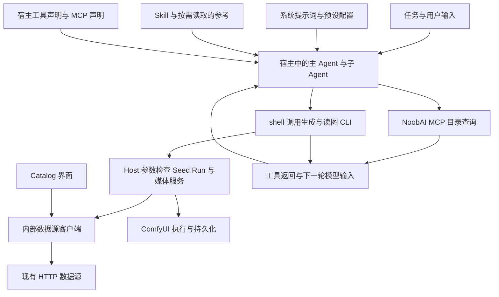

# ComfyUI Skill 目录查询 MCP 迁移方案

## 1. 名词定义

1. 目录 MCP：`http://127.0.0.1:18943/mcp` 提供的 NoobAI 查询服务。

2. 语义查询 CLI：`scripts/source-client/imagegen-semantic-query.mjs`；迁移前供 Prompt Builder 和插件 Catalog 数据访问代码调用。

3. 受管业务 CLI：`scripts/cli/harness-comfyui.mjs`，通过 Harness 调用身份执行生成、参数检查、Seed、Run、媒体和图片读取操作。

4. 本地校验 CLI：`anima-prompt-builder`、`krea2-anime-prompt-builder` 和 `wai-sdxl-prompt-builder` 各自的 `scripts/validate-output.mjs`，负责确定性结构校验。

5. 资源引用：目录 MCP 返回的 `ref`，由资源类别 `kind` 与十进制字符串 `id` 组成。

6. 实施者：用户确认本方案后执行代码、配置、Skill 文档修改与验收的 Agent。

7. 两个 ComfyUI 预设：工作台预设由 `agent-presets/harness-comfyui-cli-candidate/agent.cordis.yml` 配置，迭代预设由 `agent-presets/harness-comfyui-iteration/agent.cordis.yml` 配置。

8. 调用轨迹：按时间或事件序号关联的执行记录，包括：

   1. 实际模型输入、工具声明和可取得的模型分析记录。
   2. 文件读取、工具调用与返回、父子消息。
   3. 产物和结束状态。

## 2. 总目标

1. 两个 ComfyUI 预设中的 Skill 使用目录 MCP 查询以下资源：

   1. 作品、角色和词条。
   2. 底模、生成模型和 LoRA。
   3. Style 和画师串。
   4. Workflow 元数据和实例目录。

2. Harness 继续负责以下操作；本地校验 CLI 继续校验 Prompt Builder 结果。

   1. 接纳生成请求，检查 Workflow 参数，处理 Seed。
   2. 持久化 Run、读取媒体和视觉读图。
   3. 管理 Workspace 和 Session 归属。

3. Skill 定义资源获取目标、查询时机、候选选择规则与结果用途；MCP 工具声明负责工具发现、参数、返回结构、分页和调用错误的处理指引。Skill 执行者在需要资源时读取可用工具声明并完成查询。

## 3. 现状调研

### 3.1 2026-10-13 初始目录 MCP 调研

1. 2026-10-13 调研发现 17 个工具，服务握手报告 `noobai-catalog/0.1.0`。[调研证据](../verification/skills-mcp-migration/20261013.json)保存工具清单、调用结果、错误码、字段抽样比较和大小测量；原始响应保存在当前 worktree 的 `.local/mcp-investigation/2026-10-13/`。

2. 官方应用随附的 DSH MCP 客户端 `0.2.0-rc.2` 已注册全部工具。`dsh-probes.json` 保存 28 次调用：24 次返回工具成功，4 次返回错误。其中实例状态调用返回成功结构，但 `reachable` 为 `false`。

3. 上述错误包含实例队列和节点搜索连接失败。另有超出数量上限、大数 ID 被拒绝两类错误。`extra-probes.json` 补充记录以下调用：

   1. 底模名称筛选、非空语义查询和画师串查询。
   2. ID 格式有效但资源不存在时的错误。
   3. 节点详情连接失败。

4. 该次调研唯一返回的实例为 `2`。其目录记录中 `enabled`、`validation_passed` 均为 `true`；实时连接失败，错误码为 `MCP_INSTANCE_REMOTE_UNAVAILABLE`。节点详情、节点搜索和队列的成功路径尚待实例恢复后验证。

5. 该次调研通过语义查询 CLI 对 `127.0.0.1:18093` 的查询成功。生成模型 `17` 与 Workflow `44` 的抽样结果在 ID、文件名或标题、底模和默认模型关联上与目录 MCP 一致；证据为 `cli-model.json`、`cli-workflow.json`。

6. DSH 生成的 17 个模型可见工具声明以紧凑 JSON 序列化后为 77,984 UTF-8 字节。Workflow `44` 的详情对象约为 149 KB，包含完整 `workflow_json`。

### 3.2 能力与接口对应

| 当前用途 | 目录 MCP 工具 | 调研观察到的接口结构 |
|---|---|---|
| 作品、角色、词条 | `query_semantic_works`、`query_semantic_characters`、`query_semantic_prompt_terms` | `results` 与 `page/page_size/total_count`；已有 ID 使用 `mode: resolve` |
| 词条分类 | `list_prompt_term_categories` | 一级入口与二级类别；语义判断由 Skill 执行者完成 |
| 底模、模型、LoRA | `search_base_models`、`search_models`、`search_loras` | `results[].ref`、关联对象及 `next` |
| Style、画师串 | `search_styles`、`search_artist_prompt_strings` | 素材字段、底模关联及 `next` |
| Workflow、实例目录 | `search_workflows`、`search_instances` | 模板关联信息、实例登记信息与资源引用 |
| 资源详情 | `get_catalog_resource` | `item`；Workflow 详情当前包含完整工作流 |
| 实例运行信息 | `get_instance_status`、`get_instance_queue`、`search_instance_nodes`、`get_instance_node` | 实时状态、队列或节点定义 |
| 实例连接参数 | `get_instance_connection` | 实例地址与认证字段；现有生成任务由 Harness 获取连接参数 |

### 3.3 仓库配置与调用归属

1. 两个预设通过 `cordis:include` 引用同一配置文件 `agent-presets/noobai-mcp.cordis.yml`。配置使用环境变量 `NOOBAI_MCP_TOKEN`、60 秒工具超时和 `failOnStartupError: true`；开发环境通过 `config/desktop-e2e.json` 声明凭据传递。

2. 当前客户端 schema 没有独立启动超时字段。本次采用宿主现有初始化期限，第 5.2 节第 1 项所述预设激活行为尚待验收。

3. 当前工作树的 `src/host/core/plugin.ts` 已创建 `CatalogClient` 和 `GenerationSourceClient`，通过内部 HTTP 提供 Catalog 与生成数据；原 `catalog-cli.ts`、`source-cli.ts` 及其可执行脚本已删除。对应代码和交付验证见第 5.7 节。

4. 初始调研曾发现 `skill_name` 为 `test` 的模型。实施者按第 7 节第 4 项核对本轮采用的记录。

### 3.4 目录 CLI 退役前的失败发现链与消费者

1. [目录 CLI 发现链](../verification/skills-mcp-migration/catalog-cli-discovery-chain.json)记录了工作台 Session 的执行顺序：

   1. 读取 `generation-cli.md` 和 `template-parameter-inspection-cli.md` 的根帮助指引。
   2. seq59 调用根帮助，seq60 获得 `catalog --help` 指引。
   3. seq65 获得 `catalog instance list --help` 指引。
   4. seq76 成功查询实例。

   首次模型工具列表没有该 CLI 命令。命令在后续 shell 工具返回中出现。
2. 该轮执行时，`config/managed-cli-help.json` 的根帮助、目录分类、实例命令、NEXT 和错误后的操作指引提供目录调用。`src/cli/contract.ts` 与 `src/host/cli/dispatch.ts` 接受并执行目录请求；`src/host/cli/shell-capability.ts` 注入语义脚本路径及数据源地址。后者是已确认可达的另一条路径，本次命令发现的直接证据为第 1 项。
3. 退役前，UI 的 `CatalogRemoteService` 直接调用 `CatalogCli`；生成链的 `SourceGenerationPreparer` 与 `ComfyHttpTransport` 使用 `GenerationSourceCli`；`scripts/verification/comfyui-workflow-matrix.mjs` 也直接创建这两个类。这些消费者不经过受管 CLI 的 `catalog.*` 分发。
4. 退役前，`CatalogCli` 和 `GenerationSourceCli` 分别启动 `scripts/source-client/` 下的两个可执行脚本。脚本混合 HTTP 数据访问、argv、帮助、输出与退出码职责。当前消费者已按第 3.3 节改为内部客户端。
5. [无默认模型报告](../verification/skills-mcp-migration/deepseek-no-default-model-review.json)和[空实例报告](../verification/skills-mcp-migration/deepseek-empty-instances-review.json)保存已观察到的行为偏离。两份报告中的 Workflow 和空列表未发现截断。子会话完整 DSH 事件仍有取证缺口。自动化、模型调用和业务验收的结果分别记录，当前迁移尚未完成。

### 3.5 开发测试设施的现状

1. `tests/desktop/run-desktop-tests.mjs` 已负责候选构建、打包和官方 Desktop 回归；`tests/desktop/fixtures/official-desktop-probe.mjs` 已负责隔离目录准备、应用启停、进程身份与端口核对。`official-plugin-install.mjs`、`official-profile-patch.mjs` 和 `official-preset-overrides.mjs` 已提供安装与配置能力。
2. `tests/desktop/fixtures/renderer-cdp.mjs` 已提供与本轮官方 Desktop 应用的连接；`tests/desktop/official-desktop-live.test.mjs` 已使用官方 Remote 创建会话、通过界面发送任务并取得受控服务的请求记录。`official-command-cancellation.mjs` 已处理测试命令取消后的应用清理。
3. 官方应用已保存持久会话记录，并提供主子会话日志导出接口。当前正在按第 5.13.3 节实现任务结束后的记录导出；使用入口见[开发文档的“Agent 调用轨迹”](../agents/worktree-development.md#agent-调用轨迹)。
4. `.local/skills-mcp-migration-live/` 中曾有场景脚本重复组织应用和会话操作，并依赖其他场景的状态文件。已删除的入口及专属测试见[删除清单](../verification/skills-mcp-migration/local-script-retirement.json)。共享观察模块曾在配置未加载时继续执行任务，见[第三轮取消记录](../verification/skills-mcp-migration/remaining-handoff-zero-runtime-round-3.json)。
5. 先前官方 Desktop 验收记录为 13 个文件、277 项通过，见[夹具验证记录](../verification/skills-mcp-migration/mcp-0902-fixture-verification.json)。第 5.13.3 节的事后导出改动需要重新验证；真实模型验收状态见逐项验收矩阵。

### 3.6 2026-10-15 当前服务合同与验收状态

1. 当前部署为 NoobAI `0.90.2`，提交为 `1d5d0aa9606ab9442263d7d1924f1f2d332b3d43`；初始化响应为 `noobai-catalog/0.90.2`。[现场核对](../verification/skills-mcp-migration/mcp-0902-contract-check.json)确认全部 17 个工具声明与 2026-10-14 调研的 `0.90.1` 完全一致。`0.90.2` 从包元数据读取服务版本。
2. 相比第 3.1 节基线，当前工具名称、输入 Schema、分页与关联查询合同保持不变；作品、角色、Prompt 词条及五类资源的搜索或详情移除图片 URL 和看图指引。具体字段与消费者见[升级调研第 3、4 节](../verification/skills-mcp-migration/mcp-upgrade-research-20261014.md)。
3. `0.90.1` 调研已完成 16 次原始工具调用、4 次官方客户端调用和模型 17、Workflow 44 的跨接口比较；内部 HTTP 仍返回图片字段，关键业务数据与 MCP 一致。上述结果的日期和适用范围保留，当前服务的真实模型与 Desktop 验收仍按第 5.15 节执行。
4. 当前 [验收矩阵](../verification/skills-mcp-migration/acceptance-matrix.json)有 46 个基础项，其中 6 项通过、34 项失败、6 项未审；8 个附加项中 3 项通过、1 项失败、4 项未审。后续结果由该矩阵登记；已有失败仍需按第 5.11 节调查。
5. 当前服务还声明 MCP 资源读取能力。`resources/list` 返回 `skill://catalog-query/SKILL.md`，`resources/read` 返回目录查询说明；`resources/templates/list` 返回上游 `-32601`。边界夹具曾保留该能力声明却拒绝资源读取，相关协议修复与复验按第 5.15 节第 4 项执行。

## 4. 面临的问题

1. 当前工作树已改写 Skill 的目录查询入口；第 5.3 至第 5.6 节的业务规则仍需完成独立回扫与真实验收。

2. MCP 工具声明已解释候选预览、资源详情、关联对象和继续查询方式。若 Skill 再保存这些说明，接口调整时就会出现多份需要同步的定义。

3. Workflow 详情的完整工作流大于现有预设结果裁剪阈值。生成 Skill 通常只需要模板元数据，完整工作流仍由 Harness 编译链读取；直接替换模板 resolve 会增加上下文负担，真实会话中的裁剪影响尚待验收。

4. MCP 与原 HTTP 数据源分别配置地址，运行时可能指向不同目录。生成请求只携带资源 ID 时，查询与执行必须使用同一目录记录。

5. 目录 MCP 当前没有生成提交、模板运行参数检查、Seed、Run、媒体及视觉读图接口。上述功能的迁移涉及业务服务职责调整。

6. 退役前的调查发现，目录命令还通过其他参考文件、根帮助、命令分发、shell 注入和随包脚本提供。实施者按第 5.7 节核对这些入口的退役结果及 Host 内部数据访问。

7. 失败判定不能代替根因调查。当前已确认目录命令的实际发现链；停止条件的措辞、父子调度、模型选择及夹具一致性对其他失败的影响，必须按第 5.11 节分别验证。

8. 场景脚本曾重复提供启动、安装、配置与会话操作。脚本故障使实施工作转向维护临时测试代码。轨迹设施的待验证项见第 3.5 节第 5 项。

9. `tests/desktop/fixtures/official-mcp-fixture.json` 已同步当前服务合同并通过定向测试；第 5.15 节的 Desktop 复验已通过，真实模型复验正在执行。

## 5. 问题的解决和实施方案

1. 当前实施规则由本计划统一定义；预设配置接口与两项边界夹具分别引用对应补充方案。第 5.11 至第 5.14 节适用于本计划全部步骤。下列替换以外的修改仅按第 5.11 至第 5.14 节处理，其他文字保持原文。历史报告中的审批状态不构成新的实施前置条件。

### 5.1 实施方案要遵守的架构流程图



### 5.2 步骤一：完成两个预设的 MCP 配置

1. **启动失败与期限**：缺失凭据、凭据无效或服务不可达时，依赖目录查询的预设激活失败。其他预设继续可用。本次采用宿主现有初始化期限。凭据修正或服务恢复后，按以下顺序验证：

   1. 实施者完全退出并重新打开官方应用。
   2. 实施者选择对应预设，执行一次目录查询。
   3. 实施者核对两个项目预设的激活和查询结果。

   官方入口与失败记录机制见[恢复诊断](../verification/skills-mcp-migration/recovery-failure-diagnosis.json)。

2. 实施者保留 `agent-presets/noobai-mcp.cordis.yml` 中的以下配置：

   1. `serverName: noobai`、`transport: streamable-http` 和当前端点。
   2. 从 `NOOBAI_MCP_TOKEN` 构造的 Authorization。
   3. `toolCallTimeoutMs: 60000` 和 `failOnStartupError: true`。

   两个预设的 `agent.cordis.yml` 各保留一次 `../noobai-mcp.cordis.yml` 引用。凭据值只由应用进程环境提供。

3. 实施者在 `config/desktop-e2e.json` 的 `modes.development.credentialEnvironmentNames` 保留 `NOOBAI_MCP_TOKEN`，通过现有 development probe 将 main checkout `.env` 中的该变量传给隔离应用。

4. 实施者在 `agent-presets/harness-comfyui-cli-candidate/agent.cordis.yml` 中，将 `persona.config.prefix` 的完整原文：

    ```text
    You are the Harness ComfyUI workbench Agent. Use the available project Skills and managed project CLI. Reply in the user's language.
    ```

    完整替换为：

    ```text
    You are the Harness ComfyUI workbench Agent. Follow the selected project Skill. Use NoobAI MCP to look up works, characters, prompt terms, base models, generation models, LoRAs, artist styles, artist prompt strings, workflow templates, and ComfyUI instances. Use the managed project CLI to generate images and read images. Reply in the user's language.
    ```

    将 `subagent_task` 的 persona 完整原文：

    ```text
    You are a task subagent of the ComfyUI workbench Agent. Complete the assigned task in the parent's Workspace, use available project Skills and managed project CLI when relevant, and report the concrete result or blocking error to the parent Agent. Reply in the user's language.
    ```

    完整替换为：

    ```text
    You are a task subagent of the ComfyUI workbench Agent. Complete the assigned task in the parent's Workspace. Follow the selected project Skill. Use NoobAI MCP to look up works, characters, prompt terms, base models, generation models, LoRAs, artist styles, artist prompt strings, workflow templates, and ComfyUI instances. Use the managed project CLI to generate images and read images. Report the concrete result or blocking error to the parent Agent. Reply in the user's language.
    ```

    迭代预设的主 Agent 与四个角色按第 5.12 节核对输入来源、派发、等待与结果交接；只修订与这些职责冲突的说明，角色业务职责保持不变。

5. 实施者在 `tests/production/official-agent-preset-resources.test.mjs` 和 `tests/production/plugin-build-presets.test.mjs` 中先增加失败测试。测试验证共享配置已打包、两个 include 可解析，且配置中没有凭据值。随后完成对应修正。工具作用域继续使用 `project-tool-visibility.mjs` 的 `local-only` 配置。

6. 本步骤验收：两个预设各在官方 Desktop 中通过 NoobAI MCP 查询一次 Workflow。普通预设的工具范围保持原有规则。缺失凭据、无效凭据、服务不可达及恢复后的行为满足第 5.2 节第 1 项。复用已安装的 DSH MCP 客户端 `0.2.0-rc.2`；所需能力超出现有依赖时按第 5.14 节记录受阻事项。

#### 5.2.1 同步预设提示词与工具声明

1. 实施者依据[交付工具指引诊断](../verification/skills-mcp-migration/unavailable-presentation-tool-design.json)，核对两个项目预设的实际工具声明与 `ui:deliverable-file-references` 段落。实施者在两个预设现有 `hiddenSectionNames` 中加入该段落名称，由 `project-system-prompt-visibility.mjs` 按当前预设作用域过滤。
2. 实施者通过 `system-prompt/assemble` 回归验证两个项目预设的过滤结果。核对 persona、可用工具指引、上下文、工具声明和变量均完整保留。普通预设继续使用原有段落和工具范围。
3. 实施者在候选包的真实主子会话请求中核对段落与工具声明，再验证正常文件和图片交付。Builder 的输出格式继续按各自合同独立验收；该配置调整的效果以[展示段对照审查](../verification/skills-mcp-migration/anima-display-control-review.json)及后续原始轨迹为依据。

### 5.3 步骤二：修改 ANIMA 的目录查询段落


1. 本步骤的文件路径均相对于 `.agents/skills/anima-prompt-builder/`。实施者在 `SKILL.md` 定位以下原文：

    ```text
    ## 读取语义查询说明
    ```

    将该原文完整替换为：

    ```text
    ## 查询缺少的 Prompt 素材
    ```

2. 实施者在 `SKILL.md` 定位以下原文：

    ```text
    Skill 执行者只有在下列具体情况发生时，才先完整读取 `references/semantic-query-interfaces.md`，再按该文件说明判断是否调用 `imagegen-semantic-query`：
    ```

    将该原文完整替换为：

    ```text
    以下任一情况发生时，Skill 执行者通过 NoobAI MCP 获取所需的作品、角色、画师或 Prompt 词条：
    ```

3. 实施者在 `SKILL.md` 定位以下原文：

    ```text
    第 4 种情况表示用户没有指定画师。Skill 执行者必须先完整读取 `references/artist-style-query-vocabulary.md`，按该文件构造一条或多条画风查询，再按照 `references/semantic-query-interfaces.md` 的“查询顺序与查询值”执行 Style Search、比较候选并采用选中结果。
    ```

    将该原文完整替换为：

    ```text
    第 4 种情况表示用户没有指定画师。Skill 执行者必须先完整读取 `references/artist-style-query-vocabulary.md`，按该文件形成一条或多条画风查询，通过 NoobAI MCP 查找适用于 ANIMA 的画师素材，并按本节“选择作品、角色、画师与词条”采用结果。
    ```

4. 实施者在 `SKILL.md` 定位以下原文：

    ```text
    ## 构建并校验提示词
    ```

    将该原文完整替换为：

    ```text
    ### 查找作品、角色与画师

    1. Skill 执行者按“构建并校验提示词”规定的来源顺序采用已有 Prompt。需要补充角色或画师 Prompt 时，已有记录 ID 优先用于通过 NoobAI MCP 获取该记录；没有 ID 时，角色使用名称及已提供的所属作品信息查找，画师使用名称查找。ID 与名称均缺失时，Skill 执行者报告缺少的角色或画师信息，并停止处理该记录。
    2. 用户同时给出作品和角色名称时，Skill 执行者先确认作品，再查找该作品中的指定角色。作品返回的角色名单只用于核对或查找用户已经指定的角色。
    3. Skill 执行者查询画师素材前，通过 NoobAI MCP 确定名称精确为 `anima` 的唯一底模。没有匹配底模或存在多个匹配底模时，Skill 执行者报告实际结果，并停止本次任务的画师查询。画师素材关联其他底模时，Skill 执行者报告该素材及其底模，并停止采用该素材。

    ### 选择作品、角色、画师与词条

    1. Skill 执行者按作品名称、别名和类别核对作品候选，按所属作品、角色名称和别名核对角色候选。角色候选必须具有非空 Prompt。只有一项符合时采用该项；多项符合时，Skill 执行者报告候选标识、名称、别名及区分候选所需的作品信息，并等待用户选择。
    2. 用户指定画师时，Skill 执行者按画师名称和别名核对身份；用户没有指定画师时，Skill 执行者按已经确定的媒介、线条、上色、明暗、纹理和配色比较画师说明。只采用适用于本节确定底模且具有非空 Prompt 的候选。只有一项符合时采用该项；多项符合时，Skill 执行者报告候选标识、名称、别名和画风说明，并等待用户选择。
    3. Skill 执行者按目标概念比较词条的规范标签及别名。只有一项符合时采用该项；多个候选表达相同含义时，按使用数量从大到小、ID 从小到大采用第一项；候选含义不同且 Skill 执行者无法根据用户要求确定唯一候选时，Skill 执行者报告候选标识、规范标签和别名，并等待用户选择。
    4. 作品或角色没有可采用结果时，Skill 执行者报告缺少的作品身份、角色身份或角色 Prompt，并请求用户补充。用户指定画师而没有可采用结果时，Skill 执行者报告缺少该画师的 ANIMA Prompt，并请求用户补充。自动选择画师没有结果时，Skill 执行者沿用已经确定的媒介、线条、上色、明暗、纹理和配色继续构造 Prompt。词条没有可采用结果时，Skill 执行者将该概念的英文自然语言描述写入 `slots.natural_language`。

    ## 构建并校验提示词
    ```

5. 实施者在 `SKILL.md` 定位以下原文：

    ```text
    用户要求排除全部画师或保持 `artist_style` 为空时，Skill 执行者不处理任何画师 Prompt 来源，并把 `artist_style` 设置为空数组。其他情况下，Skill 执行者先移除用户明确排除的具体画师对应的全部 Prompt 来源，再按当前消息中的出现顺序处理用户明确要求直接采用的非空画师 Prompt，然后处理 `data.kind=style` 记录中的非空 `data.prompt_text`，最后处理 Style Search 或 Resolve 的已采用结果中的 `prompt_text`。三类来源都使用“读取当前消息”规定的画师权重外层与前缀规范化步骤并放入 `artist_style`；相同 payload 出现多次时，Skill 执行者保留最先处理的元素。每个 `artist_style` 元素解析后的 payload 必须恰好以一个 `@` 开头。
    ```

    将该原文完整替换为：

    ```text
    用户要求排除全部画师或保持 `artist_style` 为空时，Skill 执行者不处理任何画师 Prompt 来源，并把 `artist_style` 设置为空数组。其他情况下，Skill 执行者先移除用户明确排除的具体画师对应的全部 Prompt 来源，再按当前消息中的出现顺序处理用户明确要求直接采用的非空画师 Prompt，然后处理 `data.kind=style` 记录中的非空 `data.prompt_text`，最后处理从 NoobAI MCP 采用的画师 Prompt。三类来源都使用“读取当前消息”规定的画师权重外层与前缀规范化步骤并放入 `artist_style`；相同 payload 出现多次时，Skill 执行者保留最先处理的元素。每个 `artist_style` 元素解析后的 payload 必须恰好以一个 `@` 开头。
    ```

6. 实施者在 `SKILL.md` 定位以下原文：

    ```text
    Skill 执行者先按当前消息中的出现顺序处理用户明确要求直接采用的非空角色 Prompt，再处理 `data.kind=character` 记录中的非空 `data.prompt_text`，最后处理 Character Search 或 Resolve 的已采用结果中的 `prompt_text`。Skill 执行者按逗号拆分每个角色提示词来源，删除每段首尾空白，按照 `references/prompt-weight-policy.json` 解析元素形式，并把解析后的 payload 转换为小写。Skill 执行者舍弃空 payload，并依据 `references/08-count-identity.md` 和 `references/09-appearance.md` 定义的内容范围，把角色或作品身份 payload 作为未加权候选元素放入 `character_series`，把外观 payload 作为未加权候选元素放入 `appearance`；`data.character_name`、`data.work_name` 和其他说明用于理解或消歧。
    ```

    将该原文完整替换为：

    ```text
    Skill 执行者先按当前消息中的出现顺序处理用户明确要求直接采用的非空角色 Prompt，再处理 `data.kind=character` 记录中的非空 `data.prompt_text`，最后处理从 NoobAI MCP 采用的角色 Prompt。Skill 执行者按逗号拆分每个角色提示词来源，删除每段首尾空白，按照 `references/prompt-weight-policy.json` 解析元素形式，并把解析后的 payload 转换为小写。Skill 执行者舍弃空 payload，并依据 `references/08-count-identity.md` 和 `references/09-appearance.md` 定义的内容范围，把角色或作品身份 payload 作为未加权候选元素放入 `character_series`，把外观 payload 作为未加权候选元素放入 `appearance`；`data.character_name`、`data.work_name` 和其他说明用于理解或消歧。
    ```

7. 实施者在 `SKILL.md` 定位以下原文：

    ```text
    Skill 执行者把当前用户意图映射到除 `quality` 和 `artist_style` 以外的十个内容槽位，并用已读取的详细资料决定每个槽位的数组元素。Skill 执行者采用 Prompt-term Search 候选时，只把选中候选的 `canonical_tag` 放入该标签语义对应的内容槽位；`aliases_json` 用于理解和比较候选。Skill 执行者按照 `references/05-conflict-table.md` 删除冲突内容；相同 payload 出现多次时，按数组顺序保留第一个 payload 对应的元素并删除后续元素；再按照 `references/prompt-weighting.md` 设计权重。前十一槽位的每个数组元素必须符合 `references/prompt-weight-policy.json` 定义的形式，解析后的 payload 必须是英文小写且不含逗号；`natural_language` 只能放入英文小写自然语言句子，并且不使用 tag 权重外层。
    ```

    将该原文完整替换为：

    ```text
    Skill 执行者把当前用户意图映射到除 `quality` 和 `artist_style` 以外的十个内容槽位，并用已读取的详细资料决定每个槽位的数组元素。Skill 执行者采用目录词条时，只把选中词条的规范标签放入其语义对应的内容槽位。Skill 执行者按照 `references/05-conflict-table.md` 删除冲突内容；相同 payload 出现多次时，按数组顺序保留第一个 payload 对应的元素并删除后续元素；再按照 `references/prompt-weighting.md` 设计权重。前十一槽位的每个数组元素必须符合 `references/prompt-weight-policy.json` 定义的形式，解析后的 payload 必须是英文小写且不含逗号；`natural_language` 只能放入英文小写自然语言句子，并且不使用 tag 权重外层。
    ```

8. 实施者在 `references/08-count-identity.md` 定位以下原文：

    ```text
    - 用户指定已有 IP 角色时，必须写入该角色的英文角色标签、作品英文标签，以及至少五个可在图像中识别的外观标签；外观标签应覆盖发型、发色、瞳色、标志性服饰和配饰。
    - 用户要求原创角色时，直接描述角色外观，不写角色或作品身份标签。
    - 发型、发色、瞳色、标志性服饰或配饰中任一类别无法从当前用户消息、当前消息 `comfyui-context` 中的 Character 上下文记录或已采用的 Character Search 或 Resolve 结果中确认时，Skill 执行者必须向用户询问缺失的外观信息；用户回复前停止构造 Prompt。
    ```

    将该原文完整替换为：

    ```text
    1. 用户指定已有 IP 角色时，必须写入该角色的英文角色标签、作品英文标签，以及至少五个可在图像中识别的外观标签；外观标签应覆盖发型、发色、瞳色、标志性服饰和配饰。
    2. 用户要求原创角色时，直接描述角色外观，不写角色或作品身份标签。
    3. 发型、发色、瞳色、标志性服饰或配饰中任一类别无法从当前用户消息、当前消息 `comfyui-context` 中的 Character 上下文记录或已采用的 MCP 角色查询结果中确认时，Skill 执行者必须向用户询问缺失的外观信息；用户回复前停止构造 Prompt。
    ```

9. 实施者在 `references/prompt-weighting.md` 定位以下原文：

    ```text
    1. 用户明确提供的合法显式数值权重；
    2. 当前消息 `comfyui-context` 中 Style 上下文记录提供的合法默认权重或显式数值权重；
    3. Skill 执行者采用的 Style Search 或 Resolve 结果提供的合法默认权重或显式数值权重；
    4. 用户明确指定的主要或辅助作用；
    5. 选定构图中需要强调的主视觉锚点；
    6. 没有以上来源时使用未加权 payload。
    ```

    将该原文完整替换为：

    ```text
    1. 用户明确提供的合法显式数值权重；
    2. 当前消息 `comfyui-context` 中 Style 上下文记录提供的合法默认权重或显式数值权重；
    3. Skill 执行者采用的 MCP 画师查询结果提供的合法默认权重或显式数值权重；
    4. 用户明确指定的主要或辅助作用；
    5. 选定构图中需要强调的主视觉锚点；
    6. 没有以上来源时使用未加权 payload。
    ```

10. 实施者在 `references/prompt-weighting.md` 定位以下原文：

    ```text
    用户、Style 上下文记录或已采用的 Style Search 或 Resolve 结果提供的显式数值符合 `syntax.explicit_weight` 时，Skill 执行者逐字符保留该数值，不执行截断或格式化。Skill 执行者自主设计权重时，辅助内容读取 `recommendations.levels.deemphasis`，主要内容读取 `recommendations.levels.medium`，选定构图只有一个主视觉锚点并且需要强强调时读取 `recommendations.levels.strong`。
    ```

    将该原文完整替换为：

    ```text
    用户、Style 上下文记录或已采用的 MCP 画师查询结果提供的显式数值符合 `syntax.explicit_weight` 时，Skill 执行者逐字符保留该数值，不执行截断或格式化。Skill 执行者自主设计权重时，辅助内容读取 `recommendations.levels.deemphasis`，主要内容读取 `recommendations.levels.medium`，选定构图只有一个主视觉锚点并且需要强强调时读取 `recommendations.levels.strong`。
    ```

11. 实施者在 `references/prompt-weighting.md` 定位以下原文：

    ```text
    1. Skill 执行者先按十二槽职责写出完整 payload，记录用户提供的权重、Style 上下文记录提供的合法权重和已采用的 Style Search 或 Resolve 结果提供的合法权重；对于显式数值权重，Skill 执行者同时记录对应的 weight 原文，然后按槽位顺序排列。
    2. Skill 执行者删除互斥 payload、重复 payload 和表达同一视觉决定的同义 payload；一个 payload 被保留时，同时保留来源优先级最高的权重记录。
    3. Skill 执行者标记用户优先内容、主要或辅助画师、核心动作、核心身份和主构图锚点。
    4. Skill 执行者统计除用户明确提供权重以外，最终使用 `(payload)`，或者最终使用 `(payload:weight)` 且 `weight > 1` 的视觉决定。统计范围包括 Style 上下文记录提供的权重、已采用的 Style Search 或 Resolve 结果提供的权重和自主设计权重。该数量不得超过 `recommendations.maximum_boosted_decisions`。
    5. Skill 执行者遍历每个被保留 payload，依次判断用户合法显式权重、Style 上下文记录提供的合法权重、已采用的 Style Search 或 Resolve 结果提供的合法权重、主要或辅助作用和主视觉锚点。Skill 执行者采用最先成立的来源生成一层最终权重外层；以上来源均不存在的 payload 保持未加权。
    6. Skill 执行者重新检查同一 payload 的加权与未加权副本、同义加权 payload、嵌套权重和槽位冲突。
    ```

    将该原文完整替换为：

    ```text
    1. Skill 执行者先按十二槽职责写出完整 payload，记录用户提供的权重、Style 上下文记录提供的合法权重和已采用的 MCP 画师查询结果提供的合法权重；对于显式数值权重，Skill 执行者同时记录对应的 weight 原文，然后按槽位顺序排列。
    2. Skill 执行者删除互斥 payload、重复 payload 和表达同一视觉决定的同义 payload；一个 payload 被保留时，同时保留来源优先级最高的权重记录。
    3. Skill 执行者标记用户优先内容、主要或辅助画师、核心动作、核心身份和主构图锚点。
    4. Skill 执行者统计除用户明确提供权重以外，最终使用 `(payload)`，或者最终使用 `(payload:weight)` 且 `weight > 1` 的视觉决定。统计范围包括 Style 上下文记录提供的权重、已采用的 MCP 画师查询结果提供的权重和自主设计权重。该数量不得超过 `recommendations.maximum_boosted_decisions`。
    5. Skill 执行者遍历每个被保留 payload，依次判断用户合法显式权重、Style 上下文记录提供的合法权重、已采用的 MCP 画师查询结果提供的合法权重、主要或辅助作用和主视觉锚点。Skill 执行者采用最先成立的来源生成一层最终权重外层；以上来源均不存在的 payload 保持未加权。
    6. Skill 执行者重新检查同一 payload 的加权与未加权副本、同义加权 payload、嵌套权重和槽位冲突。
    ```

12. 实施者在 `references/prompt-weighting.md` 定位以下原文：

    ```text
    | 槽位 | 权重设计规则 |
    | --- | --- |
    | `quality` | `recommendations.unweighted_quality.content` 中的固定前缀保持未加权。只有用户新增并明确要求强调的质量 payload 才能加权。 |
    | `artist_style` | 权重来源优先级第 1 至 5 项均不适用的画师使用未加权 `@payload`。用户、Style 上下文记录或已采用的 Style Search 或 Resolve 结果提供的权重按来源优先级保留；主要画师读取 `recommendations.levels.medium`，辅助画师读取 `recommendations.levels.deemphasis`，唯一主画师需要强强调时读取 `recommendations.levels.strong`。 |
    | `count_gender` | 当用户明确把主体数量或主体类别指定为主要内容时，可以加权一个对应 payload；其他主体数量与主体类别 payload 保持未加权。 |
    | `character_series` | 具体角色或系列身份决定画面识别时，可以加权一个身份 payload。 |
    | `appearance` | 只加权决定角色识别或用户明确要求的一个外貌锚点。 |
    | `clothing_state` | 只加权用户明确指定为画面主题的一项服装或穿着状态；描述同一项服装或穿着状态的材质 payload、服装名称 payload 和穿着状态 payload 不得分别加权。 |
    | `pose_action_sex` | 核心动作或姿势可以成为主视觉锚点；辅助动作保持未加权。 |
    | `expression_reaction` | 用户明确要求的主表情或关键身体反应可以加权一个 payload。 |
    | `camera_shot` | 构图依赖的景别、POV、角度或焦点可以加权一个 payload。 |
    | `scene_environment` | 场所本身是主叙事对象时可以加权一个环境 payload；普通背景保持未加权。 |
    | `detail_mood` | 决定整体媒介质感或观感的一个核心效果可以加权。 |
    | `natural_language` | 该槽位保存关系文本，不使用 tag 权重外层。需要强调的视觉内容进入承担该职责的 tag 槽位。 |
    ```

    将该原文完整替换为：

    ```text
    | 槽位 | 权重设计规则 |
    | --- | --- |
    | `quality` | `recommendations.unweighted_quality.content` 中的固定前缀保持未加权。只有用户新增并明确要求强调的质量 payload 才能加权。 |
    | `artist_style` | 权重来源优先级第 1 至 5 项均不适用的画师使用未加权 `@payload`。用户、Style 上下文记录或已采用的 MCP 画师查询结果提供的权重按来源优先级保留；主要画师读取 `recommendations.levels.medium`，辅助画师读取 `recommendations.levels.deemphasis`，唯一主画师需要强强调时读取 `recommendations.levels.strong`。 |
    | `count_gender` | 当用户明确把主体数量或主体类别指定为主要内容时，可以加权一个对应 payload；其他主体数量与主体类别 payload 保持未加权。 |
    | `character_series` | 具体角色或系列身份决定画面识别时，可以加权一个身份 payload。 |
    | `appearance` | 只加权决定角色识别或用户明确要求的一个外貌锚点。 |
    | `clothing_state` | 只加权用户明确指定为画面主题的一项服装或穿着状态；描述同一项服装或穿着状态的材质 payload、服装名称 payload 和穿着状态 payload 不得分别加权。 |
    | `pose_action_sex` | 核心动作或姿势可以成为主视觉锚点；辅助动作保持未加权。 |
    | `expression_reaction` | 用户明确要求的主表情或关键身体反应可以加权一个 payload。 |
    | `camera_shot` | 构图依赖的景别、POV、角度或焦点可以加权一个 payload。 |
    | `scene_environment` | 场所本身是主叙事对象时可以加权一个环境 payload；普通背景保持未加权。 |
    | `detail_mood` | 决定整体媒介质感或观感的一个核心效果可以加权。 |
    | `natural_language` | 该槽位保存关系文本，不使用 tag 权重外层。需要强调的视觉内容进入承担该职责的 tag 槽位。 |
    ```

13. 实施者在 `references/04-final-self-check.md` 定位以下原文：

    ```text
    | # | 检查项 | 通过标准 |
    |---|---|---|
    | 1 | **固定质量前缀** | Skill 执行者确认 `quality` 符合 `SKILL.md`“构建并校验提示词”定义的固定质量词规则 |
    | 2 | **画师前缀** | Skill 执行者解析 `artist_style` 的权重外层后，确认每个 payload 恰好以一个 `@` 开头 |
    | 3 | **人数一致性** | Skill 执行者确认 `count_gender` 中各人数标签表示的人数之和，与其他槽位中分别描述的角色总数一致；`count_gender` 不得同时包含 `1boy` 和 `2boys` 等互相冲突的人数标签 |
    | 4 | **互斥冲突** | Skill 执行者按照 §3.1 互斥表核对视角、身份、服装、动作和细节标签，确认任意一组标签之间均无互斥冲突 |
    | 5 | **重复标签** | 同一标签不出现两次；固定质量前缀和画师触发词不计入内容标签重复统计 |
    | 6 | **场景合理性** | Skill 执行者确认 `scene_environment` 描述的空间、支撑物和环境条件能够容纳 `pose_action_sex` 描述的姿势与动作，不出现身体穿透物体、缺少必要支撑面或动作空间不足等冲突 |
    | 7 | **光线组合** | 光线、光影和色调标签符合 §13.8 的组合规则 |
    | 8 | **内容标签总数** | `count_gender` 至 `detail_mood` 的标签总数符合 §4.2 的复杂度范围；`quality`、`artist_style` 和 `natural_language` 不计入内容标签总数 |
    | 9 | **权重来源** | 每个显式权重必须来自用户当前请求、当前消息 `comfyui-context` 中的 Style 上下文记录、已采用的 Style Search 或 Resolve 结果，或者 `prompt-weight-policy.json` 中定义的一个策略档位 |
    | 10 | **强调数量** | Skill 执行者排除用户当前请求中提供的权重，再统计最终使用 `(payload)`，或者最终使用 `(payload:weight)` 且 `weight > 1` 的不同 payload；该数量不得超过 `recommendations.maximum_boosted_decisions` |
    | 11 | **权重结构** | 每个带权重的 tag 只允许一层权重外层；同一 payload 不得同时出现加权副本和未加权副本，也不得通过同义 tag 重复加权 |
    | 12 | **关系文本边界** | `natural_language` 没有 tag 权重外层；需要强调的视觉内容已经进入对应 tag 槽位 |
    ```

    将该原文完整替换为：

    ```text
    | # | 检查项 | 通过标准 |
    |---|---|---|
    | 1 | **固定质量前缀** | Skill 执行者确认 `quality` 符合 `SKILL.md`“构建并校验提示词”定义的固定质量词规则 |
    | 2 | **画师前缀** | Skill 执行者解析 `artist_style` 的权重外层后，确认每个 payload 恰好以一个 `@` 开头 |
    | 3 | **人数一致性** | Skill 执行者确认 `count_gender` 中各人数标签表示的人数之和，与其他槽位中分别描述的角色总数一致；`count_gender` 不得同时包含 `1boy` 和 `2boys` 等互相冲突的人数标签 |
    | 4 | **互斥冲突** | Skill 执行者按照 §3.1 互斥表核对视角、身份、服装、动作和细节标签，确认任意一组标签之间均无互斥冲突 |
    | 5 | **重复标签** | 同一标签不出现两次；固定质量前缀和画师触发词不计入内容标签重复统计 |
    | 6 | **场景合理性** | Skill 执行者确认 `scene_environment` 描述的空间、支撑物和环境条件能够容纳 `pose_action_sex` 描述的姿势与动作，不出现身体穿透物体、缺少必要支撑面或动作空间不足等冲突 |
    | 7 | **光线组合** | 光线、光影和色调标签符合 §13.8 的组合规则 |
    | 8 | **内容标签总数** | `count_gender` 至 `detail_mood` 的标签总数符合 §4.2 的复杂度范围；`quality`、`artist_style` 和 `natural_language` 不计入内容标签总数 |
    | 9 | **权重来源** | 每个显式权重必须来自用户当前请求、当前消息 `comfyui-context` 中的 Style 上下文记录、已采用的 MCP 画师查询结果，或者 `prompt-weight-policy.json` 中定义的一个策略档位 |
    | 10 | **强调数量** | Skill 执行者排除用户当前请求中提供的权重，再统计最终使用 `(payload)`，或者最终使用 `(payload:weight)` 且 `weight > 1` 的不同 payload；该数量不得超过 `recommendations.maximum_boosted_decisions` |
    | 11 | **权重结构** | 每个带权重的 tag 只允许一层权重外层；同一 payload 不得同时出现加权副本和未加权副本，也不得通过同义 tag 重复加权 |
    | 12 | **关系文本边界** | `natural_language` 没有 tag 权重外层；需要强调的视觉内容已经进入对应 tag 槽位 |
    ```

14. 实施者在前述内容迁入后删除 `references/semantic-query-interfaces.md` 整个文件。

15. 本步骤独立回扫：实施者按第 5.10 节派发独立队员，核对第 1 至第 14 项。回扫通过后才能执行本步骤真实验收。

16. 本步骤真实验收：实施者按第 5.9 节在官方 Desktop 中执行以下任务。模型按第 7 节第 8 项选择。

    1. 已有 Prompt 的上下文。
    2. 缺少 Prompt 但有资源 ID 的上下文。
    3. 重名角色。
    4. 自动画师无结果。
    5. 词条无结果。

    逐项检查 DSH Agent 执行轨迹，确认保留规则生效。Skill 及其引用文件不得再出现该 CLI 文件链接、语义 CLI 命令或 MCP 参数手册。

#### 5.3.1 词条回退与格式示例的引用一致性

1. 实施者依据[光线合同核对](../verification/skills-mcp-migration/anima-light-contract-review.json)完成以下修改。具体文字按[参考文字修订](../verification/skills-mcp-migration/anima-query-reference-repair.json)的 `changes` 执行。

   1. 澄清 `references/06-slot-order.md` 的关系表达适用条件和既有词条回退引用。
   2. 修正 `references/03-output-protocol.md` 的格式示例。
   3. 为这两个 Markdown 文件补齐文档用途和读取时机。
2. 实施者核对示例输入与输出一致。独立文字和合同审查通过后，按第 5.11 节复验原失败与相邻分支。精确光线词条命中的槽位归属按第 6 节处理。

### 5.4 步骤三：修改 Krea2 的目录查询段落


1. 本步骤的文件路径均相对于 `.agents/skills/krea2-anime-prompt-builder/`。实施者在 `SKILL.md` 定位以下原文：

    ```text
    三类内容全部不存在时，Skill 执行者必须请用户提供具体画面要求或有效 Character/Style 上下文记录，然后停止。当前请求没有要求历史查询时，Skill 执行者直接进入 Prompt 构建流程，并按后文条件调用语义查询 CLI。
    ```

    将该原文完整替换为：

    ```text
    三类内容全部不存在时，Skill 执行者必须请用户提供具体画面要求或有效 Character/Style 上下文记录，然后停止。当前请求没有要求历史查询时，Skill 执行者直接进入 Prompt 构建流程，并按后文条件通过 NoobAI MCP 查询目录。
    ```

2. 实施者在 `SKILL.md` 定位以下原文：

    ```text
    1. 当前普通文字中的明确画面要求、修改、排除和路线要求；
    2. 用户明确选定的历史正向 Prompt 基线；
    3. 按消息顺序读取且不与前两项冲突的 Character/Style `data.prompt_text`；
    4. 按语义目录查询合同采用的角色、画师与 Prompt 词条；
    5. 当前画面需要的条件参考资料；
    6. `references/krea2-prompt-rules.md` 定义的 Krea2 动漫默认设计。
    ```

    将该原文完整替换为：

    ```text
    1. 当前普通文字中的明确画面要求、修改、排除和路线要求；
    2. 用户明确选定的历史正向 Prompt 基线；
    3. 按消息顺序读取且不与前两项冲突的 Character/Style `data.prompt_text`；
    4. 本文件目录查询步骤采用的角色、画师与 Prompt 词条；
    5. 当前画面需要的条件参考资料；
    6. `references/krea2-prompt-rules.md` 定义的 Krea2 动漫默认设计。
    ```

3. 实施者在 `SKILL.md` 定位以下原文：

    ```text
    以下任一情况发生时，Skill 执行者必须在第一条语义目录命令前完整读取 `references/semantic-query-cli.md`，再按该文件执行查询、候选比较、字段采用、错误处理和重试：
    ```

    将该原文完整替换为：

    ```text
    以下任一情况发生时，Skill 执行者通过 NoobAI MCP 获取作品、角色、画师或 Prompt 词条：
    ```

4. 实施者在 `SKILL.md` 定位以下原文：

    ```text
    1. 当前普通文字出现作品、系列或 IP，且 Skill 执行者需要确认作品身份或取得该作品的角色名称；
    2. 用户指定角色，但当前 Character 记录没有非空 `data.prompt_text`，或者作品与角色身份存在歧义；
    3. 作品查询返回的 `character_names` 中存在本幅画面需要的角色，并且需要取得该角色的 `prompt_text`；
    4. 用户指定具体画师，但当前 Style 记录没有非空 `data.prompt_text`，或者画师身份存在歧义；
    5. 用户没有指定具体画师，并且当前消息没有包含非空 `data.prompt_text` 的 Style 记录；
    6. 用户使用自然语言描述外貌、服装、动作、表情、构图、场景、光线或氛围，但已读取的 Krea2 规则与条件资料不能确定精确 Prompt 标签，或者存在两个以上画面含义不同的相近标签；
    第 5 种情况中，Skill 执行者必须先根据已确定的画面设计形成具体画师方向，再按 `references/semantic-query-cli.md` 查询 Krea2 底模和该底模下的 Style 记录。目录没有合适 Style 结果时，Skill 执行者继续使用已经读取的动漫画风资料与 Krea2 默认设计，不把其他底模的 Style 记录作为 Krea2 结果。
    ```

    将该原文完整替换为：

    ```text
    1. 当前普通文字出现作品、系列或 IP，且 Skill 执行者需要确认作品身份或取得该作品的角色名称；
    2. 用户指定角色，但当前 Character 记录没有非空 `data.prompt_text`，或者作品与角色身份存在歧义；
    3. 作品查询返回的角色名单中存在用户已指定且本幅画面需要的角色，并且需要取得该角色的 Prompt；
    4. 用户指定具体画师，但当前 Style 记录没有非空 `data.prompt_text`，或者画师身份存在歧义；
    5. 用户没有指定具体画师，并且当前消息没有包含非空 `data.prompt_text` 的 Style 记录；
    6. 用户使用自然语言描述外貌、服装、动作、表情、构图、场景、光线或氛围，但已读取的 Krea2 规则与条件资料不能确定精确 Prompt 标签，或者存在两个以上画面含义不同的相近标签；
    第 5 种情况中，Skill 执行者必须先根据已确定的画面设计形成具体画师方向，再通过 NoobAI MCP 查找适用于 Krea2 的画师素材，并按本节“选择作品、角色、画师与词条”采用结果。目录没有合适 Style 结果时，Skill 执行者继续使用已经读取的动漫画风资料与 Krea2 默认设计，不把其他底模的 Style 记录作为 Krea2 结果。
    ```

5. 实施者在 `SKILL.md` 定位以下原文：

    ```text
    全部 Character 查询结束后，Skill 执行者必须检查当前请求要求出现的每名主体。某名必需主体对应的 Character 上下文记录没有非空 `data.prompt_text`，语义查询也没有返回可采用的 `prompt_text`，并且当前普通文字、用户选定的历史正向 Prompt、条件参考资料与 Krea2 默认设计仍不能完整定义该主体时，Skill 执行者必须报告具体 Character 名称或 ID 没有可用 Prompt 内容，请用户补充该主体的外观与身份要求或选择包含有效 `data.prompt_text` 的 Character 上下文记录，然后停止。上述来源能够完整定义当前请求要求的全部主体时，Skill 执行者继续构建 Prompt。
    ```

    将该原文完整替换为：

    ```text
    ### 查找作品、角色与画师

    1. Skill 执行者需要补充角色或画师 Prompt 时，已有记录 ID 优先用于通过 NoobAI MCP 获取对应记录；没有 ID 时按名称查找，角色查询同时使用已提供的作品信息。记录既没有 ID 也没有名称时，Skill 执行者报告缺少的角色或画师名称，并停止处理该记录。用户同时提供作品和角色名称时，先确认作品，再查找该作品中的指定角色；作品返回的角色名单只用于核对用户已经指定的角色。
    2. Skill 执行者通过 NoobAI MCP 确定名称精确为 `krea2` 的唯一底模，并只采用该底模对应的画师素材。底模缺失或重名时，Skill 执行者报告实际结果，并停止本次任务的画师查询；画师素材属于其他底模时，报告该素材及其底模，并停止采用该素材。

    ### 选择作品、角色、画师与词条

    1. Skill 执行者按作品名称、别名和类别核对作品候选，按所属作品、角色名称和别名核对角色候选。角色候选必须具有非空 Prompt。只有一项符合时采用该项；多项符合时，Skill 执行者报告候选标识、名称、别名和所属作品，并等待用户选择。
    2. 用户指定画师时，Skill 执行者按画师名称和别名核对身份；用户未指定画师时，Skill 执行者按已经确定的媒介、线条、上色、明暗、纹理和配色比较画师说明。只采用符合“查找作品、角色与画师”第 2 项底模要求且具有非空 Prompt 的候选。只有一项符合时采用该项；多项符合时，Skill 执行者报告候选标识、名称、别名和画风说明，并等待用户选择。
    3. Skill 执行者按概念比较词条规范标签及别名。只有一项符合时采用该项；多个候选表达相同含义时，按使用数量从大到小、ID 从小到大采用第一项；含义不同且 Skill 执行者无法根据用户要求确定唯一候选时，Skill 执行者报告候选标识、规范标签和别名，并等待用户选择。
    4. 作品或角色没有可采用结果时，Skill 执行者按“确认主体并组装 Prompt”决定继续构造或请求用户补充。指定画师没有可采用结果时，Skill 执行者报告缺少该画师的 Krea2 Prompt，并请求用户补充。自动选择画师无结果时，Skill 执行者继续使用已经读取的动漫画风资料与 Krea2 默认设计构造 Prompt。词条没有可采用结果时，Skill 执行者将该概念的英文自然语言描述写入 `positive_prompt`。

    ### 确认主体并组装 Prompt

    全部 Character 查询结束后，Skill 执行者必须检查当前请求要求出现的每名主体。某名必需主体对应的 Character 上下文记录没有非空 `data.prompt_text`，MCP 查询也没有返回可采用的角色 Prompt，并且当前普通文字、用户选定的历史正向 Prompt、条件参考资料与 Krea2 默认设计仍不能完整定义该主体时，Skill 执行者必须报告具体 Character 名称或 ID 没有可用 Prompt 内容，请用户补充该主体的外观与身份要求或选择包含有效 `data.prompt_text` 的 Character 上下文记录，然后停止。上述来源能够完整定义当前请求要求的全部主体时，Skill 执行者继续构建 Prompt。
    ```

6. 实施者在 `SKILL.md` 定位以下原文：

    ```text
    - `positive_prompt` 只包含一条 Prompt 正文，并且正文描述一幅画面；
    - `positive_prompt` 的第一个句子已经开始描述画面，Prompt 前后没有引导句或说明段落；
    - 当前明确要求已经采用，明确排除的内容没有重新出现；
    - `positive_prompt` 中的人物身份、外观与画风内容来自“构建单条 Krea2 动漫 Prompt”章节规定的六类来源；Character 或 Style 上下文记录只采用非空 `data.prompt_text`，语义查询结果只采用完成候选比较后选中结果的 `prompt_text`；
    - 人物身份、外观、服装、动作、镜头、场景和光线之间不存在可见冲突；
    - 背景符合当前普通文字中的明确要求；用户未指定背景时，背景具体、绚丽、具有静态空间层次，并且主体轮廓清楚；
    - 动作迁移路线已经满足 `references/motion-migration-constraints.md` 的全部检查项；
    - Prompt 不包含负向提示词、内部文件说明、人类可读检查项或生成器调用说明。
    ```

    将该原文完整替换为：

    ```text
    1. `positive_prompt` 只包含一条 Prompt 正文，并且正文描述一幅画面；
    2. `positive_prompt` 的第一个句子已经开始描述画面，Prompt 前后没有引导句或说明段落；
    3. 当前明确要求已经采用，明确排除的内容没有重新出现；
    4. `positive_prompt` 中的人物身份、外观与画风内容来自“构建单条 Krea2 动漫 Prompt”章节规定的六类来源；Character 或 Style 上下文记录只采用非空 `data.prompt_text`，MCP 查询结果只采用完成候选比较后选中的角色或画师 Prompt；
    5. 人物身份、外观、服装、动作、镜头、场景和光线之间不存在可见冲突；
    6. 背景符合当前普通文字中的明确要求；用户未指定背景时，背景具体、绚丽、具有静态空间层次，并且主体轮廓清楚；
    7. 动作迁移路线已经满足 `references/motion-migration-constraints.md` 的全部检查项；
    8. Prompt 不包含负向提示词、内部文件说明、人类可读检查项或生成器调用说明。
    ```

7. 实施者在 `references/input-contract.md` 定位以下原文：

    ```text
    Skill 执行者直接采用删除首尾空白后非空的 `data.prompt_text` 产生角色内容。`data.prompt_text` 缺失或删除首尾空白后为空时，该 Character 上下文记录的 ID、角色名称和所属作品按照 `semantic-query-cli.md` 查询角色记录；被采用 Character 查询结果的 `prompt_text` 产生角色内容。
    ```

    将该原文完整替换为：

    ```text
    Skill 执行者直接采用删除首尾空白后非空的 `data.prompt_text` 产生角色内容。`data.prompt_text` 缺失或删除首尾空白后为空时，该 Character 上下文记录的 ID、角色名称和所属作品按照 [目录查询步骤](../SKILL.md#查询目录中的作品角色画师和-prompt-词条) 查询角色记录；从 MCP 采用的角色 Prompt 产生角色内容。
    ```

8. 实施者在 `references/input-contract.md` 定位以下原文：

    ```text
    Skill 执行者直接采用删除首尾空白后非空的 `data.prompt_text` 产生风格内容。`data.prompt_text` 缺失或删除首尾空白后为空时，该 Style 上下文记录的 ID 和名称按照 `semantic-query-cli.md` 查询 Style 记录；被采用 Style 查询结果的 `prompt_text` 产生风格内容。
    ```

    将该原文完整替换为：

    ```text
    Skill 执行者直接采用删除首尾空白后非空的 `data.prompt_text` 产生风格内容。`data.prompt_text` 缺失或删除首尾空白后为空时，该 Style 上下文记录的 ID 和名称按照 [目录查询步骤](../SKILL.md#查询目录中的作品角色画师和-prompt-词条) 查询 Style 记录；从 MCP 采用的画师 Prompt 产生风格内容。
    ```

9. 实施者在 `references/input-contract.md` 定位以下原文：

    ```text
    1. Skill 执行者先读取当前用户消息中的全部普通文字，再按照当前消息中的出现顺序读取全部 Character 和 Style 上下文记录；同类记录保持消息顺序。
    2. 当前用户消息普通文字明确要求查询历史 Generation Run 时，Skill 执行者按照 `generation-cli.md` 查询指定的 `run_id`。普通文字明确要求采用某个查询结果的历史正向 Prompt 时，Skill 执行者按照查询结果的 `runs[]` 顺序读取对应 `arguments.parameters.positive_prompt`。
    3. Skill 执行者直接采用 Character 和 Style 上下文记录中删除首尾空白后非空的 `data.prompt_text`。该属性缺失或删除首尾空白后为空时，Skill 执行者按照 `semantic-query-cli.md` 查询对应记录；候选比较产生选中结果时，Skill 执行者采用该结果的 `prompt_text`，未产生选中结果时不采用语义查询内容。
    4. 内容冲突时，Skill 执行者依次采用当前用户消息普通文字中的明确要求、用户明确选定的历史正向 Prompt、当前消息 Character 或 Style 上下文记录产生的内容、语义查询结果产生的内容。
    5. 同一优先级的内容互相冲突时，多个历史正向 Prompt 按查询结果的 `runs[]` 顺序保留先出现的内容；多个 Character 或 Style 上下文记录产生的内容按记录在当前消息中的顺序保留先出现的内容；多个语义查询结果产生的内容按查询目标在当前用户消息中的首次出现顺序保留先出现的内容。保留的内容必须符合所有更高优先级来源。
    6. 当前用户消息普通文字没有指定某项画面内容时，Skill 执行者使用优先级较低来源中的非冲突内容补齐该项。
    ```

    将该原文完整替换为：

    ```text
    1. Skill 执行者先读取当前用户消息中的全部普通文字，再按照当前消息中的出现顺序读取全部 Character 和 Style 上下文记录；同类记录保持消息顺序。
    2. 当前用户消息普通文字明确要求查询历史 Generation Run 时，Skill 执行者按照 `generation-cli.md` 查询指定的 `run_id`。普通文字明确要求采用某个查询结果的历史正向 Prompt 时，Skill 执行者按照查询结果的 `runs[]` 顺序读取对应 `arguments.parameters.positive_prompt`。
    3. Skill 执行者按本文件的 Character 与 Style 记录处理规则取得角色与画师内容。
    4. 内容冲突时，Skill 执行者按 [来源优先级](../SKILL.md#构建单条-krea2-动漫-prompt) 选择内容。
    5. 同一优先级的内容互相冲突时，多个历史正向 Prompt 按查询结果的 `runs[]` 顺序保留先出现的内容；多个 Character 或 Style 上下文记录产生的内容按记录在当前消息中的顺序保留先出现的内容；多个语义查询结果产生的内容按查询目标在当前用户消息中的首次出现顺序保留先出现的内容。保留的内容必须符合所有更高优先级来源。
    6. 当前用户消息普通文字没有指定某项画面内容时，Skill 执行者使用优先级较低来源中的非冲突内容补齐该项。
    ```

10. 实施者在前述内容迁入后删除 `references/semantic-query-cli.md` 整个文件。

11. 本步骤独立回扫：实施者按第 5.10 节派发独立队员，核对第 1 至第 10 项。回扫通过后才能执行本步骤真实验收。

12. 本步骤真实验收：实施者按第 5.9 节在官方 Desktop 中执行以下任务。模型按第 7 节第 8 项选择。

    1. 历史 Prompt 与上下文同时存在。
    2. 角色 ID 补全。
    3. 多个画师候选。
    4. 自动画师无结果。
    5. 必需主体信息不足。

    逐项检查 DSH Agent 执行轨迹。确认来源顺序、默认设计和停止条件生效，输出仍通过现有校验器。

### 5.5 步骤四：修改 WAI 的查询与画师采用段落


1. 本步骤的文件路径均相对于 `.agents/skills/wai-sdxl-prompt-builder/`。实施者在 `SKILL.md` 定位以下原文：

    ```text
    本轮需要查询角色 Prompt、画师 Prompt，或者普通画风、媒介效果、摄影效果或数字效果的 Prompt 词条时，Skill 执行者在第一次查询前完整读取 [Prompt 内容查询 CLI](references/semantic-tool-orchestration.md)，并按照该文件取得查询结果。Skill 执行者把采用的查询结果写入对应的 Prompt 位置。
    ```

    将该原文完整替换为：

    ```text
    本轮缺少角色 Prompt、画师 Prompt 或视觉概念的规范标签时，Skill 执行者通过 NoobAI MCP 获取素材。角色与作品的候选选择按 `references/prompt-position-rules/character.md`，画师选择按 `references/artist-adoption.md`，词条采用按本节“词条采用”执行。

    ### 词条采用

    1. Skill 执行者按目标概念比较词条的规范标签与别名。只有一项符合时采用该项；多个候选表达相同含义时，按使用数量从大到小、ID 从小到大采用第一项；候选含义不同且 Skill 执行者无法根据用户要求确定唯一候选时，Skill 执行者报告候选标识、规范标签和别名，并等待用户选择。
    2. 没有可采用词条时，Skill 执行者把用户描述该概念的文字改写为一个不含逗号的英文小写短语。
    3. Skill 执行者按 `references/wai-prompt-position-order.md` 的“固定顺序和唯一职责”表，将选中的规范标签或英文短语写入唯一职责包含该概念的位置。
    ```

2. 实施者在 `references/prompt-position-rules/character.md` 定位以下原文：

    ```text
    ## 用户只提供作品时

    用户只提供作品名称而没有指定角色时，Skill Agent 按照[语义查询接口与调用流程](../semantic-tool-orchestration.md)查询并采用唯一符合的 Work 结果，然后报告该结果的 `id` 和 `name`，请求用户指定角色名称。用户指定角色名称后，Skill Agent 使用该 Work 结果的 `id` 作为 `work_id` 查询角色。用户尚未指定角色名称时，Skill Agent 不执行 Character Search，也不创建 `character` 内容。
    ```

    将该原文完整替换为：

    ```text
    ## 查询作品与角色素材

    1. 用户只提供作品名称时，Skill Agent 按“用户只提供作品时”处理；其他情况下，当前输入来源未提供角色 Prompt 时，Skill Agent 通过 NoobAI MCP 获取角色素材。已有角色 ID 时优先获取对应记录；没有 ID 时按角色名称及已提供的作品信息查找。既没有 ID 也没有角色名称时，Skill Agent 报告缺少角色名称，并停止处理该角色。
    2. Skill Agent 根据用户给出的作品名称或别名核对作品候选；用户提供作品类别时，还须核对类别。多个候选均符合时，Skill Agent 报告候选标识、名称、别名和类别，并等待用户选择。确定作品后，角色查询限定在该作品内。
    3. Skill Agent 根据所属作品、角色名称和别名核对角色候选，只采用具有非空 Prompt 的候选。多个候选均符合时，Skill Agent 报告候选标识、所属作品、名称和别名，并等待用户选择。采用的角色 Prompt 按本文件“Character Prompt 来源”及“新增、替换、排除与来源保留”处理。
    4. 作品或角色没有可采用结果时，Skill Agent 核对当前消息和已采用结果是否已提供用户要求的作品名称、每个角色的名称和非空 Prompt；全部具备时继续构造，缺少任一项时报告具体缺失内容，请求用户补充并停止本次执行。

    ## 用户只提供作品时

    用户只提供作品名称而没有指定角色时，Skill Agent 通过 NoobAI MCP 查询作品，并按本文件“查询作品与角色素材”一节确定唯一符合的作品。Skill Agent 向用户报告所选作品的标识和名称，请求用户指定角色名称。用户指定角色名称后，Skill Agent 通过 NoobAI MCP 查询该作品中的指定角色。用户尚未指定角色名称时，Skill Agent 禁止查询角色或创建 `character` 内容。
    ```

3. 实施者在 `references/artist-adoption.md` 定位以下原文：

    ```text
    本次调用需要执行 Style 语义查询时，Skill 执行者在本次调用的第一次 Style 语义查询前完整读取 [Prompt 内容查询 CLI](semantic-tool-orchestration.md)。
    ```

    将该原文完整替换为：

    ```text
    ## 查询 WAI 画师素材

    1. 本文件的画师素材指 Style 记录。Skill 执行者通过 NoobAI MCP 获取画师素材前，先确定名称精确为 `wai` 的唯一底模。底模缺失或重名时，Skill 执行者报告实际结果，并停止本次任务的画师查询。
    2. 已有画师记录 ID 时，Skill 执行者优先获取对应记录；用户指定画师名称而没有 ID 时，按名称查找；用户未指定画师时，使用“用户未指定画师”形成的画风查询词搜索。只采用与该 WAI 底模关联的素材；素材属于其他底模时，Skill 执行者报告素材标识、实际底模与所需底模，并停止采用该素材。
    ```

4. 实施者在 `references/artist-adoption.md` 定位以下原文：

    ```text
    当前用户消息没有直接提供该画师的非空 Prompt，并且 Style 上下文记录包含非空 `data.prompt_text` 时，Skill 执行者采用该字段作为画师 Prompt。当前用户消息和用户指定复用的历史 Generation Run 输入都没有提供该画师的非空 Prompt，并且 Style 上下文记录没有非空 `data.prompt_text` 时，Skill 执行者优先使用符合 `^[1-9][0-9]{0,19}$` 的 `data.id` 按照 [Prompt 内容查询 CLI](semantic-tool-orchestration.md) 执行一次 Style Resolve。Resolve 结果的 `base_model_id` 不等于本次调用中 Base Model Search 返回的 WAI Base Model ID 时，Skill 执行者报告 Style 上下文记录的 `data.id`、实际 `base_model_id` 和 WAI Base Model ID，并停止该 Style 查询目标。Resolve 结果的 `base_model_id` 等于 WAI Base Model ID 且 `prompt_text` 为非空字符串时，Skill 执行者采用该 `prompt_text`；`base_model_id` 相等但 `prompt_text` 为空，或者 Resolve 没有返回结果时，Skill 执行者按照该 CLI 的 Style 空结果规则处理。`data.id` 缺失或不符合该格式时，Skill 执行者使用非空 `data.name` 执行一次 Style Search，并按照“用户指定画师”一节的名称比较和候选选择规则采用查询结果。Style Search 没有可采用结果时，Skill 执行者按照该 CLI 的 Style 空结果规则处理。两个字段都不能提供查询值时，Skill 执行者报告缺少画师名称，并且不为该记录创建 `artist` 数组元素。
    ```

    将该原文完整替换为：

    ```text
    当前用户消息没有直接提供该画师的非空 Prompt，并且 Style 上下文记录包含非空 `data.prompt_text` 时，Skill 执行者采用该字段作为画师 Prompt。当前消息、该上下文记录和用户指定复用的历史 Generation Run 均未提供该画师的非空 Prompt 时，Skill 执行者按“查询 WAI 画师素材”取得该记录的素材，已有 ID 时，Skill 执行者核对返回资源的 ID 与该记录一致，并采用符合“查询 WAI 画师素材”底模要求的非空 Prompt；按名称搜索时，Skill 执行者按“用户指定画师”选择候选。没有可采用结果时，按“缺少画师 Prompt”处理。记录既无 ID 也无名称时，Skill 执行者报告缺少画师名称，并且不为该记录创建 `artist` 数组元素。
    ```

5. 实施者在 `references/artist-adoption.md` 定位以下原文：

    ```text
    用户指定具体画师，当前用户消息没有该画师对应的 Style 上下文记录，并且当前用户消息直接提供的画师 Prompt 与用户指定复用的历史 Generation Run 画师 Prompt 均未提供该画师的非空 Prompt 时，Skill 执行者使用用户给出的画师名称执行一次 Style Search。当前用户消息直接提供的画师 Prompt 和用户指定复用的历史 Generation Run 画师 Prompt 均未提供该画师的非空 Prompt，但存在该画师对应的 Style 上下文记录时，Skill 执行者按照“Style 上下文记录中的画师”一节处理该记录。
    ```

    将该原文完整替换为：

    ```text
    用户指定具体画师，当前用户消息没有对应的 Style 上下文记录，并且当前用户消息和用户指定复用的历史 Generation Run 均未提供该画师的非空 Prompt 时，Skill 执行者按“查询 WAI 画师素材”使用用户给出的画师名称取得素材。存在对应 Style 上下文记录时，Skill 执行者按“Style 上下文记录中的画师”处理该记录。
    ```

6. 实施者在 `references/artist-adoption.md` 定位以下原文：

    ```text
    Style 语义查询返回候选后，Skill 执行者删除用户指定画师名称、候选 `name` 和 `aliases_json` 中每个名称的首尾空白，并对这些名称进行不区分大小写的比较。Skill 执行者把 `name` 或 `aliases_json` 中任一名称与用户指定画师名称相等，并且 `prompt_text` 为非空字符串的候选列为可采用候选。只有一个可采用候选时，Skill 执行者采用该候选的 `prompt_text`；没有可采用候选时，Skill 执行者按照 [Prompt 内容查询 CLI](semantic-tool-orchestration.md) 的 Style 空结果规则处理；有多个可采用候选时，Skill 执行者报告每个可采用候选的 `id`、`name`、`aliases_json` 和 `style_description`，并在用户选择一个候选后采用该候选的 `prompt_text`。
    ```

    将该原文完整替换为：

    ```text
    MCP 返回候选后，Skill 执行者删除用户指定画师名称、候选名称和每个别名的首尾空白，再进行不区分大小写的比较。名称或任一别名与用户指定名称相等且具有非空 Prompt 的候选可以采用。只有一个可采用候选时，Skill 执行者采用其画师 Prompt；没有可采用候选时，按“缺少画师 Prompt”处理；有多个可采用候选时，Skill 执行者报告候选标识、名称、别名和画风说明，等待用户选择后采用选中候选的 Prompt。
    ```

7. 实施者在 `references/artist-adoption.md` 定位以下原文：

    ```text
    ## 用户未指定画师

    用户要求新增或选择画师，但只给出画师风格方向而未给出具体画师名称时，Skill 执行者执行以下步骤：

    1. Skill 执行者根据用户要求、选定构图、主体、动作、环境和画面重点，分别写出需要画师呈现的媒介、线条、上色、明暗、纹理和配色特点。
    2. Skill 执行者读取 [画师画风查询预置词](artist-style-query-vocabulary.md)，并选择能够表达这些特点的查询词。
    3. Skill 执行者默认把步骤 2 选出的全部查询词组合成一组，并使用该组查询词执行一次 Style Search。用户明确要求多个不同画风方向时，Skill 执行者按照每个画风方向对步骤 1 的视觉特点分组，再为每组选择对应的预置查询词并执行一次 Style Search。
    4. Skill 执行者分别处理步骤 3 产生的每组查询结果。对于每组查询结果，Skill 执行者把 `style_description` 明确描述该组每项视觉特点且 `prompt_text` 为非空字符串的候选列为匹配候选。用户没有要求从同一画风方向采用多个画师时，该组只有一个匹配候选则采用该候选的 `prompt_text`，没有匹配候选则按照 [Prompt 内容查询 CLI](semantic-tool-orchestration.md) 的 Style 空结果规则处理，有多个匹配候选则报告每个匹配候选的 `id`、`name`、`aliases_json` 和 `style_description`，并在用户选择一个候选后采用该候选的 `prompt_text`。
    5. 用户要求从同一画风方向采用多个画师时，Skill 执行者报告该组全部匹配候选的 `id`、`name`、`aliases_json` 和 `style_description`。用户给出具体画师数量时，匹配候选数量等于该数量则采用全部匹配候选的 `prompt_text`，匹配候选数量大于该数量则在用户选出该数量的候选后采用每个选中候选的 `prompt_text`，匹配候选数量小于该数量则报告现有候选数量和缺少的数量，并在用户调整画师数量或画风方向前停止本次执行。用户只要求多个画师但没有给出具体数量时，至少两个匹配候选才满足要求；Skill 执行者在用户选择两个或更多匹配候选后采用每个选中候选的 `prompt_text`，匹配候选少于两个时报告现有候选数量，并在用户调整画师数量或画风方向前停止本次执行。
    ```

    将该原文完整替换为：

    ```text
    ## 用户未指定画师

    用户要求新增或选择画师，但只给出画师风格方向而未给出具体画师名称时，Skill 执行者执行以下步骤：

    1. Skill 执行者根据用户要求、选定构图、主体、动作、环境和画面重点，分别写出需要画师呈现的媒介、线条、上色、明暗、纹理和配色特点。
    2. Skill 执行者读取 [画师画风查询预置词](artist-style-query-vocabulary.md)，并选择能够表达这些特点的查询词。
    3. Skill 执行者默认把步骤 2 选出的全部查询词组合成一组，并按“查询 WAI 画师素材”使用该组查询词获取候选。用户明确要求多个不同画风方向时，Skill 执行者按照每个画风方向对步骤 1 的视觉特点分组，再为每组选择对应的预置查询词并分别获取候选。
    4. Skill 执行者分别处理步骤 3 产生的每组查询结果。对于每组查询结果，Skill 执行者把画风说明明确描述该组每项视觉特点且画师 Prompt 非空的候选列为匹配候选。用户没有要求从同一画风方向采用多个画师时，该组只有一个匹配候选则采用该候选的画师 Prompt，没有匹配候选则按照“缺少画师 Prompt”处理，有多个匹配候选则报告每个匹配候选的标识、名称、别名和画风说明，并在用户选择一个候选后采用该候选的画师 Prompt。
    5. 用户要求从同一画风方向采用多个画师时，Skill 执行者报告该组全部匹配候选的标识、名称、别名和画风说明。用户给出具体画师数量时，匹配候选数量等于该数量则采用全部匹配候选的画师 Prompt，匹配候选数量大于该数量则在用户选出该数量的候选后采用每个选中候选的画师 Prompt，匹配候选数量小于该数量则报告现有候选数量和缺少的数量，并在用户调整画师数量或画风方向前停止本次执行。用户只要求多个画师但没有给出具体数量时，至少两个匹配候选才满足要求；Skill 执行者在用户选择两个或更多匹配候选后采用每个选中候选的画师 Prompt，匹配候选少于两个时报告现有候选数量，并在用户调整画师数量或画风方向前停止本次执行。
    ```

8. 实施者在 `references/artist-adoption.md` 定位以下原文：

    ```text
    ## 取得画师说明

    Skill 执行者为每名已采用画师取得非空 `style_description`，再处理该画师与其他视觉内容的冲突。画师来自 Style 语义查询结果时，Skill 执行者采用该结果中的非空 `style_description`；该字段为空时，Skill 执行者报告该画师缺少 `style_description`，并在用户补充画师说明或选择其他画师前停止本次执行。

    当前用户消息明确提供某名已采用画师的非空画风说明时，Skill 执行者采用该说明作为该画师的 `style_description`，不再为该画师查询说明。

    画师直接采用 Style 上下文记录的 `data.prompt_text` 时，Skill 执行者使用该记录中符合 `^[1-9][0-9]{0,19}$` 的 `data.id` 执行一次 Style Resolve。Style Resolve 结果的 `base_model_id` 不等于 WAI Base Model ID 时，Skill 执行者报告 Style 上下文记录的 `data.id`、实际 `base_model_id` 和 WAI Base Model ID，并停止该 Style 查询目标。Resolve 结果的 `base_model_id` 等于 WAI Base Model ID，并且 `style_description` 为非空字符串时，Skill 执行者采用该字段。Resolve 没有返回结果，或者结果的 `base_model_id` 等于 WAI Base Model ID 但 `style_description` 为空时，Skill 执行者报告该画师缺少 `style_description`。`data.id` 缺失或不符合该格式时，Skill 执行者使用非空 `data.name` 执行一次 Style Search。Skill 执行者删除 `data.name`、结果 `name` 和 `aliases_json` 中每个名称的首尾空白，并进行不区分大小写的比较；Skill 执行者把 `name` 或 `aliases_json` 中任一名称与 `data.name` 相等且 `style_description` 为非空字符串的结果列为可采用说明。只有一项可采用说明时，Skill 执行者采用该结果的 `style_description`；没有可采用说明时，Skill 执行者报告该画师缺少 `style_description`；有多项可采用说明时，Skill 执行者报告每项结果的 `id`、`name`、`aliases_json` 和 `style_description`，并在用户选择一项后采用该项的 `style_description`。Style 上下文记录不能提供查询值时，Skill 执行者报告该画师缺少 `style_description`。Skill 执行者报告缺少 `style_description` 后，在用户补充画师信息或选择其他画师前停止本次执行。

    画师 Prompt 来自当前用户消息或历史 Generation Run 输入时，Skill 执行者使用该来源为画师提供的名称执行一次 Style Search，并按照“用户指定画师”一节的名称比较规则选择结果。唯一符合名称的结果包含非空 `style_description` 时，Skill 执行者采用该字段，但继续使用原来源提供的画师 Prompt。来源没有提供画师名称、没有唯一符合名称的结果或所选结果的 `style_description` 为空时，Skill 执行者报告该画师缺少 `style_description`，并在用户补充画师名称、画师说明或选择其他画师前停止本次执行。
    ```

    将该原文完整替换为：

    ```text
    ## 取得画师说明

    1. Skill 执行者必须为每名已采用画师取得非空的完整画风说明，再处理该画师与其他视觉内容的冲突。用户已在当前消息提供该画师的非空画风说明时，采用用户说明；否则采用已取得素材中的完整画风说明。
    2. 已有素材未提供完整说明时，Skill 执行者按“查询 WAI 画师素材”取得说明。画师 Prompt 来自 Style 上下文记录时，使用该记录的 ID；没有 ID 时使用该记录的名称。Prompt 来自用户消息或历史 Generation Run 时，使用该来源为画师提供的名称。查询说明不替换已采用的 Prompt。
    3. 按名称查询说明时，Skill 执行者删除查询名称、候选名称及别名的首尾空白，并进行不区分大小写的比较。名称或任一别名相等且具有非空完整画风说明的候选可以采用。只有一个候选时采用其说明；多个候选时报告各项标识、名称、别名及说明，并等待用户选择。
    4. 没有可用 ID 或名称、查询无结果或所选素材缺少完整画风说明时，Skill 执行者报告该画师缺少说明，并在用户补充画师信息、说明或选择其他画师前停止本次执行。
    ```

9. 实施者在 `references/artist-adoption.md` 定位以下原文：

    ```text
    用户给出全部已采用画师的完整顺序时，Skill 执行者按照该顺序排列画师。用户只给出部分已采用画师的顺序时，Skill 执行者报告全部已采用画师，请求用户给出完整顺序，并在收到完整顺序前停止本次执行。用户没有指定画师顺序时，Skill 执行者按照以下位置排列画师：当前用户消息直接提供的画师 Prompt 采用该 Prompt 首次出现的位置；Style 上下文记录提供的画师采用该记录首次出现的位置；历史 Generation Run 输入提供的画师采用用户指定复用这些画师的顺序；用户指定具体画师并通过 Style Search 取得 Prompt 时，采用该画师名称在当前用户消息中首次出现的位置；由画风方向查询结果产生的画师采用对应画风方向首次出现的位置。同一画风方向产生多个已采用画师时，用户选择这些画师的顺序决定其排列顺序；Skill 执行者因匹配候选数量等于用户指定数量而直接采用全部匹配候选时，按照 Style Search `results` 数组中的顺序排列这些画师。
    ```

    将该原文完整替换为：

    ```text
    用户给出全部已采用画师的完整顺序时，Skill 执行者按照该顺序排列画师。用户只给出部分已采用画师的顺序时，Skill 执行者报告全部已采用画师，请求用户给出完整顺序，并在收到完整顺序前停止本次执行。用户没有指定画师顺序时，Skill 执行者按照以下位置排列画师：当前用户消息直接提供的画师 Prompt 采用该 Prompt 首次出现的位置；Style 上下文记录提供的画师采用该记录首次出现的位置；历史 Generation Run 输入提供的画师采用用户指定复用这些画师的顺序；用户指定具体画师并通过 MCP 取得画师 Prompt 时，采用该画师名称在当前用户消息中首次出现的位置；由画风方向查询结果产生的画师采用对应画风方向首次出现的位置。同一画风方向产生多个已采用画师时，用户选择这些画师的顺序决定其排列顺序；Skill 执行者因匹配候选数量等于用户指定数量而直接采用全部匹配候选时，按照 MCP 返回候选的顺序排列这些画师。
    ```

10. 实施者在 `references/artist-adoption.md` 定位以下原文：

    ```text
    Skill 执行者记录每项 `style_description` 的实际数据来源。该字段来自 Style Resolve 或 Style Search 结果时，实际数据来源是对应查询结果；该字段由用户补充时，实际数据来源是当前用户消息。执行 Prompt 冲突比较时，每项 `style_description` 继承对应画师的已采用 Style Prompt 来源优先级。用户只提供画师名称并通过 Style Search 取得 Prompt 时，该画师的 Prompt 和 `style_description` 均使用 Style 查询结果优先级。`non_artist_style`、`detail_mood` 和 `lighting` 中的每项 Prompt 使用产生该内容的来源优先级。
    ```

    将该原文完整替换为：

    ```text
    Skill 执行者记录每项 `style_description` 的实际数据来源。该说明来自 MCP 查询结果时，实际数据来源是对应查询结果；该字段由用户补充时，实际数据来源是当前用户消息。执行 Prompt 冲突比较时，每项 `style_description` 继承对应画师的已采用 Style Prompt 来源优先级。用户只提供画师名称并通过 MCP 取得画师 Prompt 时，该画师的 Prompt 和 `style_description` 均使用 Style 查询结果优先级。`non_artist_style`、`detail_mood` 和 `lighting` 中的每项 Prompt 使用产生该内容的来源优先级。
    ```

11. 实施者在 `references/artist-adoption.md` 定位以下原文：

    ```text
    ## 缺少画师 Prompt

    Skill 执行者完成“画师 Prompt 来源”一节规定的来源选择后，如果某名画师仍没有已采用的非空 Style Prompt 内容，则不为该画师创建 `artist` 数组元素。
    ```

    将该原文完整替换为：

    ```text
    ## 缺少画师 Prompt

    1. Skill 执行者完成“画师 Prompt 来源”规定的来源选择后，某名画师仍没有已采用的非空 Style Prompt 时，禁止为该画师创建 `artist` 数组元素。
    2. 画师查询没有可采用结果时，当前消息已提供非空画师 Prompt 则继续采用；否则，用户已指定媒介、线条、上色、明暗、纹理或配色中的至少一项时，Skill 执行者使用这些描述继续构造 Prompt。上述两类内容均不存在时，Skill 执行者报告缺少画师 Prompt 和视觉特点，请求用户补充并停止本次执行。
    ```

12. 实施者在 `references/wai-prompt-position-order.md` 定位以下原文：

    ```text
    1. 第一优先级：Skill 执行者选择当前用户消息作为来源，并采用该消息中直接提供且要求整体采用的完整角色 Prompt 作为 Character Prompt 内容。
    2. 第二优先级：Skill 执行者选择 `data.prompt_text` 非空的 Character 上下文记录作为来源，并采用该记录的 `data.prompt_text` 作为 Character Prompt 内容。
    3. 第三优先级：Skill 执行者选择用户指定复用的历史 Generation Run 输入作为来源，并采用该输入中的完整角色 Prompt 作为 Character Prompt 内容。
    4. 第四优先级：Skill 执行者选择按照[语义查询接口与调用流程](semantic-tool-orchestration.md)取得的 Character 查询结果作为来源，并采用该结果的 `prompt_text` 作为 Character Prompt 内容。
    ```

    将该原文完整替换为：

    ```text
    1. 第一优先级：Skill 执行者选择当前用户消息作为来源，并采用该消息中直接提供且要求整体采用的完整角色 Prompt 作为 Character Prompt 内容。
    2. 第二优先级：Skill 执行者选择 `data.prompt_text` 非空的 Character 上下文记录作为来源，并采用该记录的 `data.prompt_text` 作为 Character Prompt 内容。
    3. 第三优先级：Skill 执行者选择用户指定复用的历史 Generation Run 输入作为来源，并采用该输入中的完整角色 Prompt 作为 Character Prompt 内容。
    4. 第四优先级：Skill 执行者选择按照 [目录素材查询](../SKILL.md#4-查询缺少的角色画师与风格效果-prompt-内容)取得的 MCP 角色查询结果作为来源，并采用选中角色的 Prompt 作为 Character Prompt 内容。
    ```

13. 实施者在 `references/wai-prompt-position-order.md` 定位以下原文：

    ```text
    1. 第一优先级：Skill 执行者选择当前用户消息作为来源，并采用该消息中直接提供且要求采用的画师 Prompt 作为 Style Prompt 内容。
    2. 第二优先级：Skill 执行者选择 `data.prompt_text` 非空的 Style 上下文记录作为来源，并采用该记录的 `data.prompt_text` 作为 Style Prompt 内容。
    3. 第三优先级：Skill 执行者选择用户指定复用的历史 Generation Run 输入作为来源，并采用该输入中的画师 Prompt 作为 Style Prompt 内容。
    4. 第四优先级：Skill 执行者选择按照[语义查询接口与调用流程](semantic-tool-orchestration.md)取得的 Style 查询结果作为来源，并采用该结果的 `prompt_text` 作为 Style Prompt 内容。
    ```

    将该原文完整替换为：

    ```text
    1. 第一优先级：Skill 执行者选择当前用户消息作为来源，并采用该消息中直接提供且要求采用的画师 Prompt 作为 Style Prompt 内容。
    2. 第二优先级：Skill 执行者选择 `data.prompt_text` 非空的 Style 上下文记录作为来源，并采用该记录的 `data.prompt_text` 作为 Style Prompt 内容。
    3. 第三优先级：Skill 执行者选择用户指定复用的历史 Generation Run 输入作为来源，并采用该输入中的画师 Prompt 作为 Style Prompt 内容。
    4. 第四优先级：Skill 执行者选择按照 [目录素材查询](../SKILL.md#4-查询缺少的角色画师与风格效果-prompt-内容)取得的 MCP 画师查询结果作为来源，并采用选中画师的 Prompt 作为 Style Prompt 内容。
    ```

14. 实施者在 `references/wai-prompt-position-order.md` 定位以下原文：

    ```text
    1. 把当前主场景在[场景分支矩阵](composition-scenario-branches.md)中要求的位置加入必选位置集合。
    2. 对当前用户消息中不属于已采用 Character Prompt 来源或已采用 Style Prompt 来源的已保留画面要求，以及已采用 Work 和 Prompt-term 查询结果中的提示词内容，按照“固定顺序和唯一职责”表加入对应位置。
    3. 每轮都把 `quality` 加入必选位置集合，并写入 WAI 质量标签和用户明确要求的质量内容。对已采用 Style Prompt 内容中的每项已保留提示词内容，按照“固定顺序和唯一职责”表加入对应位置并写入该内容；其中具体画师提示词只进入 `artist`，非画师画风或创作媒介类别只进入 `non_artist_style`。存在已采用 Character Prompt 内容时，把 `character` 加入位置集合并写入本轮 Character Prompt。
    4. 本轮已经选择的前十四个位置完成内容映射后，如果这些位置仍不能准确表达主体关系或分组、动作归属、物件或接触关系归属、空间关系、画格关系或者剧情内容归属，则把 `relation_narrative` 加入位置集合。
    5. 步骤 2 至步骤 4 完成后，必选位置仍没有实际内容时，Skill 执行者按照该位置规则补全能够满足主场景要求、符合该位置唯一职责并且能够与全部已保留内容同时成立的提示词内容。只有不属于必选位置集合并且没有实际内容的位置才可以删除；最终 Prompt 不保留空位置。
    ```

    将该原文完整替换为：

    ```text
    1. 把当前主场景在[场景分支矩阵](composition-scenario-branches.md)中要求的位置加入必选位置集合。
    2. 对当前用户消息中不属于已采用 Character Prompt 来源或已采用 Style Prompt 来源的已保留画面要求，以及已采用目录词条的规范标签，按照“固定顺序和唯一职责”表加入对应位置。
    3. 每轮都把 `quality` 加入必选位置集合，并写入 WAI 质量标签和用户明确要求的质量内容。对已采用 Style Prompt 内容中的每项已保留提示词内容，按照“固定顺序和唯一职责”表加入对应位置并写入该内容；其中具体画师提示词只进入 `artist`，非画师画风或创作媒介类别只进入 `non_artist_style`。存在已采用 Character Prompt 内容时，把 `character` 加入位置集合并写入本轮 Character Prompt。
    4. 本轮已经选择的前十四个位置完成内容映射后，如果这些位置仍不能准确表达主体关系或分组、动作归属、物件或接触关系归属、空间关系、画格关系或者剧情内容归属，则把 `relation_narrative` 加入位置集合。
    5. 步骤 2 至步骤 4 完成后，必选位置仍没有实际内容时，Skill 执行者按照该位置规则补全能够满足主场景要求、符合该位置唯一职责并且能够与全部已保留内容同时成立的提示词内容。只有不属于必选位置集合并且没有实际内容的位置才可以删除；最终 Prompt 不保留空位置。
    ```

15. 实施者在 `references/wai-prompt-position-order.md` 定位以下原文：

    ```text
    位置映射只改变内容在 WAI Prompt 中的位置，不改变用户要求、已采用 Character Prompt 来源、已采用 Style Prompt 来源、Work 和 Prompt-term 查询结果或 Skill 执行者补充内容的来源身份和既有优先级。
    ```

    将该原文完整替换为：

    ```text
    位置映射只改变内容在 WAI Prompt 中的位置，不改变用户要求、已采用 Character Prompt 来源、已采用 Style Prompt 来源、目录词条查询结果或 Skill 执行者补充内容的来源身份和既有优先级。
    ```

16. 实施者从 `references/wai-prompt-position-order.md` 删除以下原文：

    ```text
    Skill 执行者按照[语义查询接口与调用流程](semantic-tool-orchestration.md)读取 Style、Character、Work 和 Prompt-term 的接口用途与字段用途。
    ```

17. 实施者在 `references/composition-decision-tree.md` 定位以下原文：

    ```text
    Skill 执行者使用冲突处理后保留的构图要求。每项要求继续保留其来源：当前用户消息中的明确要求、当前消息 `comfyui-context` 中的 Character 或 Style 上下文记录、已采用的 Work 或 Prompt-term 查询结果，或者 Skill 执行者补充内容。
    ```

    将该原文完整替换为：

    ```text
    Skill 执行者使用冲突处理后保留的构图要求。每项要求继续保留其来源：当前用户消息中的明确要求、当前消息 `comfyui-context` 中的 Character 或 Style 上下文记录、已采用的目录词条查询结果，或者 Skill 执行者补充内容。
    ```

18. 实施者在 `references/composition-decision-tree.md` 定位以下原文：

    ```text
    Skill 执行者按照[语义查询接口与调用流程](semantic-tool-orchestration.md)取得 Work 或 Prompt-term 查询结果并读取其提示词字段。
    ```

    将该原文完整替换为：

    ```text
    Skill 执行者按 [词条采用](../SKILL.md#词条采用)获取与构图要求对应的规范标签。作品查询结果只用于确认作品身份和角色所属作品。
    ```

19. 实施者在 `references/composition-decision-tree.md` 定位以下原文：

    ```text
    本文件使用“要求合并顺序”确定画格、对象、动作和其他内容的首次出现位置。Skill 执行者依次合并：当前用户消息普通文字中从前到后的要求；当前消息中 Character 和 Style 上下文记录按照其出现顺序提供的要求；各次 Work 查询按照调用顺序返回的结果；各次 Prompt-term 查询按照调用顺序返回的结果；Skill 执行者按照本文件步骤产生的补充内容。同一次查询返回多项结果时保持返回顺序，同一结果中的提示词内容按照从前到后的顺序读取。后文的“出现顺序”“第一次出现”和“最先出现”均指要求合并顺序。
    ```

    将该原文完整替换为：

    ```text
    本文件使用“要求合并顺序”确定画格、对象、动作和其他内容的首次出现位置。Skill 执行者依次合并：当前用户消息普通文字中从前到后的要求；当前消息中 Character 和 Style 上下文记录按照其出现顺序提供的要求；各次目录词条查询按照调用顺序采用的结果；Skill 执行者按照本文件步骤产生的补充内容。同一次查询返回多项结果时保持返回顺序，同一结果中的提示词内容按照从前到后的顺序读取。后文的“出现顺序”“第一次出现”和“最先出现”均指要求合并顺序。
    ```

20. 实施者在 `references/prompt-position-rules/non-artist-style.md` 定位以下原文：

    ```text
    Prompt-term 接口和字段用途由[语义查询接口与调用流程](../semantic-tool-orchestration.md)统一规定。
    ```

    将该原文完整替换为：

    ```text
    目录词条的采用规则见 [词条采用](../../SKILL.md#词条采用)。
    ```

21. 实施者在前述内容迁入后删除 `references/semantic-tool-orchestration.md` 整个文件。

22. 本步骤独立回扫：实施者按第 5.10 节派发独立队员，核对第 1 至第 21 项。回扫通过后才能执行本步骤真实验收。

23. 本步骤真实验收：实施者按第 5.9 节在官方 Desktop 中执行以下任务。模型按第 7 节第 8 项选择。

    1. 作品同名。
    2. 角色缺少 Prompt。
    3. 画师 Prompt 已有但说明缺失。
    4. 多个画风方向。
    5. 同义词条。
    6. 词条无结果。

    逐项检查 DSH Agent 执行轨迹。确认执行者读取本步骤指定规则，通过 NoobAI MCP 查询目录。确认执行者按规则选择画师并生成十五位置结果。

#### 5.5.1 WAI 引用清理

1. 实施者在 `.agents/skills/wai-sdxl-prompt-builder/references/prompt-position-rules/non-artist-style.md` 定位以下原文：

    ```text
    按照语义查询接口文档采用的普通视觉概念
    ```

    将该原文完整替换为：

    ```text
    按照本文件引用的‘词条采用’规则采用的普通视觉概念
    ```

2. 实施者在 `.agents/skills/wai-sdxl-prompt-builder/references/prompt-position-rules/non-artist-style.md` 定位以下原文：

    ```text
    被采用的普通视觉概念准确使用语义查询接口文档规定的内容
    ```

    将该原文完整替换为：

    ```text
    被采用的普通视觉概念符合本文件引用的‘词条采用’规则
    ```

3. 实施者在 `.agents/skills/wai-sdxl-prompt-builder/references/wai-prompt-position-order.md` 定位以下原文：

    ```text
    Work 和 Prompt-term 查询结果中的每项已保留提示词内容
    ```

    将该原文完整替换为：

    ```text
    目录词条查询结果中的每项已保留规范标签
    ```

#### 5.5.2 主场景选择规则的引用

1. 实施者读取[WAI 复验诊断](../verification/skills-mcp-migration/wai-limit-rerun-review.json)。核对第 5.5 节第 23 项任务的实际输入和已读取规则。再定位主场景选择的首次偏离。修复范围为 `.agents/skills/wai-sdxl-prompt-builder/SKILL.md` 第 2 节首段；主场景的业务规则由 `references/composition-scenario-branches.md` 的“主场景选择”定义。
2. 实施者将该首段完整替换为：

    ```text
    Skill 执行者完整读取[场景分支矩阵](references/composition-scenario-branches.md)，并按该文件的“主场景选择”确定本轮主场景。
    ```

3. 独立队员按第 5.10 节核对引用关系和修改范围。主场景的匹配、等待、用户选择和次要约束仍由场景分支矩阵定义。
4. 实施者在干净会话中复验第 5.5 节第 23 项的画师说明缺失任务。复验使用相同模型、任务输入和目录数据，核对场景选择及等待行为。测试回复按第 5.13 节第 4 项执行。相邻场景覆盖用户已明确主场景和多个场景匹配两类输入。实施者分别记录该引用调整的效果、画师查询顺序和最终结果交付情况。

### 5.6 步骤五：修改生成 Skill 的目录入口与请求来源


1. 本步骤的文件路径均相对于 `.agents/skills/comfyui-generate/`。实施者从 `SKILL.md` 删除以下原文：

    ```text
    Skill 执行者完整读取 `references/catalog-cli.md`，并按照该文件确定 `template_id`、`model_id` 和 LoRA ID 有序列表。
    ```

2. 实施者在 `SKILL.md` 定位以下原文：

    ```text
    Skill 执行者先按照 `references/catalog-cli.md` 查询已确定的 Workflow 模板和各项 LoRA。用户指定了生成模型时，Skill 执行者使用该 `model_id` 查询生成模型并采用该查询结果；用户没有指定生成模型，并且 Workflow 模板查询结果的 `model_id` 非空时，Skill 执行者使用该 `model_id` 查询默认生成模型并采用该查询结果；用户没有指定生成模型，并且 Workflow 模板查询结果的 `model_id` 为 `null` 时，Skill 执行者报告当前 Workflow 模板没有默认生成模型，并等待用户指定一个 `model_id`。本节完成时必须存在一个已经采用的生成模型查询结果。
    ```

    将该原文完整替换为[模型选择表述修订方案第 5.2 节第 1 项](skills-mcp-model-selection-clarification-20261013.md#52-两处文字替换)规定的目标文字。

3. 实施者在 `SKILL.md` 定位以下原文：

    ```text
    每项查询结果的 `id` 必须等于用于查询该对象的 ID。存在不同的 ID 时，Skill 执行者列出请求 ID 和返回 ID，并等待用户重新指定该对象。
    ```

    将该原文完整替换为：

    ```text
    用户选择的资源须核对返回标识与用户提供的标识一致；模板默认模型须核对返回标识与模板关联的默认模型标识一致。存在不一致时，Skill 执行者列出预期标识和返回标识，并等待用户重新指定该资源。
    ```

4. 实施者在 `SKILL.md` 定位以下原文：

    ```text
    Workflow 模板查询结果、采用的生成模型查询结果和每项 LoRA 查询结果的 `base_model_id` 必须相同。存在不同的 `base_model_id` 时，Skill 执行者分别列出 Workflow 模板、生成模型和每项 LoRA 的 `id` 与 `base_model_id`，并等待用户指定要更换的 Workflow 模板、生成模型或 LoRA。
    ```

    将该原文完整替换为：

    ```text
    Workflow 模板、采用的生成模型和每项 LoRA 必须关联同一底模。存在不同底模时，Skill 执行者分别列出这些资源的标识及关联底模，并等待用户指定要更换的 Workflow 模板、生成模型或 LoRA。
    ```

5. 实施者在 `SKILL.md` 定位以下原文：

    ```text
    用户只要求核对兼容性时，Skill 执行者返回 Workflow 模板、采用的生成模型和每项 LoRA 的查询结果，以及这些查询结果的 `base_model_id` 比较结论，然后结束本次任务。
    ```

    将该原文完整替换为：

    ```text
    用户只要求核对兼容性时，Skill 执行者返回所选 Workflow 模板、生成模型和每项 LoRA 的查询结果及关联底模的比较结论，然后结束本次任务。
    ```

6. 实施者在 `SKILL.md` 定位以下原文：

    ```text
    ## 核对当前选择
    ```

    将该原文完整替换为：

    ```text
    ## 搜索 Workflow 模板、生成模型与 LoRA

    1. 用户要求查找模板、模型或 LoRA 时，Skill 执行者通过 NoobAI MCP 搜索，按返回顺序展示候选标识、名称和用途说明，并等待用户选择；没有候选时报告没有匹配资源。

    ## 核对当前选择
    ```

7. 实施者在 `SKILL.md` 定位以下原文：

    ```text
    Skill 执行者按照 `references/catalog-cli.md` 取得 `instance_id`，然后完整读取 `references/template-parameter-inspection-cli.md`。
    ```

    将该原文完整替换为：

    ```text
    Skill 执行者通过 NoobAI MCP 获取实例列表，采用返回的第一个实例作为本次目标；实例列表为空时，Skill 执行者报告没有可用的 ComfyUI 实例，并停止创建图片。确定实例 ID 后，Skill 执行者完整读取 `references/template-parameter-inspection-cli.md`。
    ```

8. 实施者在 `SKILL.md` 定位以下原文：

    ```text
    Skill 执行者按照 LoRA ID 有序列表和各项 LoRA 查询结果中 `trigger_words` 的数组顺序，建立触发词字符串有序列表；相同字符串出现多次时，Skill 执行者只保留第一次出现的字符串。Skill 执行者依次检查触发词字符串；正向 Prompt 尚未包含当前完整字符串时，Skill 执行者在非空正向 Prompt 末尾追加英文逗号、一个空格和当前字符串，正向 Prompt 为空时直接写入当前字符串。
    ```

    将该原文完整替换为：

    ```text
    Skill 执行者按照 LoRA ID 有序列表和从各项 LoRA 资源取得的触发词顺序，建立触发词字符串有序列表；相同字符串出现多次时，Skill 执行者只保留第一次出现的字符串。Skill 执行者依次检查触发词字符串；正向 Prompt 尚未包含当前完整字符串时，Skill 执行者在非空正向 Prompt 末尾追加英文逗号、一个空格和当前字符串，正向 Prompt 为空时直接写入当前字符串。
    ```

9. 实施者在 `references/generation-cli.md` 定位以下原文：

    ```text
    ## 输入值的来源

    - `run_ids[]` 来自用户指定的 Generation Run ID。
    - `title` 来自用户指定的运行标题；用户没有指定运行标题时，Skill 执行者按照待创建图片顺序使用 `图片 1`、`图片 2` 至 `图片 20`。
    - `template_id` 来自 `catalog template resolve` 返回的 `id`。
    - `instance_id` 来自 `catalog instance list` 返回的 `results[0].id`。
    - `model.id`、`model.file_name` 和 `loras[]` 的各属性来自对应的 Catalog 查询结果。
    - `parameters` 的属性名和取值限制来自 `generation inspect-template-parameters --stdin` 的返回结果。
    正向 Prompt、负向 Prompt 或正向规避内容来自已经通过 `references/prompt-result-contract.md` 检查的结果 JSON。

    ### Seed 的来源

    1. 用户为一张图片给出整数 Seed 时，该图片使用这个整数。用户给出整数 Seed 但没有指定图片时，当前请求中的全部图片使用这个整数。
    2. 用户要求固定 Seed，但没有给出整数或历史 `run_id` 时，Skill 执行者等待用户提供整数或 `run_id`。
    3. 用户要求复用历史 Seed 时，Skill 执行者先查询该 `run_id`。当前 Workflow 参数检查结果中只有一个 `kind` 为 `seed` 的项目，并且历史 Run 的 `arguments.parameters` 在该项目的 `parameter_id` 下保存了整数时，使用该整数；其他情况均报告无法确定历史 Seed，并等待用户提供整数或选择重新取得 Seed。
    4. 没有使用前三项来源的图片，按照图片顺序使用 `generation random-seeds --stdin` 返回的 `seeds[]`。
    ```

    将该原文完整替换为：

    ```text
    ## 输入值的来源

    1. `run_ids[]` 来自用户指定的 Generation Run ID。
    2. `title` 来自用户指定的运行标题；用户没有指定运行标题时，Skill 执行者按照待创建图片顺序使用 `图片 1`、`图片 2` 至 `图片 20`。
    3. `template_id` 使用 [SKILL.md](../SKILL.md)“核对当前选择”确定的模板 ID。
    4. `instance_id` 使用 [SKILL.md](../SKILL.md)“检查 Workflow 参数”确定的实例 ID。
    5. `model.id`、`model.file_name` 和 `loras[]` 的各属性来自 [SKILL.md](../SKILL.md)“核对当前选择”采用的模型与 LoRA 资源。
    6. `parameters` 的属性名和取值限制来自 `generation inspect-template-parameters --stdin` 的返回结果。
    正向 Prompt、负向 Prompt 或正向规避内容来自已经通过 `references/prompt-result-contract.md` 检查的结果 JSON。

    用户显式指定模型时，Skill 执行者使用该模型构造 Generation Request 的 `model` 对象；用户未指定模型而采用模板默认模型时，Generation Request 的 `model` 为 `null`。

    ### Seed 的来源

    1. 用户为一张图片给出整数 Seed 时，该图片使用这个整数。用户给出整数 Seed 但没有指定图片时，当前请求中的全部图片使用这个整数。
    2. 用户要求固定 Seed，但没有给出整数或历史 `run_id` 时，Skill 执行者等待用户提供整数或 `run_id`。
    3. 用户要求复用历史 Seed 时，Skill 执行者先查询该 `run_id`。当前 Workflow 参数检查结果中只有一个 `kind` 为 `seed` 的项目，并且历史 Run 的 `arguments.parameters` 在该项目的 `parameter_id` 下保存了整数时，使用该整数；其他情况均报告无法确定历史 Seed，并等待用户提供整数或选择重新取得 Seed。
    4. 没有使用前三项来源的图片，按照图片顺序使用 `generation random-seeds --stdin` 返回的 `seeds[]`。
    ```

    实施者按[模型选择表述修订方案第 5.2 节第 2 项](skills-mcp-model-selection-clarification-20261013.md#52-两处文字替换)替换 `references/generation-cli.md` 的 `model` 参数项正文。

10. 实施者在 `references/template-parameter-inspection-cli.md` 定位以下原文：

    ```text
    ## 输入值的来源

    `template_id` 使用 `catalog template resolve` 返回 JSON 中的 `id`。

    `instance_id` 使用 `catalog instance list` 返回 JSON 中的 `results[0].id`。
    ```

    将该原文完整替换为：

    ```text
    ## 输入值的来源

    1. `template_id` 使用 [SKILL.md](../SKILL.md)“核对当前选择”确定的模板 ID。
    2. `instance_id` 使用 [SKILL.md](../SKILL.md)“检查 Workflow 参数”确定的实例 ID。
    ```

11. 实施者在前述内容迁入后删除 `references/catalog-cli.md` 整个文件。

12. 本步骤独立回扫：实施者按第 5.10 节派发独立队员，核对第 1 至第 11 项。回扫通过后才能执行本步骤真实验收。

13. 本步骤真实验收：实施者按第 5.9 节在官方 Desktop 中执行以下任务。模型按第 7 节第 8 项选择。

    1. 用户指定模型。
    2. 模板默认模型。
    3. 无默认模型。
    4. 底模不一致。
    5. 多个 LoRA。
    6. 空实例列表。
    7. 目录搜索后选择资源。

    逐项检查 DSH Agent 执行轨迹，确认请求构造和停止条件。成功任务继续完成参数检查、生成提交、Run 查询和媒体读取。无默认模型和空实例列表按[两项边界场景验收方案](skills-mcp-migration-boundary-acceptance-20261013.md)验收。

### 5.7 步骤六：移除 Agent 目录 CLI 并迁移内部数据访问

1. 实施者先建立消费者清单，覆盖 `src/host/core/plugin.ts`、`src/host/catalog/catalog-service.ts`、`src/host/generation/source-cli.ts`、`scripts/verification/comfyui-workflow-matrix.mjs` 及其实际导入方。逐项记录调用对象、输入、返回、取消和错误合同，区分 Agent 命令调用与 Host 内部方法调用。
2. 实施者把两个 `scripts/source-client/imagegen-*.mjs` 的数据访问逻辑移入普通内部模块。迁移内容包括 HTTP 请求、discovery、协议校验、超时和取消。模块通过类型明确的对象参数和返回值供 Host 调用。

   1. 将 `CatalogCli` 与 `GenerationSourceCli` 改为内部客户端，保留 Catalog 结果归一化及 `GenerationSource` 合同。
   2. 更新 Core、CatalogRemoteService、生成准备、传输和 workflow matrix 的导入与构造。
   3. 不得复制第二套数据访问代码，也不得调用仍依赖 argv/stdout 的 `main()`。
3. 内部消费者迁移后，实施者删除两个可执行 source-client 入口。同时删除仅服务这些入口的参数解析、帮助、NEXT、stdout/stderr 和进程启动包装。删除失去消费者的 `guidance.mjs`、`guidance-schema.mjs` 和 `config/source-cli-guidance.json`。更新 `config/plugin-runtime-resources*`、`config/plugin-package*`、构建和运行时资源校验，移除退役脚本路径并打包实际需要的内部模块。
4. 实施者删除 `src/cli/contract.ts` 中全部 `catalog.*` 请求类型、JSON 解析分支和 argv 分支。删除 `src/host/cli/dispatch.ts` 对应执行分支。清理 `schema.ts`、`route.ts`、`plugin.ts` 和 `scripts/cli/harness-comfyui.mjs` 中仅服务目录命令的依赖与输出特例。未知目录命令必须由 CLI 与 Host 请求解析共同拒绝；不得只从帮助中隐藏仍能执行的命令。
5. 实施者从 `config/managed-cli-help.json` 及其消费者删除目录 CLI 的全部推荐。清理范围包括根帮助、分类、命令、NEXT，以及成功和错误后的操作指引。生成、参数检查、Seed、Run、媒体与图片读取的帮助和调用保持可用。逐份核对八个项目 Skill 中保留的 CLI 参考，确认其入口与帮助只通向仍受支持的业务；优先使用当前命令或分类帮助，避免参考文档引向无关能力。
    保留 CLI 参考的帮助目标文字见 [CLI 参考修订记录](../verification/skills-mcp-migration/cli-reference-revision.json)；生成参考的来源引用、列表和重复规则整理见 [完整差异](../verification/skills-mcp-migration/generation-cli-semantic-revision.patch)，Seed、模型选择与提交重试条件保持原合同。

6. 实施者删除 `config/managed-cli-environment.json`、对应 schema、`shell-capability.ts`、`plugin.ts` 与 Core 中仅用于向 shell 提供语义脚本路径、Source URL 和 Source port 的字段。保留受管业务 CLI 的 executable、Node executable、API 和 capability；数据源设置继续供内部客户端与 UI 使用。
7. `character-portrait-prompt-designer`、`comfyui-image-review` 和 `local-image-reader` 的业务规则、Run 与读图入口保持不变，其帮助引用按第 5 项核对。迭代 Skill 按第 5.12 节处理。三个 Prompt Builder 的校验脚本与结构化结果合同保持不变。
8. Host 全局目录 Tool 的当前消费者和两个预设的实际可见性必须分别验证。两个预设及其子会话继续采用 `local-only`；普通预设的既有 Tool 行为不在本次删除范围。不得用宿主全局 Tool 的存在推断它已暴露给失败 Session，也不得用主会话不可见代替子会话验证。
9. 实施者采用 TDD 验证退役结果：

   1. 受管 CLI argv 和直接 Host POST 的目录请求均被拒绝。
   2. 帮助和错误提示没有退役命令，shell 环境没有退役字段。
   3. 安装包没有可执行目录脚本。

   随后验证保留功能：

   1. UI 搜索、详情、底模查询及内部实例、模板读取。
   2. 协议错误、超时和取消处理。
   3. 参数检查、Seed、Run、生成、媒体与读图。
10. 测试范围包含现有 `cli-contract`、`cli-route`、`cli-help`、`cli-shell-capability`、Catalog service、generation source、source-client、打包和官方 Desktop 测试。迁移协议测试到内部客户端，删除只验证退役命令的测试；结构断言不得替代真实 Agent 行为验收。

#### 5.7.1 受管 CLI 的独立运行依赖

1. 实施者移除 `tests/integration/cli-command.test.ts` 为待测 CLI 创建的 `schemastery` 链接，运行已有命令测试并记录缺依赖的失败。
2. 实施者在 `tests/production/plugin-package.test.mjs` 中直接运行解包到仓库外的受管 CLI。核对帮助、无效请求和缺少受管环境时的退出码及输出。记录修复前的失败。运行目录保持安装包内容，测试进程清除 `NODE_PATH`、`NODE_OPTIONS` 和受管 CLI 环境变量。
3. 实施者依据[受管 CLI 打包诊断](../verification/skills-mcp-migration/cli-standalone-packaging-diagnosis.json)，在 `scripts/build/cli-module.mjs` 中配置 `deps.alwaysBundle: ['@deepseek-ai/schemastery']`，将受管 CLI 可达的现有依赖打入产物。随后运行前两项对应回归。CLI 继续引用共享配置解析器，Host 构建继续使用 `scripts/build/host-module.mjs` 的依赖策略。
4. 实施者通过官方 Desktop 把候选安装到第 5.13.1 节规定的运行目录。随后复验参数检查、生成提交、Run 和媒体读取。独立审查员核对实际命令路径、依赖来源与完整轨迹，关联原失败及新的候选身份。

#### 5.7.2 内部生成客户端的 HTTP 错误诊断

1. 实施者依据 [边界原因调查](../verification/skills-mcp-migration/current-boundary-causal-design.json) 的 `diagnosticInformationLoss`，修复 `GenerationSourceClient.run` 转换 `SOURCE_HTTP_ERROR` 时丢失 HTTP 状态的问题。该问题发生在参数检查阶段。
2. 实施者在 `src/host/generation/source-client.ts` 的唯一错误转换处为 HTTP 状态错误保留 `SOURCE_QUERY_FAILED` 分类。现有消息字段传递以下内容：

   1. 读取操作、已校验的资源 ID 和 HTTP 状态。
   2. 核对当前目录记录和数据源配置的操作指引。

   `config/error-catalog.json` 唯一定义文案模板。`config/error-catalog-schema.ts` 校验所需占位符。HTTP 状态只表明请求结果，判断资源不存在等原因必须有协议证据。实施者不得把服务端响应正文写入面向 Agent 的错误消息。
3. 实施者先在 `tests/unit/generation-source-client.test.ts` 构造模板与实例读取分别返回 404、503 的失败。测试验证诊断能区分操作、ID 和状态。测试还覆盖正文中的额外字段、取消、协议错误、过大响应及连接失败。随后编写转换代码，并运行以下测试：

   1. 对应单元测试。
   2. CLI route 测试：验证错误分类和消息传递。
   3. CLI 命令测试：验证非零退出和 stderr 诊断。
   4. Run 失败测试：验证错误分类和消息持久化。
4. 独立审查员核对本步骤的错误合同、直接消费者及测试结果。审查通过后，实施者构建插件候选包，通过官方 Desktop 中的受管 CLI 执行 `generation inspect-template-parameters`，核对 stderr 中的诊断消息。实施者按第 5.11 节观察同场景复验中模型的停止行为和参数检查调用次数。

#### 5.7.2.1 已提交 Run 的目录连接恢复

1. 实施者在 `GenerationSourceClient` 中保留目录连接故障与请求超时的错误类别，并在 `GenerationRuntime` 查询已提交 Run 的进度时复用现有 `recordObservationGap` 和恢复期限。恢复期间继续查询原 `prompt_id`；同一 Run 的生成提交次数必须为一次。
2. 目录连接恢复后，Host 继续读取该任务的结果并保存媒体；连续故障达到现有期限时，Host 保存失败状态及对应错误。协议错误、鉴权错误、HTTP 状态错误和实例地址变更按现有失败规则处理。
3. 实施者先在现有客户端与生成生命周期测试中复现错误，再修改实现。验收覆盖连接重置、超时、恢复后媒体保存、持续故障到期和确定性失败，验证原 Run 与 `prompt_id` 保持一致及提交次数为一次。

#### 5.7.3 受管 CLI 的结果文件与复用

1. 受管 CLI 负责结果文件的创建、写入和路径发布，具体见[结果保存合同](../verification/skills-mcp-migration/run-result-persistence-contract.json)。当前用户级命令行规则要求 JSON 写入临时文件并返回路径。首次查询成功后为保存文件而重复查询的轨迹已核实；统一保存能否消除该行为，仍必须复验。
2. 实施者先完成该合同的独立审查，再按 `implementationContract` 和 `tests` 执行 TDD。6 条业务命令的成功 stdout 改为结果文件路径。业务 JSON、Host 请求与响应、原生 Tool 和 Builder 输出 schema 保持原合同。帮助继续直接输出文本。
3. 实施者按 `consumerInventory` 更新帮助、直接消费者和 9 份 CLI 参考。公共文件协议由 CLI 帮助唯一定义，Skill 使用者首次调用前读取对应帮助，再读取结果文件。Skill 使用者按原有条件复用或刷新结果；需长期保留时复制已经保存的文件。
4. 实施者按 `fileLifecycle` 和 `exitAndErrorContract` 分别处理请求前创建失败、Host 成功后的保存失败及路径发布失败。文件错误不得自动触发业务重试。实施者覆盖并发、完整输出、退出码与未发布文件清理，再验证独立包中的实际入口。
5. 验收执行者在两个项目预设中验证真实前台 shell 返回路径、后续读取和文件保留。随后按 `tests.originalFailure` 及 `tests.neighbors` 复验原失败与同机制消费者。独立审查员核对完整调用轨迹、文件字节和实际查询次数，分别报告协议通过与业务行为通过。


### 5.8 步骤七：修改仓库开发规范与配置文档

1. 实施者在 `docs/agents/comfyui-workbench-preset-and-skill-development.md` 中保留“项目 Skill 的 CLI 使用参考文档”对实际 CLI 消费者的要求。在“SKILL.md 的参考文档读取条件”之前新增：

    ```text
    ## 项目 Skill 的 MCP 查询步骤

    Skill 编写者必须在查询步骤中明确要取得的作品、角色、Prompt 词条、底模、生成模型、LoRA、画师风格、画师串、Workflow 模板或 ComfyUI 实例，并指定通过 NoobAI MCP 获取。工具参数、返回结构、分页和调用错误处理以运行时工具声明为准，禁止复制到 Skill 参考文件。
    ```

    “SKILL.md 的参考文档读取条件”保留首次调用受管 CLI 前读取其参考的要求，补充：

    ```text
    Skill 执行者执行 MCP 查询步骤时，只读取当前任务需要的 Skill 资料与可用工具声明。
    ```

2. 实施者在 `docs/system/configuration.md`“Harness-ComfyUI 数据源服务设置”之后新增：

    ```text
    ## NoobAI MCP

    1. 两个 ComfyUI 预设通过 `agent-presets/noobai-mcp.cordis.yml` 配置目录 MCP，凭据由应用进程环境中的 `NOOBAI_MCP_TOKEN` 提供。MCP 地址与 Host 数据源地址须连接同一目录数据。
    ```

    在 `docs/system/architecture.md`“Host Node 与 managed CLI”之前新增：

    ```text
    ## 预设目录 MCP

    1. 两个 ComfyUI 预设通过 DSH 原生 MCP 客户端查询目录。Host 内部数据读取通过内部数据源客户端完成。
    ```

    实施者在 `docs/system/architecture.md`“Generation 生命周期”中定位以下原文：

    ```text
    ANIMA、Krea2 和 WAI Prompt Builder 的语义查询命令使用同一个前台 shell ToolExecution。`CliShellCapabilityStore` 向该调用提供插件内置语义查询客户端路径，以及 `harness-comfyui-source` Settings 中保存的数据源服务 URL 和端口。Skill 通过这些值直接执行内置语义查询客户端；该客户端先请求数据源服务的实时 discovery，再请求选定的语义查询路径。
    ```

    将该原文完整替换为：

    ```text
    ANIMA、Krea2 和 WAI Prompt Builder 的目录查询遵循“预设目录 MCP”。
    ```

    实施者在同节定位以下两句原文：

    ```text
    `comfyui-generate` 按自身 CLI 参考文档规定的 Catalog 入口使用固定 search 请求，读取数据源服务当前返回的 ComfyUI 实例目录；每个实例结果项只向 Agent 投影 `id`。该 Skill 再按 CLI 参考文档规定的 `generation submit --stdin` 入口，把当前查询的首个有效 ID 写入 Generation Request 的 `instance_id`。
    ```

    将这两句完整替换为：

    ```text
    `comfyui-generate` 按自身 `SKILL.md`“检查 Workflow 参数”一节通过 NoobAI MCP 获取实例列表，采用返回的第一个实例，并按自身 CLI 参考文档提交 Generation Request。
    ```

    该段末句的 Host 实例选择职责保持原文。

3. 实施者在 `docs/agents/worktree-development.md`“交互调试”的凭据段补充：

    ```text
    NoobAI MCP 凭据用于两个 ComfyUI 预设的目录查询；开发环境传入的凭据变量以 `config/desktop-e2e.json` 为准。
    ```

    在 `docs/system/testing.md`“其他业务验证”中新增：

    ```text
    目录 MCP 迁移的真实模型验收按 [迁移计划第 5.9 节](../plans/skills-mcp-migration-20261013.md#59-步骤八使用获准模型逐项执行与验收) 执行。
    ```

4. 本步骤验收：每份修改的文字文件经过独立语义审计，配置值与工具合同各有唯一来源；修改后的文档不得要求为 MCP 创建 CLI 风格参考手册。

### 5.9 步骤八：使用获准模型逐项执行与验收

1. 实施者按第 7 节第 8 项选择模型。在 `config/desktop-e2e.json` 的 development 初始 Profile 中设置该默认模型。对应 Provider 的模型声明必须符合该模型的实际能力。已有持久验收 Profile 通过官方设置更新；原 initialProfilePatches 不会覆盖已有配置。生产 Profile 保持不变。

2. 实施者在隔离验收 Profile 中将迭代预设四个角色的 `agentOptions` 均指向第 7 节第 8 项允许的模型。图片读取服务从该范围内选择支持图像输入的模型。工作台子 Agent 继承本轮父会话模型。每条实际模型调用分别记录 Provider 与模型 ID，不得仅设置主 Agent 后沿用其他角色未经授权的模型。

3. 实施者按以下顺序准备和执行任务：

   1. 按第 5.15 节第 1 至第 4 项更新本轮合同与夹具。
   2. 按第 5.13.3 节完成轨迹导出设施及受控任务验证。
   3. 按第 5.13 节准备场景配置和可预先取得的输入。
   4. 运行 `pnpm test:desktop`，构建并安装候选包。
   5. 按 `docs/agents/worktree-development.md` 启动 development probe。
   6. 在官方应用中分别选择两个 ComfyUI 预设。
   7. 按任务依赖取得 Builder 结果、媒体和历史 Run。

   第 5.3 至第 5.6 节的每项任务均在两个预设中各执行一次。任务由官方应用中干净上下文的独立执行队员完成。派发输入包含 Skill 路径、工作目录和任务参数。实施者不得提供额外工具教程，也不得在执行中提示。用户选择和恢复场景按第 5.13 节第 4 项分轮执行。

4. 实施者为每项任务登记以下身份，并据此关联完整执行轨迹：

   1. DSH 主 Session、子 Session 和 Workspace。
   2. 预设和本轮 Desktop probe 的 runId。
   3. 实际模型调用中的 Provider 和模型 ID。

   轨迹来源为 DSH 会话事件和实际模型调用记录。除第 1 节定义的内容外，还必须记录重试和子任务派发、完成事件。工具调用保留名称与参数，每条事件标明序号或时间戳。

5. 实施者对照第 5.3 至第 5.6 节的每项任务逐条检查轨迹：已有 Prompt 是否按来源顺序采用；缺失 Prompt 是否使用已有资源 ID 查询；重名候选是否等待用户选择；无结果是否进入该 Skill 规定的补充、继续或停止分支；目录查询是否使用本计划确定的入口；请求构造、生成提交及角色交接是否满足对应步骤要求。每项判定都记录预期动作、实际动作、对应 Session 与事件位置、产物路径，以及“通过／未通过／证据不足”结论。不得仅凭最终回答、Agent 自述或自动化测试通过判定真实验收通过。

6. 响应疑似截断、上下文耗尽或轨迹缺失时，停止依赖该信息的任务。实施者按第 5.11 节逐段定位。范围内修复按第 5.14 节执行，未受影响的任务继续；缺失信息补齐并经独立核对后重验。不得以回退目录 CLI、删减必要字段或降低证据标准代替修复。

7. 每次失败均先按第 5.11 节完成诊断记录，再按第 5.14 节处理；不得从失败结果直接跳到修改 Skill 文字或更换模型。证据不足的项目先补取证，真实响应与夹具来源分别标记。

8. 实施者用同一组模板、模型、LoRA 和实例记录比较 MCP 与 Host 查询结果。随后完成一次生成并取得媒体。再由构图、生成、观察和比较角色依次完成一轮交接。验收记录写入 `docs/verification/skills-mcp-migration/`，保存第 4、5 项的轨迹索引和逐项结论，并关联生成请求、Run ID、Actual Workflow 与媒体路径；CLI 与 MCP 的上下文比较使用相同任务输入。

9. 本步骤完成条件为本节规定的任务全部执行完成，且逐项轨迹判定均为通过；未通过及证据不足的项目均保持未完成状态。

### 5.10 Skill 修改的独立回扫要求

1. 实施者使用 `team-mode`，为每个 Skill 修改步骤分别派发干净上下文、未参与本步骤修改的独立回扫队员。队员读取用户批准的该步骤原文、修改前的对应文件、修改后的完整文件及实际 diff；派发时不得用实施者的摘要替代计划原文，不得提供预设结论。此回扫核对实施是否符合计划；独立队员仍按第 5.8 节审计文件文字质量。

2. 队员把每项增、删、改、迁移和保留要求拆成核对项。逐项记录计划条目、原文位置、目标文件与行号。记录实际变更和通过结论，并按操作类型核对：

   1. 删除：内容已删除，引用已清理。
   2. 迁移：目标位置完整保留内容，原位置的重复定义已删除。
   3. 保留：文字与修改前原文逐字一致。

3. 对计划明确给出的目标文字，队员逐字核对。第 5.11 至第 5.14 节范围内的修复，实施者先补入对应步骤：

   1. 证据和影响文件。
   2. 完整目标文字或代码合同。
   3. 修复层次和复验方法。

   独立队员随后核对。范围内修订不再逐句请求用户批准。未列入修复范围的内容仍与修改前原文逐字比较。

4. 任一核对项缺失、实际修改不符或超出第 5.14 节范围时，队员指出具体差异并判为未通过。实施者修正后，由独立队员复扫受影响条目及相邻内容；回扫通过前不得将该步骤标为完成或启动其真实模型复验。审查发现业务决策冲突时按第 5.14 节处理，不以文字等价推断为由放宽业务条件。

5. 回扫记录保存到 `docs/verification/skills-mcp-migration/`。每项记录关联被审文件版本和 diff。语义审计、真实验收或后续修改改变 Skill 文件时，重新核对受影响条目。实施者必须在交付前派发独立队员完成这次核对。最终回扫记录必须对应实际交付文件。

### 5.11 每次失败的轨迹调查与根因验证

1. **固定复现条件。** 实施者为每次执行保存以下信息：

   1. 任务输入、候选源码与安装文件身份。
   2. 预设及覆盖配置、Provider／模型／推理设置。
   3. 目录或夹具数据来源、主子 Session、Workspace。
   4. 超时及调用上限。

   模型、输入、数据或代码不同的执行使用不同编号。全部失败记录继续保留。
2. **采集实际可见信息。** 按第 5.15 节关联服务身份与工具声明。逐步保存模型实际收到的内容：

   1. 系统提示词、宿主及全局 Tool 声明。
   2. MCP 声明及动态发现结果、Skill 与参考文件内容。
   3. shell 环境中的公开路径、帮助和错误后的操作指引。
   4. 工具返回及父子消息。

   凭据脱敏后，记录变量名和来源。记录本机全局命令或配置的使用，不擅自修改机器级环境。模型读取行为以实际模型输入为准，不能仅凭磁盘文件存在判断模型已读取。
3. **定位首次偏离。** 独立审查员先确定预期行为依据的合同。随后标记最早偏离的 Session、事件和调用参数。审查员从该处向前查找命令、工具或判断依据首次进入上下文的位置。按“读取／声明／返回→模型输入→动作→结果”关联记录。再向后追踪父子传播、后续查询、提交和产物。不得只解释最后一次报错或最终回答。
4. **检查可取得的模型分析记录。** 将分析记录关联到同一步的实际输入、调用和返回。核对执行者当时如何理解缺项、候选、错误和下一步。分析记录只提供假设线索，不能单独作为根因证据；宿主没有提供时明确注明，不猜测或伪造隐藏过程。
5. **分别核对信息与能力。** 针对首次偏离涉及的操作，审查员逐项检查：

   1. 系统提示词、Skill 索引及引用、父子 persona。
   2. MCP／全局 Tool 作用域、shell 工具、环境注入和全局命令。
   3. 程序帮助、NEXT 和错误后的操作指引。
   4. 命令注册、Host route、安装包和动态配置。

   审查员分别记录模型获知操作的来源、运行时允许条件和实际消费者。每项判断附对应证据。隐藏声明、删除文档、拒绝调用和删除代码的结果分别核对。
6. **检查数据流和状态。** 对 MCP 比较原始响应、宿主 Tool 结果、下一轮模型消息；对文件比较读取范围、实际返回和模型接收内容。区分服务返回错误、工具结果裁剪、日志展示截断、上下文耗尽及采集缺失。对子任务核对派发输入、继承工具和模型、Workspace、完成通知、结果文件、等待状态及重复提交；检查测试夹具与同一对象其他查询结果是否一致。
7. **建立可检验的原因假设。** 每条假设列出支持证据、反例、缺失证据和最小验证动作。原因可位于测试输入、数据、工具发现、宿主能力、指令冲突、角色交接或模型执行；允许多项共同作用，不能默认都是 Skill 措辞问题。出现明确违规动作时可先判验收失败，但不能据此声称根因已确定。
8. **验证因果并选择修复层次。** 使用同条件复现、单变量对照或反事实验证，固定未研究的因素。若产品仍介绍并接受退役命令，先修复发现及调用路径；若来源规则相互冲突，修改唯一规则所属文档及引用；若父子消息改写来源或重复派发，修复交接；若响应丢失，修复负责丢失的组件。纯结构问题用代码及确定性测试处理，语义判断由独立 Agent 完成。不得用关键词规则代替理解，也不得用语义文案代替命令边界修复。
9. **实施前形成诊断记录。** 在 `docs/verification/skills-mcp-migration/` 保存预期、首次偏离、完整发现链、事实／假设、修复文件与合同、受影响场景及验证方法。实施者将第 5.14 节范围内的修复补入本计划；独立队员完成诊断与方案审查后，实施者执行修复。证据不足时先补取证。未验证的效果只能写为预期。
10. **复验修复结果。** 先运行与改动对应的确定性测试。再用相同模型、输入和数据的干净会话复验。复验覆盖原失败及同机制相邻场景，核对完整轨迹和实际产物。对照改变多个因素时只能得出新条件下的验收结果，不能宣称证明单一原因。连续两次同条件失败且没有新证据时，停止重复运行，重新检查假设与修复层次。
11. **取消与失败归类。** 执行队员执行合同不允许的操作时，该场景判为未通过。此时可取消后续无用执行。取消不能证明自然停止或最终零提交。429、服务不可达、模型协议不兼容和额度耗尽分别记录为环境失败。缺失必要轨迹时，记录为证据不足。不得将这些状态折算为通过。

### 5.12 父子任务、输入来源与业务不变量

1. 实施者逐项核对三类 Builder 的以下分支：

   1. 已有 Prompt、缺少 Prompt 和身份歧义。
   2. 底模唯一性和自动画师无结果。
   3. 词条无结果和同义选择。

   保留各 Skill 的来源优先级与允许继续条件。ANIMA、Krea2、WAI 分别按已有合同处理缺失，不合并为统一猜测或停止规则。
2. 生成前的模型、资源身份、兼容性、Builder JSON、实例及参数条件由对应 Skill 定义。生成执行者按生成 Skill 规定的前置条件，判断缺项后可以继续的操作及停止、恢复条件。先按第 5.11 节查清偏离原因，不得把“结束本轮”等新增措辞预设为已证实的修复。
3. 迭代 Skill 的 `SKILL.md`、`references/records.md` 及两个预设有关派发和交接的 persona／参数说明纳入本次一致性检查。主 Agent 已知生成条件不满足时，不能派发依赖该条件的任务；子 Agent 报告缺项或需要选择时，父 Agent 保留来源身份并向用户转达。父 Agent 不能从 Workflow 节点、模型路线或自身推测补成“用户已选择”。具体条件引用生成 Skill，不在各 persona 重复定义。
4. 创建调用返回的 `subagentId` 标识子任务，续派调用返回的 `messageId` 标识已投递消息；主 Agent 等待完成通知并读取结果文件。未收到结果、队列为空或结果文件尚未写完，都不能成为重复生成依据。提交结果不明时沿用 Generation CLI 的现有重试合同，不得创建替代子任务或由父 Agent 再次提交来试探状态。
5. Builder JSON 的当前消息合同保持不变。父 Agent 需要补齐材料时，从约定文件读取完整 JSON。父 Agent 将 JSON 原样交给原生成 Agent，并保留用户选择和查询结果的来源。交接不得改变用户选择。输入不足、工具错误、提交已接纳但产物未完成分别记录。
6. 对应验收必须覆盖以下情形：

   1. 重名等待及选择后恢复、缺少模型、底模不一致和空实例。
   2. Builder JSON 缺失、无效和原样补齐。
   3. 子任务延迟完成、原 Agent 续派和提交后通知延迟。

   两个预设分别核对提交次数、Run 对应关系和父子消息。核对最终状态是等待还是交付。新增情形作为第 5.13 节台账中的独立项目。

#### 5.12.1 当前轨迹诊断对应的实施文字

1. 实施者按 [交接修复目标](../verification/skills-mcp-migration/handoff-repair-targets.json) 中的文件、原文和目标文字执行三处替换；诊断依据见该记录引用的原始轨迹。完成通知提前消费问题先执行该记录中的待验证项，按第 5.11 节确定修复所属层。

#### 5.12.2 派发工具的完成边界

1. 实施者按[完成边界诊断与合同](../verification/skills-mcp-migration/handoff-completion-boundary-design.json)的派发等待与接纳身份合同修复 `project-iteration-dispatch.mjs`。两个预设共用该模块；实施者同步消费者说明和测试。工具注册按第 5.12.2.1 节执行。实施者先补齐报告中取消后接纳身份恢复的证据，再实施等待逻辑。
2. 实施者按该报告的 `acceptance` 完成确定性生命周期测试和官方应用复验。保存原失败及每次复验的完整轨迹。独立队员分别判断消息接纳、子任务结束、业务完成和结果交付。

##### 5.12.2.1 派发控制工具的注册范围

1. 实施者按[本地工具退役合同](../verification/skills-mcp-migration/local-tool-retirement-contract.json)修复两个预设的工具注册，保留所需的中断与子任务查询能力。实施者通过定向测试及官方运行时分别验证预设初始化、主子会话、原生工具调用与 PTC 调用。

#### 5.12.3 迭代预设的任务范围

1. 实施者按[任务范围合同](../verification/skills-mcp-migration/iteration-persona-scope-contract.json)的 `repair.original` 与 `repair.target` 替换主 persona。运行时主 Agent 根据项目 Skill 的 description 匹配用户请求；符合 comfyui-iterate-generation description 的请求进入四角色流程，其他请求按匹配 Skill 的任务范围和交付条件执行。
2. 实施者按该合同的 `validation` 核对配置结构并执行复验。第 5.9 节第 3 项的独立 Skill 分支与第 8 项的完整角色交接分别验收；验收记录分别保存 Skill 业务结果、当轮 persona 遵循情况和四角色专项结果。

#### 5.12.4 观察任务的媒体引用解析

1. 实施者按[观察媒体交接合同](../verification/skills-mcp-migration/observation-media-handoff-contract.json)的 `implementation` 与 `textTargets` 完成代码和文字修改；该合同规定父 Agent、派发组件与观察 Agent 的职责及错误行为。实施前由独立队员核对合同和目标文字。
2. 实施者按该合同的 `acceptance` 验证真实 Workspace 归属、所选媒体和子任务消息。再以相同模型和业务输入复验四角色任务。其他交接失败分别保存证据和结论。

### 5.13 场景准备、证据完整性与交付顺序

1. **建立唯一验收台账。** 将 `.local/skills-mcp-migration-live/task-matrix.json` 的 23 类任务与两个预设展开为 46 个基础项目，并纳入第 5.7、5.12 节新增项目。持久台账保存在 `docs/verification/skills-mcp-migration/acceptance-matrix.json`，分别记录准备状态、执行状态和独立验收结论；每次执行保存输入、候选身份、模型、数据来源、前置条件、证据索引和下一动作。实施者保留每次失败的执行记录。
2. **先补输入与资源。** 实施者按任务依赖取得输入：

   1. 完成三种 Builder 的真实执行和各自校验。
   2. 使用有效结果完成真实生成。
   3. 取得历史 Run 后，验证 Krea2 历史来源场景。

   显式模型场景必须使用不同于模板默认模型的兼容模型。多个 LoRA 场景先核对至少 2 项记录及其触发词和权重。核对目标实例中的文件可用性。样本失效时，改选现有资源并在执行前固定输入。不得写真实目录以凑齐条件。
3. **区分真实目录与边界夹具。** 实施者按以下数据要求准备场景：

   1. 生成成功、同记录一致性、Run／媒体和角色交接使用真实服务。
   2. 无默认模型和空实例采用边界方案。保持同一对象的搜索、详情及其他受影响查询一致。文本与结构化返回一致，Workflow 节点原文保留。
   3. 空实例按[目录数据域方案](../verification/skills-mcp-migration/boundary-data-domain-design.json)覆盖 MCP 和 Host 内部 HTTP 的实例查询。两种协议共用场景定义，各自保留鉴权、参数校验和错误合同。
   4. 每个场景使用独立的官方 Profile。使用边界夹具的场景，将 MCP 和 Host 内部 HTTP 接入同轮夹具。保存实际生效地址和消费者探测结果。
   5. 独立审查员分别判定 Agent 停止行为和 Host 提交结果。记录 Agent 实际采用的文件或网络访问路径。
   6. 其他零结果、重名、多候选和同义分支先查找真实样本。数据不足时记录前置条件受阻，不伪造结果或声称通过。
   7. 夹具各查询响应不一致时，实施者先修复夹具，再采集轨迹。独立审查员依据该轨迹判断产品行为。
4. **预先定义测试用户回复。** 选择或补齐信息的场景，先验证第一轮正确等待。随后，实施者按执行前保存的回复规则充当测试用户。回复仅包含实际候选中的选择或所缺材料。不补调用教程，不在同一轮中提示执行队员。选择规则使用真实返回的 ID，语义判断由审查员完成。测试回复不逐次请求任务发起者审批。
5. **固定输入变体。** 对可能缺少尺寸、构图、身份或历史记录的输入，执行前核对该缺项是否属于被测分支。补齐非目标缺项可建立新变体；若改变了被测前提，原项目仍保持未完成。不得用完整构图变体代替未指定构图分支，也不得把模板默认模型场景当作显式模型覆盖。
6. **先验证取证能力。** 长任务开始前，先用最小父子任务验证取证。核对官方消息交付、结束后的事件查询、实际模型请求记录和产物路径。子 Session 接口不可用时，检查官方受支持的导出或宿主已有事件记录，采集与分页缺口按第 5.13.3 节补齐；不得绕过访问检查。仍缺少关键调用记录时明确标记证据不足，不用父通知或模型日志冒充独立宿主事件。
7. **设定调用边界。** 每批应用配置从 `config/desktop-e2e.json` 派生。实施者按第 7 节第 8 项选择模型，并在本轮输入中显式保存以下限制：

   1. 模型白名单与单次调用期限。
   2. 每任务总期限与调用次数上限。
   3. 失败取消条件。

   切换模型时，核对主会话、工作台子会话、四角色及图片读取的实际模型身份。宿主自动发起的模型调用也必须核对。模型不可用时，可在第 7 节第 8 项范围内改选。切换导致单变量因果复验无法完成时，单独记录该限制。业务验收结果另行记录。
8. **按依赖顺序运行。** 实施者按以下顺序验收：

   1. 工具发现和退役入口的确定性回归、官方应用基本功能测试。
   2. 无默认模型和空实例两个生成边界场景。
   3. 各 Builder 的成功、缺失和歧义分支。
   4. 真实生成、历史复用和完整角色交接。

   未受影响且证据仍对应交付文件的通过项可复用。文件、声明、配置或数据改变后，独立审查员判断受影响项目并要求重验。
9. **保存可复核证据。** 证据索引引用实际存在的原始记录、安装身份、请求、响应、事件、模型输入与产物；大文件可保留在专属证据目录，报告必须给出绝对路径及与场景的对应关系。原始记录脱敏并保留到交付后；只迁移格式或压缩展示时，不把展示内容当原始响应。
10. **完成清理与交付。** 实施者登记本轮 Desktop、夹具、观察代理、进程、端口及 Profile 覆盖。结束时释放临时资源，并恢复真实 MCP 地址。保留 worktree 的持久 Profile、Workspace、Run、媒体及已有目录服务。

    验收台账全部通过后，实施者完成以下交付检查：

    1. 最终候选的独立 Standards／Spec 审查。
    2. 修改文件的独立文字语义审计。
    3. `pnpm quality` 和 `git diff --check`。

    检查通过后，保持候选不变并提交当前分支，不推送或部署。后续修改必须重审受影响项，并重跑交付门禁。

#### 5.13.1 验收资料与运行目录的分离

1. 实施者为每个场景在仓库之外准备独立运行目录。目录名使用无场景含义的随机标识。本轮官方 Profile、安装包、Workspace、观察器和日志保存在该目录。验收矩阵与诊断报告保存在 `docs/verification/skills-mcp-migration/`。输入准备记录和其他场景的原始资料保存在 `.local/skills-mcp-migration-live/`。
2. 向模型提交场景输入前，实施者检查实际安装路径、Profile 引用、观察器依赖和工作目录。确认本轮运行文件完整，且未引入其他场景资料。历史来源场景单独登记获准使用的历史 Run、所属 Workspace 和资料范围。
3. 独立审查员沿主子会话的全部工具调用、返回内容和实际模型请求核对资料来源。被测主 Agent 或子 Agent 读取或接收未获本任务授权的验收资料时，该轮判为资料污染。审查员保留原始记录；来源链缺失时，判为证据不足。实施者重新准备独立场景后复验，保留全部执行记录。
4. 当前官方文件策略允许读取本机文件，目录分离只减少验收资料的暴露路径。实施者依据[读取边界调查](../verification/skills-mcp-migration/acceptance-read-boundary-review.json)和实际进程探针记录适用限制；行为对照只报告已核对样本的输入差异与观察结果。稳定性和因果结论必须有重复试验和控制变量证据。
5. 实施者按[启动目录边界合同](../verification/skills-mcp-migration/runtime-launch-boundary-review.json)修复验收驱动。创建进程前，核对控制目录、运行目录和过滤后的隔离路径变量。拒绝启动时保存脱敏审计，官方 probe 保留失败及清理记录。

#### 5.13.2 运行期凭据的证据脱敏

1. 模型请求和会话事件按[证据脱敏诊断](../verification/skills-mcp-migration/evidence-redaction-diagnosis.json)的 `repairScope` 统一写入文件。实施者按 `verification` 验证调用顺序及非凭据内容的保留情况。
2. 实施者处理已保存记录时，保存逐文件脱敏位置和数量，核对事件、消息及声明的结构；独立队员复核既有记录和后续采集结果。

#### 5.13.3 复用开发测试设施并在任务结束后导出轨迹

##### 5.13.3.1 本步骤的用途与范围

1. 本步骤为第 5.11 节的根因调查提供官方已有会话记录。后续开发共用同一导出入口核对输入、调用、结果和缺失项。
2. 实施者复用第 3.5 节的启动、安装、会话操作和停止设施。禁止新增场景调度器、Profile 备份平台或各场景专用执行脚本。
3. 实施者不得向被测应用注册采集插件，不得拦截模型流、会话事件或工具执行。记录导出在任务结束后进行。

##### 5.13.3.2 执行流程与代码归属

1. 实施者遵循以下流程。

   ```mermaid
   flowchart LR
     A[现有 Desktop 测试或 development probe] --> B[现有安装与 Profile 配置]
     B --> C[现有界面或 Remote 执行任务]
     C --> D[确认主子任务结束]
     C -->|需要取消| E[官方任务取消并等待结束]
     E --> D
     D --> G[调用官方会话日志导出]
     G --> H[独立审查员按第 5.11 节判断]
     H -->|还有任务| C
     H -->|全部任务完成| F[现有应用停止流程]
   ```

2. `scripts/verification/collect-session-trace.mjs` 的 `collect` 接收运行标识、主会话标识、配置路径和输出目录，复用官方会话日志导出接口取得指定任务的记录。应用保持运行，同一实例继续执行后续任务。
3. 导出结果包含主子关系、会话记录、结束状态、覆盖范围与缺失项。标准输出只返回索引文件路径。`tests/desktop/fixtures/official-trace-evidence.mjs` 负责导出阶段的脱敏与文件写入。
4. `config/desktop-e2e.json` 的 `sessionTrace` 只定义官方导出接口路径和导出文件名。
5. 官方未保存的 Provider 请求、流片段或模型分析内容必须标为缺失。实施者不得用会话投影替代原始模型请求，也不得补写未发生的事件。

##### 5.13.3.3 实施步骤

1. 实施者删除运行时采集插件、probe 注入、启用开关、运行副本准备和对应专用测试；核对隔离 Profile 的采集注册残留，并保留原有业务数据和历史证据。
2. 实施者在现有测试入口按红绿顺序验证：

   1. probe 启动不注册采集插件，配置拒绝运行时采集开关。
   2. 应用保持运行时，已结束会话能够导出父子关系、工具调用与返回、结束事件及已保存的模型分析内容；导出后同一应用继续执行下一项任务。
   3. 用户取消后保留官方已保存的中断消息。
   4. 活动任务的导出被拒绝。官方接口或应用不可用时，命令返回包含失败原因和后续处理方法的错误信息；已取得的日志缺失或不完整时，索引标明缺失项。
   5. 发行包排除测试设施。

3. 实施者在既有受控父子任务结束后执行导出，核对官方记录与输出一致。需要核对 Provider 请求时，使用受控服务已有的请求记录；真实服务未保存的信息按第 5.13.3.2 节处理。
4. 实施者使用修复后的导出入口读取此前真实模型任务的持久记录，再按第 5.9 节继续真实模型验收。模型、输入、期限和生成次数沿用对应任务的执行合同。
5. 实施者将使用方法写入 `docs/agents/worktree-development.md`，将测试范围写入 `docs/system/testing.md`。

##### 5.13.3.4 完成条件

1. 官方应用执行任务时不加载本仓库的轨迹采集插件；probe、Profile、构建产物和发行包的核对结果均有记录。
2. 主子会话的已保存记录成功导出。索引明确区分记录完整性、任务结束状态及官方未保存的信息；受影响的业务验收保持证据不足。
3. 受控任务的正常结束、取消结束和应用清理均通过既有 Desktop 验收。此前真实任务的持久记录可由同一导出入口读取。
4. 独立代码审查与文字审计通过后，实施者继续迁移验收；最终质量门禁按第 5.13 节第 10 项执行。

### 5.14 执行授权与范围内修复

1. 实施者在本计划目标、业务不变量和本节范围内完成调查、修复、独立审查及复验。不得按单条文字、单个测试或单次模型切换重复请求批准。每次修复先满足第 5.11 节的证据要求，再更新对应步骤和执行记录。
2. 范围包括：本计划涉及的 Skill 文字及保留 CLI 参考；两个项目预设的目录、工具作用域、输入交接与等待配置；第 5.7 节的受管目录命令、内部客户端、直接消费者、帮助、环境注入、构建和打包；对应测试、隔离 Profile、只读夹具、采集脚本、验证记录和仓库说明。Skill 内脚本、输出 schema、真实目录、外部服务与依赖安装不因本条获得额外修改权限。
3. 文字类修复只澄清职责、来源、顺序、停止／恢复条件及消除重复或冲突引用；来源优先级、画师选择条件、权重、尺寸、数量、兼容性和错误重试的业务规则保持原有合同。结构性缺陷优先在能力暴露、数据访问、消息交接或配置所属层修复。不得以不断堆叠提示词代替结构修复。
4. 本轮统一诊断并处理所有已知同机制路径。核对范围包括主子会话、正常帮助与错误帮助。还包括原生 Tool 与 shell 命令、安装资源与运行配置。程序只检查结构、调用次数、路径、生命周期和数据一致性；语义判断继续由独立 Agent 完成，不新增命令字符串拦截、并发锁或另一套调度框架。
5. 遇到业务规则冲突，或必须执行第 8 节列出的操作才能继续时，记录受阻项。实施者保存证据与尚缺的决定，完成其余可执行工作。交付时集中报告受阻事项。不得临时扩大权限、降低验收要求，或把范围外问题拆成连续审批弹窗。

### 5.15 当前 MCP 合同的适配与复验

1. **固定本轮合同。** 实施者以第 3.6 节为起点保存执行时的服务身份。身份信息包括初始化响应、部署版本和提交。另存原始 `tools/list` 和宿主实际提供给模型的声明。将这些记录关联到 Session 和验收结果。合同变化时，先核对受影响消费者，再执行对应场景。
2. **同步已有夹具。** 实施者从本轮实际声明更新 `tests/desktop/fixtures/official-mcp-fixture.json` 中的 `search_workflows` 与 `get_catalog_resource`，同步删除响应中的图片字段和对应说明。定向测试核对声明、结果结构，以及文本 JSON 与 `structuredContent` 的一致性。现有受控模型继续使用相同工具名称、参数和任务流程。
3. **保留调用职责。** 两个预设继续动态读取 MCP 工具声明；第 5.3 至第 5.6 节的字段采用和业务选择规则保持不变。第 5.7 节的目录 CLI 退役及内部客户端继续交付；内部 HTTP 的图片字段按其自身合同处理。模型发现路径的审查必须区分外部 MCP、Host 原生工具和内部 HTTP 消费者。
4. **核对边界数据。** 实施者按第 5.13 节第 3 项核对无默认模型和空实例场景。确认同一对象的 MCP 与内部 HTTP 共用业务字段一致。受控目录使用 `tests/desktop/fixtures/official-mcp-services.mjs`；真实目录的边界响应由 `tests/desktop/fixtures/official-catalog-boundary.mjs` 处理。实施者将后者从已有本地夹具中提取，移除专属 CLI 启停与凭据文件读取，保留显式参数和关闭接口。夹具按初始化声明转发资源的只读查询，并保留上游返回的结果与错误。实施者核对资源内容是否包含场景覆盖的对象数据，相关对象仍须满足本项的一致性要求。替代验证通过后，删除对应重复本地入口。
5. **衔接验收。** 完成前 4 项后，按第 5.13.3 节完成轨迹设施和开发文档。实施者运行既有 `pnpm test:desktop`。验证两个预设的主子会话、普通预设隔离和启动失败恢复。真实模型验收顺序按第 5.13 节第 8 项执行，任务范围与完成条件按第 5.9 节执行。
6. **关联历史证据。** 实施者保留已保存的报告和轨迹，并在验收矩阵中登记其服务合同与候选代码。依赖 MCP 声明或响应的历史通过项必须补充当前合同下的证据；CLI 退役、内部客户端等确定性记录按代码受影响范围复核。失败项按第 5.11 节复现、查因和复验。

## 6. 方案待决策项清单

1. ANIMA 的精确光线词条命中后缺少已定义的目标槽位，详见[光线合同核对](../verification/skills-mcp-migration/anima-light-contract-review.json)的 `businessDecisions`。实施者保留当前业务边界，完成第 5.14 节中已有明确执行条件的项目，并集中报告所缺决定。


## 7. 计划验收清单

1. **配置**：官方 Desktop 冷启动后，两个项目预设均发现预期 MCP 工具；其他预设的工具范围符合现有作用域规则。预设在凭据缺失、无效或服务不可达时的行为，符合第 5.2 节第 1 项。凭据修正或服务恢复后的激活行为也符合该项要求。

2. **资源查询**：验证各 Skill 实际使用的查询能力。适用路径包括成功、空结果、资源不存在和错误输入。还必须验证关联筛选和详情读取。分页验收确认模型已获得翻页方法；模型根据任务需要自主决定是否继续读取后续页。实例恢复后，补测状态、队列、节点搜索和节点详情的成功路径。

3. **生成衔接**：用户上下文中的模板、模型和 LoRA ID 经 MCP 查询后，能通过原模板参数检查。生成请求提交到同一实例。返回的 Run、Actual Workflow 和媒体归属正确。同一请求重试与用户要求多张图片的行为符合现有 Generation Request 合同。

4. **执行轨迹与任务产物**：第 5.9 节规定的逐项轨迹判定全部通过。三类 Prompt Builder 的独立执行结果通过各自校验器；观察者逐图读取实际媒体，迭代角色按已有职责完成至少一轮交接。验收任务选用的生成模型，其 `skill_name` 指向实际可用 Skill；该现有目录记录不满足条件时，实施者按第 5.13 节选择其他现有资源；仍不满足时记录受阻项。

5. **上下文**：在真实模型会话中记录工具声明、Workflow 元数据响应和 Skill 参考文档的实际大小。核对 Agent 收到的 MCP 响应是否提供模板身份、默认模型和关联底模。确认模板响应被截断时，按第 5.9 节第 6 项定位与复验。其他调用或任务失败按该节第 7 项处理。比较 CLI 基准任务的上下文成本后，再决定是否调整工具说明或角色工具范围。

6. **文档与清理**：第 5.3 至第 5.6 节的独立回扫全部通过。记录符合第 5.10 节，文字审计覆盖每份修改的文件。第 5.8 节的文档要求和第 5.9 节的独立执行任务均已完成。每项目录查询均使用 MCP，文件引用均可解析。已替换的调用说明完成清理，保留代码均有明确消费者。

7. **交付门禁**：第 5.13 节第 10 项的交付检查全部通过；提交的候选树与通过检查的候选树一致。

8. **验收模型**：真实模型验收允许使用 OpenRouter 免费模型，以及 OpenCode Go 套餐内的 `opencode-go / deepseek-v4.1-flash`。用户已确认 Go 套餐有效，且 `Use balance` 已关闭。实施者按以下要求执行：

   1. 验收前核对所需工具调用、上下文和图像输入能力。
   2. 在隔离验收配置中指定 Provider 和模型 ID。
   3. 记录 Provider、模型 ID、验收日期和调用结果。
   4. 模型限流、不可用或能力不足时，可在获准范围内改选。记录切换前后的模型及原因。
   5. OpenRouter 调用前必须确认所选模型免费。Go 调用只允许使用套餐额度，不得套餐外计费。
   6. 获准范围内没有可用模型时，记录未完成的验收项。

9. **当前服务合同**：第 5.15 节的夹具更新、边界数据核对和历史证据关联完成；当前合同下的真实验收满足第 5.9 节。

## 8. 非本次目标

1. Client Catalog 界面和生产 Profile 的视觉模型设置保持当前行为。

2. 以下操作不属于本次实施范围。实施者按第 5.14 节记录阻塞，不在执行中临时扩项。

   1. 写入真实目录或修改外部 MCP 服务端。
   2. 升级宿主 SDK 或安装依赖。
   3. 套餐外计费。
   4. 推送、发布或生产部署。

## 9. 已获得的授权

1. 用户已授权创建独立 worktree、配置 DSH 的两个 ComfyUI 预设。用户已授权测试目录 MCP、比较 CLI 与 MCP，并根据升级后的服务重新调研和设计方案。

2. 用户已授权第 5.2 至第 5.9 节的迁移实施，以及第 5.10 节的独立回扫。

3. 用户已授权真实模型验收采用第 7 节第 8 项规定的模型范围。

4. 用户已授权第 5.5.1 节三处 WAI 引用清理，并确认第 5.2 节第 1 项的启动失败行为与期限。

5. 用户已授权[语义审计范围报告](../verification/skills-mcp-migration/semantic-findings-triage.md)第 2 节所列的最小文字差异。授权还包括该报告第 3.8、3.10、3.13、3.14、3.15、3.20 节所列的最小文字差异。实施目标载于第 5.4、第 5.5、第 5.6 和第 5.8 节。第 5.5 节第 3 项的 Style 资源类别定义也已获授权。

6. 用户已授权第 5.6 节第 13 项引用的 [两项边界场景验收方案](skills-mcp-migration-boundary-acceptance-20261013.md)。

7. 用户于 2026-10-14 要求补全执行流程，并按调用轨迹调查根因。用户同时取消范围内修复的逐项临时审批。实施者按第 5.11 至第 5.14 节执行。

8. 用户于 2026-10-15 授权将升级调研方案写入本计划；当前服务基线为第 3.6 节，适配范围与执行顺序由第 5.15 节规定。

9. 用户于 2026-10-15 授权第 5.7.2.1 节的 Host 修复，并明确采用第 7 节第 2 项的分页验收规则。
