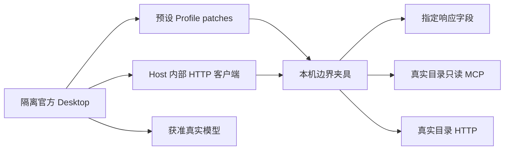

# 目录 MCP 两项边界场景验收方案

## 1. 名词定义
1. 原计划指 [Skills MCP 迁移计划](skills-mcp-migration-20261013.md)。
2. 边界夹具指原计划第 5.13 节第 3 项规定的 MCP 与内部 HTTP 场景服务。
3. 真实模型指原计划第 7 节第 8 项授权范围内、当前可用的模型。
4. 两个 ComfyUI 预设指原计划第 1 节第 7 项定义的工作台预设和迭代预设。

## 2. 总目标
1. 实施者使用边界夹具和真实模型，分别在两个 ComfyUI 预设中验证“模板没有默认模型”和“实例列表为空”时的停止行为。
2. 实施者在验收记录中明确标注目录数据为夹具、模型调用为真实调用，并将这四次执行作为原计划对应边界场景的验收依据。

## 3. 现状调研
1. 当前真实目录返回已配置默认模型的 Workflow，并返回标识为 `2` 的可用实例；枚举结果保存在 `.local/mcp-investigation/2026-10-13/current-catalog-readiness.json`。
2. 两个预设的受控 MCP 注入入口及官方 Desktop 测试已经通过，实施入口见 [Profile 覆盖补充方案第 5.3 节](skills-mcp-e2e-injection-20261013.md#53-步骤二从安装资源派生-profile-覆盖)。

## 4. 面临的问题
1. 当前真实目录数据无法自然触发原计划第 5.6 节的无默认模型和空实例列表场景。

## 5. 问题的解决和实施方案

### 5.1 架构流程

### 5.2 准备边界夹具
1. 实施者按原计划第 5.15 节第 4 项调用受管边界夹具；在本轮控制目录保存场景配置与证据。
2. 夹具沿用真实服务的工具声明，向真实目录转发只读请求。请求日志记录工具名称、参数、响应来源和指定字段的值，并脱敏凭据。
3. 无默认模型场景使用 Workflow 29 的真实响应，将详情中的 `item.model` 及搜索结果中同一 Workflow 的对应默认模型字段设置为 `null`；文本与结构化返回保持一致，其余内容采用真实响应，包括 Workflow 节点原文。
4. 空实例场景按原计划第 5.13 节第 3 项覆盖 MCP 与内部 HTTP 的实例列表、详情及受影响查询。
5. 实施者使用确定性测试验证两个场景的指定字段、响应结构、只读请求限制和服务关闭后的端口释放。

### 5.3 执行四次真实模型验收
1. 实施者按原计划第 5.13 节第 3 项配置各轮 Profile，并保存 MCP 与内部 HTTP 消费者探测结果。
2. 四次任务均执行 `comfyui-generate`，各自使用独立工作目录和干净会话；每次输入均包含该 Skill 的明确路径、场景参数，以及通过 `comfyui-generate/references/prompt-result-contract.md` 检查的 WAI 结果 JSON。实施者在控制目录保存同一份结果 JSON，再将完整内容写入每次任务消息；运行目录与验收资料按原计划第 5.13.1 节分离。
3. 无默认模型场景的预期行为为：执行 `comfyui-generate` 的 Agent 请求用户指定模型，并在收到模型选择前停止后续生成步骤。
4. 空实例场景的预期行为为：执行 `comfyui-generate` 的 Agent 报告没有取得 ComfyUI 实例，并停止依赖实例的后续步骤。
5. 实施者按原计划第 5.9 节保存实际模型输入与官方 Desktop 会话的完整事件，实施者核对第 3、4 项行为；任一 Generation Request 提交事件均使对应任务验收不通过。
6. 每次执行完成后，实施者按原计划第 5.13 节第 10 项完成应用、夹具与 Profile 收尾。

## 6. 方案待决策项清单
1. 当前无待决策项。

## 7. 计划验收清单
1. 两种响应均通过结构与字段范围测试。
2. 两个预设的两种场景均有独立会话、模型身份、完整事件和逐项行为结论。
3. 验收报告明确区分边界夹具证据与其他场景的真实目录证据。
4. 各轮应用、夹具与 Profile 的收尾记录满足原计划第 5.13 节第 10 项。

## 8. 非本次目标
1. 修改真实目录中的 Workflow、模型或实例记录。
2. 修改产品 MCP 合同、Skill 文本或生产 Profile。
3. 安装依赖，或者使用原计划授权范围以外的模型。

## 9. 已获得的授权
1. 用户已授权原计划实施、已有目录服务恢复及 Profile 覆盖补充方案。
2. 用户已批准本计划的夹具数据与真实模型组合验收；真实调用采用原计划第 7 节第 8 项的获准模型范围。
