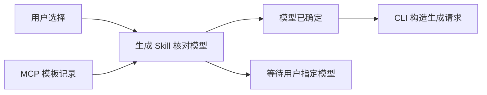

# 生成 Skill 模型选择表述修订方案

## 1. 名词定义
1. 迁移计划指 [Skills MCP 迁移计划](skills-mcp-migration-20261013.md)。
2. 边界方案指 [目录 MCP 两项边界场景验收方案](skills-mcp-migration-boundary-acceptance-20261013.md)。
3. 两预设指边界方案第 1 节第 4 项定义的工作台预设和迭代预设。
4. 原任务指[诊断记录](../verification/skills-mcp-migration/boundary-model-selection-diagnosis.json)的 `scope.cases` 中列出的两个无默认模型任务。

## 2. 总目标
1. 实施者明确生成 Skill 读取模板默认模型的字段，并使 CLI 参数说明与现有模型选择规则一致。
2. 实施者通过同一边界任务验证使用修订后 Skill 的执行者是否等待用户指定模型。

## 3. 现状调研
1. 两预设的执行者收到 `item.model: null` 后，均从 Workflow 节点查找模型并提交生成；原始响应、宿主结果和下一轮模型输入逐字一致。
2. 独立诊断的会话、事件、字段差异与证据边界见诊断记录。

## 4. 面临的问题
1. `comfyui-generate/SKILL.md` 的“核对当前选择”要求空默认模型时等待用户，但没有定位默认模型的返回字段。
2. `references/generation-cli.md` 的参数说明将未选择模型描述为 `null`，而来源说明将 `null` 用于已采用模板默认模型的请求。两处适用条件不一致。

## 5. 问题的解决和实施方案

### 5.1 架构流程

### 5.2 两处文字替换
1. 实施者在 `.agents/skills/comfyui-generate/SKILL.md` 的“核对当前选择”中，将以“Skill 执行者通过 NoobAI MCP 获取已选模板、模型和 LoRA。”开头的整段替换为以下文字：

   > 模板默认模型指 NoobAI MCP 返回的 Workflow 记录的 `item.model`。Skill 执行者通过 NoobAI MCP 获取已选模板、模型和 LoRA。用户指定模型时，Skill 执行者采用该模型；用户未指定模型且模板默认模型非 `null` 时，Skill 执行者采用模板默认模型。用户未指定模型且模板默认模型为 `null` 时，Skill 执行者请求用户提供 `model_id`，并停止创建图片；禁止从 Workflow 节点或模型路线推选生成模型。进入创建图片步骤前，Skill 执行者必须已取得所采用生成模型的查询结果。

2. 实施者在 `.agents/skills/comfyui-generate/references/generation-cli.md` 的参数说明中，将 `model` 对应项的正文替换为以下文字：

   > `model` 必须是包含生成模型 `id` 和 `file_name` 的 JSON 对象，或者为 `null`；取值按本文件“输入值的来源”一节确定。

### 5.3 实施与复验
1. 实施者在迁移计划中引用本方案第 5.2 节，并保存修改前文件。
2. 实施者只替换第 5.2 节指定的两处文字，完成独立语义审计，并由独立队员核对替换结果是否符合第 5.2 节，再构建并通过官方应用安装候选包。
3. 实施者按边界方案复验无默认模型场景；因果对照的条件固定、模型选择与后续失败诊断遵循迁移主计划第 5.11 至第 5.14 节。
4. 实施者按第 7 节第 2 项判定复验结果；未通过时，实施者保存失败轨迹并继续定位执行者偏离该项要求的原因。

## 6. 方案待决策项清单
1. 当前无待决策项。

## 7. 计划验收清单
1. 两个目标文件的指定段落与第 5.2 节一致；后续范围内修复按迁移主计划第 5.10 节核对。
2. 两预设的执行者均在干净会话中请求用户指定模型，并在收到选择前停止后续生成步骤。
3. 证据包含原始 MCP 响应、宿主事件、下一轮模型输入、实际模型身份与逐项结论。
4. 测试应用和夹具停止后，其进程与端口已释放；隔离 Profile 已恢复真实 MCP 地址。

## 8. 非本次目标
1. 修改 Host 生成逻辑、目录数据、MCP 工具声明或 Workflow 响应结构。
2. 本方案只定义第 5.2 节的两处替换；其他修改范围及模型调用限制遵循迁移主计划第 5.14 节和第 7 节第 8 项。

## 9. 已获得的授权
1. 用户已批准迁移计划及边界方案；当前模型授权以迁移主计划第 7 节第 8 项为准。
2. 用户已批准第 5.2 节的两处文字替换及同模型复验。
