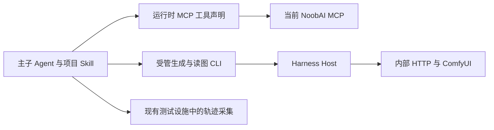

# NoobAI MCP 升级调研

## 1. 名词定义

1. 调研基线：2026-10-13 保存的 [17 个工具声明](../../../.local/mcp-investigation/2026-10-13/tools.json)。
2. 当前服务：2026-10-14 在 `127.0.0.1:18943/mcp` 实测的 NoobAI v0.90.1 部署，提交为 `76b951aa10846889d8d7c0d47bea5ab48c5d3ded`。
3. 内部 HTTP：Harness Host 通过 `127.0.0.1:18093` 使用的数据源接口。

4. 原计划：[目录查询 MCP 迁移方案](../../plans/skills-mcp-migration-20261013.md)。验收矩阵：[迁移验收台账](acceptance-matrix.json)。
5. 三个 Builder：`anima-prompt-builder`、`krea2-anime-prompt-builder` 和 `wai-sdxl-prompt-builder`。
6. 两个预设：原计划第 1 节定义的工作台预设与迭代预设。四角色交接：构图、生成、观察、比较四个角色依次交付任务结果。

## 2. 本次调研目标

1. 核对当前服务与调研基线的差异，确定迁移计划、已实施代码和验收证据的适用范围，并提交调整建议供用户批准。

## 3. 已核实事实

### 3.1 版本与协议

1. 当前服务进程为 PID 47429，工作目录为 `/Volumes/4Tdisk/work/AI2/NoobAI-XL-FZ-PROD-ENV`；包版本是 `0.90.1`，握手仍报告 `noobai-catalog/0.1.0`。服务端 `config/mcp-contracts.json` 将握手版本固定为 `0.1.0`。
2. `v0.90.0` 提交为 `17a85a9b42a5ba81e4678ca495e6898cc104dfc6`。到当前部署之间只有删除图片字段的实现提交及其合并提交。旧调研快照已经包含 v0.90.0 的 17 个工具。
3. [声明比较](../../../.local/mcp-investigation/2026-10-14-upgrade/schema-comparison.json)显示：17 个工具名称、输入 Schema 和 annotations 全部一致；10 个输出 Schema、9 个工具说明发生变化。资源发现入口保持，`resources/templates/list` 当前返回方法不存在。

### 3.2 返回内容

| 查询对象 | 当前变化 | 保持的业务内容 |
|---|---|---|
| 作品、角色、Prompt 词条 | 删除 `cover_url`、`sample_image_urls` 及看图指引 | 身份、别名、角色 Prompt、规范标签、分类和分页 |
| 模型、LoRA、Style、画师串、Workflow 搜索 | 删除候选 `cover_url` | `ref`、关联条件、候选文字和 `next` |
| 上述五类资源详情 | 删除 `cover_url`、`sample_image_urls` | 模型文件、LoRA 权重与触发词、画风说明、Prompt、画师串和完整 Workflow |
| 分类工具 | 输出 Schema 引用及记录说明调整 | 分类输入和业务字段 |
| 底模、实例目录与五个实例读取工具 | 工具合同一致 | 查询参数、结果和错误处理约定 |

1. 服务端变更来源为 `mcp/adapters/project-catalog.mjs`、`mcp/adapters/resource-queries.mjs`、对应 Schema 和字段用途配置；[发布范围](</Volumes/4Tdisk/work/AI2/NoobAI-XL-FZ-PROD-ENV/docs/versions/v0.90.1/变动范围.md>)声明图片字段及指引删除。
2. `item.model`、`prompt_text`、`canonical_tag`、`style_description`、`artist_string`、`workflow_json` 和两种分页合同保持。服务端查询 Skill 同步删除图片链接交付要求。
3. [现场调用记录](../../../.local/mcp-investigation/2026-10-14-upgrade/live-probes.json)包含 16 次成功的工具调用，各次文本 JSON 与 `structuredContent` 一致。Workflow 44 的完整工作流仍在详情中返回。

### 3.3 宿主与内部 HTTP

1. 已安装官方 MCP 客户端 `0.2.0-rc.2` 实际注册 17 个工具；Workflow 搜索、角色读取、Style 搜索和 Workflow 详情四次调用均成功。[客户端记录](../../../.local/mcp-investigation/2026-10-14-upgrade/dsh-probes.json)来自官方模块的独立 Cordis 上下文。
2. 同口径的模型可见声明从 77,984 降为 75,808 UTF-8 字节。该测量未包含真实模型调用。
3. 内部 HTTP 的 discovery 去除说明字段后与基线结构相同；模型 17 和 Workflow 44 仍返回图片字段。两者与 MCP 的 ID、底模、模型文件或默认模型一致，Workflow 内容相同。详见[调研摘要](../../../.local/mcp-investigation/2026-10-14-upgrade/summary.json)。

4. 本次调研尚未复验真实模型、Desktop UI、实例实时状态、队列和节点。

## 4. 当前实施面临的问题

1. `tests/desktop/fixtures/official-mcp-fixture.json` 仍向模型提供图片字段和看图指引；其中 `search_workflows` 与 `get_catalog_resource` 的声明及响应需要同步当前合同。继续使用该夹具无法证明新版声明下的表现。
2. 原计划第 3.1 节记录的是历史基线，第 3.3 节部分当前时态仍描述已删除的 CLI 客户端类。计划需要区分历史调研、当前实现和待验收状态。
3. 三个 Builder 与生成 Skill 的现有字段依赖仍受当前合同支持。Host 原生目录工具和内部 HTTP 名称相近，但属于其他调用路径；它们的图片字段不能按 MCP 输出变化一并删除。
4. 验收矩阵有 46 个基础项，其中 6 项通过、34 项失败、6 项未审；8 个附加项中 3 项通过、1 项失败、4 项未审。这些失败项在服务升级后的状态尚待复验。
5. 用户要求重新调研后，轨迹基础设施实施已暂停。采集错误处理、导出 CLI、probe 的 `--config` 实现及 Desktop 断言尚未完成；开发文档中的对应操作尚未通过验证。[probe 测试](../../../tests/production/official-desktop-probe.test.mjs)中的 `--config` 对应测试当前失败，轨迹采集与导出功能尚未完成验收。

## 5. 待批准的调整方案

### 5.1 调用职责

1. 目录查询继续使用运行时 MCP 声明。生成、参数检查、历史 Run、媒体及读图继续使用现有 Harness 职责划分。
2. 按本次核实结果，保留两个预设的 MCP 配置、查询目标和字段采用规则，保留已实施的目录 CLI 退役与 Host 内部客户端。

### 5.2 计划与实施对应

| 原计划位置 | 批准后拟调整内容 |
|---|---|
| 第 3.1—3.3 节 | 保留原始调研日期，新增当前部署提交与声明差异，校正已实施客户端的现状 |
| 第 5.2 节 | 保留预设配置，增加实际声明及部署身份记录；握手版本只作为其中一项证据 |
| 第 5.3—5.6 节 | 保留三个 Builder、生成选择与等待规则；在当前声明下继续未完成验收 |
| 第 5.7 节 | 保留 CLI 退役与内部 HTTP 客户端；明确 HTTP 图片字段与 MCP 输出的边界 |
| 第 5.8 节 | 同步开发文档的实际入口与已验证状态 |
| 第 5.9、5.13 节 | 固定当前合同样本，更新 MCP 夹具及相关断言，登记旧验收记录适用的声明版本 |
| 第 5.11 节 | 将部署提交、实际工具声明、宿主输入与首次偏离位置关联，继续按完整轨迹查因 |
| 第 5.13.3 节 | 继续限定为现有测试设施中的采集与导出；先完成暂停项，再用于真实模型验收 |

### 5.3 实施顺序

1. 用户批准后，实施者按第 5.2 节更新原计划，完成独立文字审计。
2. 实施者用当前服务的两项实际工具声明更新已有 MCP 夹具，移除对应响应图片字段；受控模型继续采用相同名称与参数。结构测试核对夹具声明与本轮证据，并检查文本和结构化返回一致。
3. 实施者核对无默认模型和空实例夹具，确认 MCP 与内部 HTTP 对同一对象返回的共用业务字段一致；按原计划第 5.13.3 节调整边界夹具的代码位置，复用已有 MCP 服务夹具。
4. 实施者完成暂停的采集、导出和现有 Desktop 接入，按已有测试入口验证正常与中断记录；开发文档随实际入口完成独立审计。
5. 实施者先完成第 7 节定向验收，再继续原迁移矩阵中的未完成任务。失败项继续追查首次偏离，并通过复验确认修复结果。

## 6. 方案待决策项

1. 请用户批准第 5 节的调整范围。批准前保持迁移计划和产品代码当前状态，仅保存本次调研证据。

## 7. 计划验收清单

1. 固定当前 17 个工具声明，核对影响字段、分页、错误及文本与结构化返回；受管夹具使用相同合同。
2. 两个项目预设在官方应用中取得当前声明，主子会话完成搜索和详情读取；普通预设隔离、凭据错误和恢复行为继续符合原计划。
3. 在现有测试设施中验证无默认模型和空实例，并核对 MCP 与内部 HTTP 的同对象一致性。
4. 三个 Builder 各在两个预设中完成一个覆盖角色、词条或画风素材的代表任务；生成执行验证默认模型与显式模型选择，再完成生成、媒体和四角色交接。原矩阵其余未完成项仍按原合同处理。
5. 旧通过项保留为历史事实；依赖 MCP 声明与响应的通过项取得当前服务的新证据。CLI 退役和内部客户端的确定性通过记录按对应代码变化复核。
6. 实施者按原计划复验真实模型调用、Desktop UI、实例实时状态、队列和节点，并完成原计划规定的独立审查与质量门禁。

## 8. 非本次目标

1. 本次适配不增加依赖、MCP 兼容层、图片补查接口、应用启动器或场景执行框架。
2. 本次适配不修改 NoobAI 服务端、真实目录、Skill 输出 Schema、生成媒体或生产部署。

## 9. 已获得的授权

1. 用户授权本次版本调研、已实施部分核对与方案设计；计划修改须等待本方案批准。此前已保存的实施文件保持暂停状态。
